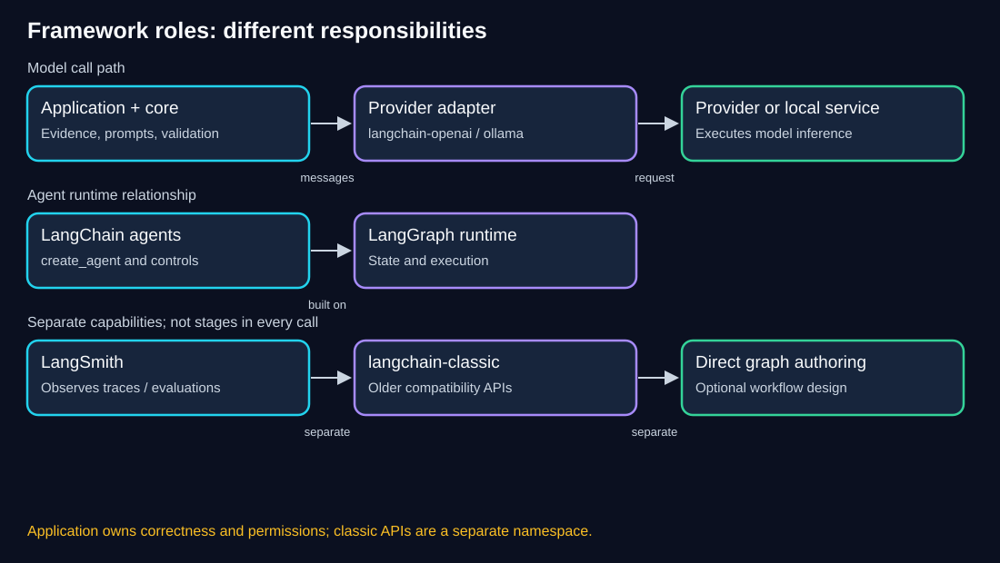
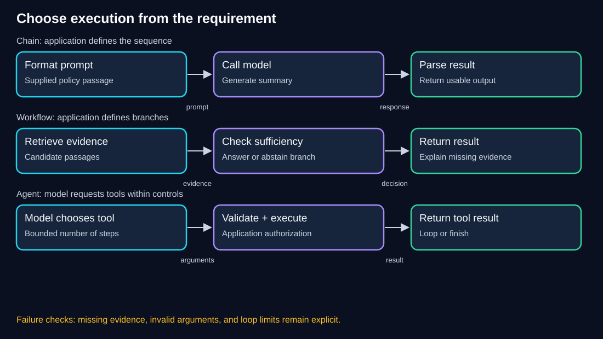

# Chapter 01 — Foundations: Models, Context, and Application Design

> **Estimated study time:** 45–60 minutes reading; 20–30 minutes for exercises.  
> **Prerequisite:** [Environment Setup](00-environment-setup.md), basic Python functions and dictionaries.  
> **Central question:** What does the model do, and what must our application do around it?  
> **Running example:** Fernwood team-notes assistant.

[Previous: Environment Setup](00-environment-setup.md) · [Index](README.md) · [Next: Models and Messages](02-models-and-messages.md)

## Learning objectives

By the end, you should be able to:

- Distinguish inference, training, and fine-tuning.
- Explain chat models, embedding models, messages, tokens, and context windows.
- Explain why prior messages and documents must be supplied explicitly.
- Compare direct provider calls with LangChain integrations.
- Distinguish chains, workflows, and agents using application requirements.
- Explain LangGraph, LangSmith, and the classic compatibility boundary.
- Estimate illustrative token cost and identify omitted cost drivers.

## 1. Intuition: a capable colleague with a limited briefing

Imagine asking a colleague to explain an equipment policy. They can write fluently, but if you never give them Fernwood's policy, they may describe another organization's practices. If you ask “What about that limit?” without the earlier conversation, they may not know which limit you mean.

A chat model likewise generates a response from the input supplied to the current call and patterns learned during training. Our application decides which instructions, messages, and evidence to supply. Fluency is not proof that the correct policy was used.

The analogy has limits: a model is not a person who understands responsibility, verifies every claim, or automatically knows our company's rules. We must inspect evidence and define failure behavior.

### Pause and predict

You ask an assistant about Fernwood's reimbursement limit without supplying the policy. It confidently gives a number. Has it demonstrated knowledge of our documents?

<details><summary>Reveal the reasoning</summary>

No. A plausible number can be an unsupported guess. Our fictional source specifies INR 12000 per calendar year, combined across eligible items. Even an accidentally correct number would not establish that retrieval or grounding worked. We need evidence of what entered the call and which passage supports the answer.

</details>

## 2. Training, fine-tuning, and inference

| Process | What happens | Fernwood example |
|---|---|---|
| Training | Optimization changes model parameters using training data | A model learns broad language patterns before we use it |
| Fine-tuning | Additional training adapts an existing model using selected examples | A team trains for a particular response style or task |
| Inference | A configured model processes input and generates output | Our application asks for a summary of a supplied policy |

Calling a model, adding documents to a vector index, or saving conversation history does not by itself fine-tune the model. Provider data-use policies are a separate question; do not infer them from how a Python API behaves.

Retrieval is often appropriate for changing facts because it supplies selected evidence at inference time. It is not training, and it does not make retrieved material automatically correct. Fine-tuning and retrieval solve different problems and can be combined, but neither is necessary for this chapter's lab.

## 3. Chat models versus embedding models

| Component | Input | Output | Purpose |
|---|---|---|---|
| Chat model | Messages and supported content | Assistant response, possibly structured blocks or tool requests | Generate or transform content |
| Embedding model | Text | Numeric vectors | Compare representations for retrieval and other tasks |

For Fernwood, the embedding model helps find a relevant policy passage; the chat model uses supplied passages to formulate an answer. A vector is not the answer, and proximity is not proof of truth.

Our planned routes use hosted or local adapters. We install those adapters when first used in later chapters. Do not add packages for this conceptual lesson.

## 4. Messages, roles, and conversation history

A message combines a role with content. Content can be text or supported structured content, depending on the model and adapter.

| Role | Typical responsibility | Caution |
|---|---|---|
| System | Application instructions and behavior | Instructions are not an enforcement mechanism |
| Human/user | Current request or user-supplied material | Treat input as untrusted |
| Assistant | Earlier generated response or current result | Earlier prose can be wrong |
| Tool | Result returned by an executed tool | Tool data still needs validation and permission checks |

**Illustrative fragment — message structure, not a provider call:**

```python
messages = [
    {"role": "system", "content": "Answer only from supplied evidence."},
    {"role": "user", "content": "What is the annual equipment limit?"},
]
```

This structure shows roles; it supplies no policy evidence. A grounding instruction cannot invent missing context. Later chapters show actual adapter calls and keep trusted instructions separate from document data.

The next API call does not automatically inherit an earlier call's Python variables or conversation. Some services provide conversation-state features, but application code must intentionally use them. This workbook teaches explicit history so that storage, isolation, retention, and context limits remain visible.

If a follow-up asks “Is that for each item?”, include the earlier question and answer, plus the relevant policy. Do not treat the earlier generated answer as the authoritative policy.

## 5. Tokens, context windows, and temperature

**Token:** A unit used by a model's tokenizer. It may represent part of a word, a whole word, punctuation, or other content. A character count or whitespace word count is not an exact token count. Tokenization varies by model and language.

**Context window:** The model's supported budget for the content it can process in a request, with input/output accounting depending on model and API. Instructions, history, retrieved text, tool descriptions/results, and reserved output can all affect the budget. Consult the selected model's limits rather than memorizing one number for all providers.

**Illustrative budget:** If a hypothetical model has a 16000-token combined budget and we reserve 2000 for output, an approximate input budget is 14000. Instructions (1000), history (7000), and retrieved passages (5000) total 13000, leaving 1000 for the question and other overhead. This simplified calculation omits model-specific accounting and is not a sizing guarantee.

Adding all documents and all conversation turns forever increases cost and can exceed limits. Retrieval, history bounds, and summarization help manage the briefing; each can also omit useful information.

**Temperature:** A sampling setting that influences how alternatives are selected during generation. Lower values often reduce variation where supported. Temperature zero does not guarantee identical output across calls, model revisions, runtimes, or providers. It also does not guarantee factual correctness. Some models restrict or ignore particular settings.

**Checkpoint:** Explain why “the answer is repeatable” and “the answer is supported” require different tests.

<details><summary>Show reasoning</summary>

Repeatability measures consistency across runs. Support measures whether claims follow from the evidence. A system can repeat the same unsupported statement consistently.

</details>

## 6. Direct provider calls and LangChain

For a single request, a provider SDK can be sufficient. It exposes that provider's request and response conventions directly. LangChain integrations provide reusable model interfaces and composition building blocks when our application grows.

**Illustrative pseudocode — comparison only; not runnable:**

```text
Direct provider route:
  application messages → provider SDK request → provider-specific response

LangChain route:
  application messages → provider adapter.invoke → standardized message object
                                               → provider SDK/service underneath
```

| Need | Direct SDK | LangChain ecosystem |
|---|---|---|
| One provider-specific call | Often sufficient | Also possible through an adapter |
| Common composition interfaces | Application builds them | Reusable prompts, runnables, messages, and adapters |
| Provider-specific features | Direct access | Depends on adapter support and configuration |
| Provider changes | Adapt request/response handling | Shared interfaces help, but feature parity is not guaranteed |

LangChain does not replace the model, erase usage charges, validate every fact, or grant tool permissions. It adds abstractions with dependencies and learning costs. Use it where those abstractions help the application. The [official overview](https://docs.langchain.com/oss/python/langchain/overview) describes standardized interfaces and agent composition.

We will follow one application path through the workbook. This comparison does not require building a second SDK application.

## 7. Ecosystem responsibilities and the classic boundary



**Diagram walkthrough:**

1. Our application owns evidence selection, validation, and permissions.
2. Core building blocks and provider adapters help format and execute model calls. Provider adapters connect to hosted services or local Ollama.
3. Agent creation belongs to the current LangChain API. Its runtime uses LangGraph; simple model calls need not become explicit graphs.
4. LangGraph also supports explicitly designed stateful workflows. We explore a small graph only in the optional extension.
5. LangSmith observes execution through traces and supports evaluation; it is not the model or the retrieval database.
6. `langchain-classic` is a separate compatibility namespace, not a stage every request must pass through. The core workbook teaches explicit composition instead.

| Name | Role in this workbook |
|---|---|
| `langchain-core` | Message, prompt, runnable, document, and parser interfaces |
| `langchain-openai` / `langchain-ollama` | Provider integrations |
| `langchain` | Current agent API and related building blocks |
| `langgraph` | State and control-flow orchestration; optional direct use |
| LangSmith | Optional execution tracing/debugging/evaluation |
| `langchain-classic` | Compatibility APIs for older patterns; not a required dependency |

The [migration guide](https://docs.langchain.com/oss/python/migrate/langchain-v1) explains why older tutorials use different import paths. Check the package boundary rather than copying autocomplete suggestions blindly. [LangGraph](https://docs.langchain.com/oss/python/langgraph/overview) and [LangSmith](https://docs.langchain.com/langsmith/observability) have distinct responsibilities; neither is mandatory for a first call.

## 8. Chains, workflows, and agents



**Diagram walkthrough:**

1. A chain follows the composition we define: format a policy-summary prompt, call the model, extract text.
2. A workflow can branch according to application rules: retrieve evidence, check whether it is sufficient, then answer or abstain.
3. An agent lets a model choose whether and how to request an allowed tool. Application controls validate and authorize execution before returning tool results.
4. The agent loop needs limits. A model choosing tools does not justify endless retries or unrestricted actions.

These are useful teaching distinctions, not mutually exclusive product categories. Chains can contain routing; workflows can include agents; an agent executes within an application workflow.

| Fernwood requirement | Smallest reasonable starting design | Why |
|---|---|---|
| Summarize one supplied paragraph | One model call, optionally composed as a chain | The input and task are already known |
| Retrieve policy, answer if supported, otherwise abstain | Explicit workflow | The branching condition is a known requirement |
| Choose among several read-only information tools | Agent, if dynamic selection is justified | Tool choice depends on the task |
| Return an authoritative fixed allowance | Deterministic lookup can suffice | No generation is needed merely to return a stored number |

Start from the requirement. Adding an agent does not automatically improve reliability or reduce implementation work.

## 9. Worked token-cost estimate

All rates below are **invented for arithmetic practice**, not current provider pricing. Do not use this table to budget an account.

Assume one hypothetical request uses 1200 billed input tokens and 300 billed output tokens. Illustrative rates are USD 0.50 per million input tokens and USD 2.00 per million output tokens.

```text
Input cost  = 1200 / 1000000 × 0.50 = USD 0.00060
Output cost =  300 / 1000000 × 2.00 = USD 0.00060
Total       = USD 0.00120 per request
1000 equivalent requests          = USD 1.20
```

If a retry repeats the same billable work, that request's model cost can roughly double. A rewrite call, embeddings, reranking, tools, storage, taxes, and provider-specific cached/reasoning-token rules are not included. Local inference uses compute and electricity rather than these illustrative API rates.

Measure actual usage where available. A model's generated claim about its own token count is not reliable billing telemetry.

## 10. Hands-on: inspect a briefing without calling a model

**Starting state:** Chapter 00's learner project is available. This exercise uses only the Python standard library, so add no dependencies. Neither hosted credentials nor Ollama is required.

**Working directory:** Your learner-owned `langchain-learning` project root.

**Complete runnable file — `foundations_lab.py`:**

```python
from decimal import Decimal


def estimate_cost(input_tokens, output_tokens):
    if input_tokens < 0 or output_tokens < 0:
        raise ValueError("Token counts must be nonnegative.")
    million = Decimal("1000000")
    return (
        Decimal(input_tokens) / million * Decimal("0.50")
        + Decimal(output_tokens) / million * Decimal("2.00")
    )


def main():
    evidence = (
        "Each employee may request reimbursement of up to INR 12000 "
        "per calendar year for a monitor, keyboard, or ergonomic chair. "
        "This is one combined annual limit."
    )
    messages = [
        {"role": "system", "content": "Use only the supplied evidence."},
        {"role": "user", "content": evidence},
        {"role": "user", "content": "Is that limit for each item?"},
    ]
    print("Roles:", ", ".join(message["role"] for message in messages))
    print("Evidence supplied:", evidence in messages[1]["content"])
    print("No model was called; no answer was generated.")
    print(f"Illustrative cost: USD {estimate_cost(1200, 300):.5f}")


if __name__ == "__main__":
    main()
```

Run:

```powershell
uv run --locked python foundations_lab.py
```

Expected output:

```text
Roles: system, user, user
Evidence supplied: True
No model was called; no answer was generated.
Illustrative cost: USD 0.00120
```

`Decimal` keeps this money arithmetic explicit. The token counts are supplied hypothetical inputs, not counts computed from the message strings. The list demonstrates an inspectable briefing, not a complete production grounding or injection defense.

### Failure drill

Temporarily change the first cost argument to `-1`. Run again and observe `ValueError`; restore `1200` and rerun. A traceback is acceptable in this small development exercise, but a user-facing app should translate expected failures into understandable feedback.

| Symptom | Check | Repair |
|---|---|---|
| File not found | `Get-Location`, filename | Run from the learner project root |
| Locked environment fails | Chapter 00's metadata/lock alignment | Resolve the intended setup before this lab |
| Negative-count error | Supplied numeric inputs | Use nonnegative token counts |
| Expecting a generated answer | Script contains no model invocation | Explain the briefing first; model calls begin in Chapter 02 |

## 11. Independent design challenge

Fernwood wants an assistant to explain the equipment limit, answer a follow-up, and decline questions about an undocumented retirement contribution.

**Your deliverables:** Draw a small architecture; identify chat versus embedding responsibilities; state what enters each call; choose one call, workflow, or agent; list two failure checks. No additional implementation or API spend is required.

<details><summary>Hint 1 — Start from evidence</summary>

Identify the supplied policy and which requested fact is absent. Tool choice is not automatically needed.

</details>

<details><summary>Hint 2 — Separate history and knowledge</summary>

The follow-up needs earlier messages; the factual answer needs the policy. History is not an authoritative replacement for the source.

</details>

<details><summary>Show one reasonable solution</summary>

Use an explicit retrieval-and-answer workflow as the document set grows; for one known passage, supplying it directly is sufficient. Embeddings select candidate passages, and the chat model generates a response using supplied evidence and bounded history. Check unsupported questions for abstention and verify claims against the policy. Isolate each session. No agent is necessary when the required steps are already known. The retirement question must not receive an invented percentage.

</details>

## 12. Knowledge checks

### Q1. Does saving a conversation fine-tune the model?

<details><summary>Show answer</summary>

No. It stores application data. Supplying that history in inference changes context, not model parameters through training.

</details>

### Q2. Does an embedding model write the final policy explanation?

<details><summary>Show answer</summary>

No. It outputs vectors. A chat model generates the explanation, or deterministic code returns a known answer when generation is unnecessary.

</details>

### Q3. Is temperature zero a factuality guarantee?

<details><summary>Show answer</summary>

No. Reduced sampling variation does not validate facts, and identical outputs are not universally guaranteed.

</details>

### Q4. Must a first model call use LangGraph and LangSmith?

<details><summary>Show answer</summary>

No. A simple adapter call is sufficient. Explicit graph design and tracing are separate capabilities introduced when useful; agents may use LangGraph internally without requiring us to author a graph.

</details>

### Q5. Under the illustrative rates, what is the cost of 2400 input and 600 output tokens?

<details><summary>Show answer</summary>

USD 0.00240: input USD 0.00120 plus output USD 0.00120. The rates are invented and other costs are omitted.

</details>

## 13. Revision and next step

| Question | Answer to remember |
|---|---|
| What changes weights? | Training or fine-tuning, not ordinary inference |
| Where does evidence come from? | Application-supplied sources, not fluent prose alone |
| What selects semantically similar passages? | Embedding-based retrieval |
| Who owns history and permissions? | The application |
| What does LangChain help with? | Interfaces, composition, integrations, and agent building blocks |
| When is an agent justified? | Dynamic tool selection, with explicit limits and controls |
| What must cost estimates state? | Counts, rates, units, assumptions, and omitted work |

- [ ] I can explain the ecosystem diagram without reading its labels aloud.
- [ ] I can distinguish a model's job from application responsibilities.
- [ ] I ran the local reasoning lab and diagnosed its deliberate failure.
- [ ] I can justify a simple design and calculate the illustrative cost.

Next, turn the briefing into a real invocation and inspect the returned message in [Models and Messages](02-models-and-messages.md). That chapter remains a scaffold until implemented.

