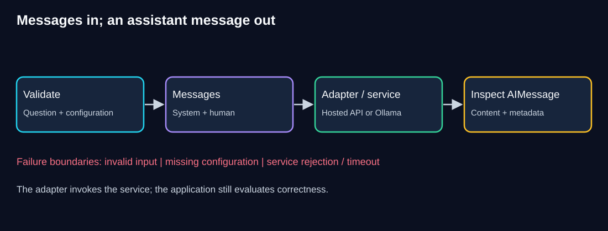

# Chapter 02 — Models and Messages: Your First Real Call

> **Estimated study time:** 60–90 minutes, plus provider setup if unfinished.  
> **Prerequisites:** [Environment Setup](00-environment-setup.md) and [Foundations](01-foundations.md).  
> **Central question:** What exactly enters a chat model call, and how do we inspect what comes back?  
> **Running example:** Fernwood team-notes assistant.  


[Previous: Foundations](01-foundations.md) · [Index](README.md) · [Next: Prompts](03-prompts.md)

## Learning objectives

- Construct system and human messages and invoke the selected chat adapter.
- Run the same application through hosted OpenAI or local Ollama configuration.
- Inspect an `AIMessage` rather than assuming the result is a string.
- Distinguish raw content, text blocks, usage metadata, and response metadata.
- Reject empty questions and missing configuration before a model request.
- Diagnose authentication, network, quota, model-access, and local-service failures.
- Compare observations without assuming provider feature or quality equivalence.

## 1. Intuition: send a briefing, receive an envelope

When you email a colleague, the reply contains more than its prose: sender, timestamps, and other details accompany the message. Similarly, a chat adapter returns a message object, not just a sentence.

Our application must inspect both the response content and its accompanying information. A successful request does not establish that its answer is correct. The envelope analogy explains structure, not model reasoning or evidence guarantees.

### The Fernwood problem

We want to ask what makes a procedure note useful. In the previous chapter we constructed a briefing but never sent it. Now we will send explicit instructions and a question, then inspect the response type, text, usage information when present, and elapsed time.

This first call is a general explanation task, not RAG. It has no retriever and must not claim knowledge of Fernwood's unpublished policies. Policy-specific evidence is introduced in later lessons.

### Pause and predict

If `llm.invoke(messages)` succeeds, will `len(response)` necessarily tell us the number of answer characters?

<details><summary>Reveal the reasoning</summary>

No. The result is normally an `AIMessage`, not a plain string. Inspect `response.content` and its type; content itself may be a string or a list of blocks. Token usage, if provided, is separate from character count.

</details>

## 2. Trace the request and response



**Diagram walkthrough:**

1. The application validates the question and configuration before constructing the request.
2. A system message supplies the application's instruction; a human message supplies the question.
3. The selected adapter translates the common interface into a provider-specific request. Hosted calls use an external API; local calls contact Ollama.
4. The returned `AIMessage` contains content and may contain standardized usage and provider-specific response metadata.
5. The application displays selected fields. It must still evaluate accuracy and handle failures; an adapter does not perform every correctness check.

| Object or field | Meaning | What to inspect |
|---|---|---|
| `SystemMessage` | Application instructions | Intended task and limits |
| `HumanMessage` | User input | Validated question |
| `AIMessage` | Assistant response | Content, tool requests if present, metadata |
| `.content` | Raw response content | String or supported block list |
| `.content_blocks` | Standardized content-block view | Types such as text; may include non-text blocks |
| `.usage_metadata` | Standardized usage when available | Input/output/total tokens; may be absent |
| `.response_metadata` | Provider-specific information | Model/finish details; keys vary |

We use explicit classes from `langchain_core.messages` to make roles visible. Tuple shorthand is also supported by many adapters, but explicit objects are easier to inspect at this stage. See the [message documentation](https://docs.langchain.com/oss/python/langchain/messages).

## 3. Prepare only your chosen route

**Working directory:** The learner-owned `langchain-learning` project root from Chapter 00. Keep its `python-dotenv` dependency, private `.env`, and ignore rules.

Choose one installation block. You may install the other adapter later for a comparison; it is not required to complete a single route.

**Hosted route:**

```powershell
uv add langchain-core langchain-openai
uv sync --locked
```

Edit your private `.env`:

```dotenv
MODEL_PROVIDER=openai
OPENAI_API_KEY=replace-privately-with-your-own-key
```

Replace the placeholder privately before running. Do not put real credentials in `.env.example` or terminal commands. The model used below is `gpt-4o-mini`, selected for course continuity; your account must actually have access. An unavailable model requires an explicit, documented alternative, not an unexplained code change. Calls may incur charges.

**Local route:**

```powershell
uv add langchain-core langchain-ollama
uv sync --locked
```

Keep `MODEL_PROVIDER=local` in your private `.env`. Complete Chapter 00's Ollama checks and download `llama3.1:8b`. No hosted key is needed. Ollama is an independent service, not something `uv add` installs or starts.

The script imports only the selected adapter, so installing one route is sufficient. Core is a direct dependency because our code imports its message classes. See the [OpenAI adapter](https://docs.langchain.com/oss/python/integrations/chat/openai) and [Ollama adapter](https://docs.langchain.com/oss/python/integrations/chat/ollama) documentation.

## 4. Build an inspectable model call

**Complete runnable file — `first_call.py`:** Create this file in your learner project root. It does not replace the Chapter 00 sanity check.

```python
import argparse
import os
from pathlib import Path
import sys
from time import perf_counter

from dotenv import load_dotenv
from langchain_core.messages import HumanMessage, SystemMessage


def validate_question(value):
    question = value.strip()
    if not question:
        raise ValueError("Enter a nonempty question.")
    if len(question) > 1000:
        raise ValueError("Keep this learning question within 1000 characters.")
    return question


def read_configuration():
    load_dotenv(Path(__file__).resolve().parent / ".env", override=False)
    provider = os.getenv("MODEL_PROVIDER", "").strip().lower()
    if provider not in {"openai", "local"}:
        raise ValueError("Set MODEL_PROVIDER to openai or local.")
    key = os.getenv("OPENAI_API_KEY", "").strip()
    if provider == "openai" and (
        not key or key == "replace-privately-with-your-own-key"
    ):
        raise ValueError("Set OPENAI_API_KEY privately for the hosted route.")
    return provider, key


def build_model(provider, key):
    if provider == "openai":
        from langchain_openai import ChatOpenAI

        return ChatOpenAI(
            model="gpt-4o-mini",
            api_key=key,
            temperature=0,
            max_tokens=200,
            timeout=30,
            max_retries=0,
        )

    from langchain_ollama import ChatOllama

    return ChatOllama(
        model="llama3.1:8b",
        temperature=0,
        num_predict=200,
        client_kwargs={"timeout": 180},
    )


def text_from_blocks(response):
    return "\n".join(
        block["text"]
        for block in response.content_blocks
        if block.get("type") == "text" and isinstance(block.get("text"), str)
    )


def main():
    parser = argparse.ArgumentParser()
    parser.add_argument("question", nargs="?")
    parser.add_argument("--inspect-only", action="store_true")
    args = parser.parse_args()

    try:
        raw = args.question if args.question is not None else input("Question: ")
        question = validate_question(raw)
        provider, key = read_configuration()
    except (ValueError, EOFError) as exc:
        print(f"Input/configuration error: {exc}", file=sys.stderr)
        return 2

    messages = [
        SystemMessage(
            content=(
                "You are a concise learning assistant. Explain in at most "
                "three sentences. Do not claim access to private Fernwood "
                "documents that were not supplied."
            )
        ),
        HumanMessage(content=question),
    ]
    print("Provider:", provider)
    print("Message roles:", ", ".join(message.type for message in messages))
    if args.inspect_only:
        print("Inspection only: no adapter constructed or model called.")
        return 0

    try:
        model = build_model(provider, key)
        started = perf_counter()
        response = model.invoke(messages)
        elapsed = perf_counter() - started
    except ImportError:
        print("Install the adapter for your selected route using uv add.",
              file=sys.stderr)
        return 1
    except Exception as exc:
        # Do not print arbitrary exception text: it may include request data.
        print(f"Model request failed ({type(exc).__name__}). "
              "Use the chapter troubleshooting table.", file=sys.stderr)
        return 1

    print("Response class:", type(response).__name__)
    print("Content type:", type(response.content).__name__)
    print("Answer:", text_from_blocks(response) or "[No text block returned]")
    print("Usage:", response.usage_metadata or "Not supplied")
    print("Response metadata keys:", sorted(response.response_metadata))
    print(f"Elapsed seconds: {elapsed:.2f}")
    return 0


if __name__ == "__main__":
    raise SystemExit(main())
```

### Explain the important lines

- Validation occurs before model construction. Empty or excessively long questions cannot trigger an API call in this script. The 1000-character limit is an application rule, not the model's token limit.
- Configuration is loaded from beside the script. Shell variables still take precedence; a private file change can be masked by a shell override.
- The hosted timeout and local timeout are intentionally different. First local loading may take longer. The output caps limit requested generation; they are not a budget guarantee and do not cover all possible billable work.
- `max_retries=0` keeps hosted retries explicit for this introductory lab. Later lessons design bounded retries for appropriate failures.
- `.invoke()` sends the messages synchronously and waits for the result. The timer includes the adapter/service call and may include local model loading; it is not an isolated benchmark of inference speed.
- `text_from_blocks` displays only text blocks. It does not silently stringify tool calls or other structured content as an answer. This text-only lab does not enable tools or multimodal input.
- The request boundary reports the exception class without dumping arbitrary error bodies. This avoids casually exposing request data but gives less diagnostic detail; a later operational lesson designs sanitized structured logging.

## 5. Run and inspect

**Working directory:** Learner project root, with your route configured.

First inspect the request structure without making a model call:

```powershell
uv run --locked python first_call.py --inspect-only "What makes a procedure note useful?"
```

Expected output with local configuration:

```text
Provider: local
Message roles: system, human
Inspection only: no adapter constructed or model called.
```

Hosted configuration prints `Provider: openai`. This option still checks configuration but does not verify adapter installation, authentication, model availability, or service health.

Then make one real request:

```powershell
uv run --locked python first_call.py "What makes a procedure note useful?"
```

**Expected structure, not literal model output:**

```text
Provider: <selected route>
Message roles: system, human
Response class: AIMessage
Content type: <str or list>
Answer: <generated explanation>
Usage: <token counts if supplied, otherwise Not supplied>
Response metadata keys: <provider-specific field names>
Elapsed seconds: <measured duration>
```

A short explanation is the target, not a guaranteed exact answer. Record whether it follows the requested format and whether it makes unsupported Fernwood claims. Do not label the answer grounded in company evidence: none was retrieved.

### Usage and metadata interpretation

When `usage_metadata` is populated, typical standardized fields include `input_tokens`, `output_tokens`, and `total_tokens`; additional details may be present. A missing value is not zero usage. Local measurements are not automatically an API bill, and hosted cost needs actual provider accounting and current rates.

Printing metadata keys shows available categories without dumping all values. For this fictional exercise, use the debugger to inspect `response.content` and `.content_blocks` if needed. Raw metadata and prompts can contain sensitive data in real applications; avoid unrestricted dumps.

## 6. Offline response-inspection lab

A live response is not required to learn object structure. The following creates a clearly synthetic message, not a model answer or actual usage record.

**Complete runnable file — `inspect_message.py`:** Requires only the `langchain-core` dependency already added.

```python
from langchain_core.messages import AIMessage


def main():
    response = AIMessage(
        content=[{"type": "text", "text": "Synthetic example: verify each step."}],
        usage_metadata={"input_tokens": 10, "output_tokens": 5, "total_tokens": 15},
        response_metadata={"example_only": True},
    )
    print("Class:", type(response).__name__)
    print("Raw content type:", type(response.content).__name__)
    print("Block type:", response.content_blocks[0]["type"])
    print("Text:", response.content_blocks[0]["text"])
    print("Illustrative total tokens:", response.usage_metadata["total_tokens"])
    print("Metadata keys:", sorted(response.response_metadata))


if __name__ == "__main__":
    main()
```

Run:

```powershell
uv run --locked python inspect_message.py
```

Expected output:

```text
Class: AIMessage
Raw content type: list
Block type: text
Text: Synthetic example: verify each step.
Illustrative total tokens: 15
Metadata keys: ['example_only']
```

**Checkpoint:** Explain why `.content.upper()` would fail for this example, even though the message contains text.

<details><summary>Reveal the reasoning</summary>

`.content` is a list, so it has no string `.upper()` method. Extract a text block first. In a mixed-content response, decide deliberately which blocks the application can display or act on.

</details>

## 7. Failure drills and troubleshooting

Try a whitespace-only question:

```powershell
uv run --locked python first_call.py "   "
```

Expect a nonempty-question error and exit code 2 before adapter construction. In PowerShell, inspect `$LASTEXITCODE` immediately after the command.

Next, temporarily use `MODEL_PROVIDER=invalid` in your private configuration. Run with a valid question, observe the configuration error, and restore your chosen provider. For hosted mode, a blank key must also fail before the request. Do not replace a real key with a logged test string or deliberately spend requests testing invalid credentials.

| Symptom | Boundary to inspect | Action |
|---|---|---|
| Import failure | Project dependency/environment | Add the selected adapter; locked sync; use the project's uv execution |
| Input/configuration error | Question or provider/key presence | Correct input or private configuration; check shell overrides |
| Authentication failure | Hosted account credential | Review or rotate credentials privately; never print the key |
| Permission/model-not-found failure | Account/model access | Verify the exact model and account permissions |
| Rate-limit or quota failure | Provider usage controls | Distinguish temporary throttling from billing/quota; avoid blind retries |
| Connection failure in local mode | Ollama service | Repeat Chapter 00's `/api/tags` check and start the service if needed |
| Local model missing | Downloaded model list | Pull the exact `llama3.1:8b` tag |
| Timeout or memory failure | Network, model loading, or hardware | Check the service directly and resource usage; do not assume more retries help |
| Empty displayed answer | Content block types / finish state | Inspect the response structure; do not invent text for a non-text response |

Exception names vary between SDK versions. This script's generic request failure does not by itself distinguish every quota/authentication cause. Use the provider account controls or service logs carefully; later debugging lessons add safe structured diagnostics. Never paste secrets or private request bodies into support messages.

## 8. Compare providers fairly

| Aspect | Hosted route | Local route |
|---|---|---|
| Dependency | `langchain-openai` | `langchain-ollama` |
| Execution | External API with credentials | Local Ollama service and model files |
| Latency contributors | Network, queueing, inference | Loading, CPU/GPU, memory, inference |
| Cost | Provider usage and account terms | Local compute, electricity, hardware |
| Interface | `.invoke(messages)` → message | Same broad interface |
| Guarantees | Depend on model and service | Depend on model and runtime |

Shared interfaces reduce application changes; they do not guarantee identical content blocks, feature support, latency, factuality, or usage metadata. A successful local text response does not prove tool support. A good explanation from either route does not prove knowledge of private policies.

Repeat the same general question once per available route and record model, date, response structure, factual issues, elapsed time, and available usage. Do not rank entire providers from one sample or compare a cold local load against a warm hosted request as a controlled benchmark. Learners with only one route can complete the exercise without acquiring another account or downloading another model.

## 9. Independent exercise

Modify the system instruction to request two bullet points explaining why a procedure needs a verification step. Keep validation, configuration, and inspection intact.

**Deliverables:** Your changed instruction, one response or an explicitly recorded service blocker, a format assessment, and an explanation of which fields are standardized versus provider-specific. The offline inspection lab must still run.

<details><summary>Hint 1 — Separate instructions and question</summary>

The formatting request belongs in the system message. The user's topic stays in the human message.

</details>

<details><summary>Hint 2 — Evaluate rather than assume</summary>

Inspect the text blocks and count the visible bullet points. A prompt asks for a format; it does not enforce a validated schema.

</details>

<details><summary>Show one reasonable solution</summary>

Change the system instruction to “Explain using exactly two short bullet points. Do not claim access to unsupplied Fernwood documents.” Ask “Why does a procedure need a verification step?” Check the observed format and whether the explanation is sensible. Keep generated wording out of exact-string assertions. `AIMessage` and standardized usage fields offer shared structure, while response metadata keys and availability differ by adapter/model.

</details>

## 10. Knowledge checks

### Q1. Does constructing `ChatOpenAI` prove the key is valid?

<details><summary>Show answer</summary>

No. Constructor success does not establish service authentication, billing, or model access. Those require a real request.

</details>

### Q2. Why can a route work without installing the other adapter?

<details><summary>Show answer</summary>

The script imports adapters conditionally inside `build_model`. Only the selected route is constructed. Core message classes are shared.

</details>

### Q3. Is missing token usage the same as zero tokens?

<details><summary>Show answer</summary>

No. It means usage was not supplied through that field. Record absence rather than fabricating counts or cost.

</details>

### Q4. What happens to an empty question in this script?

<details><summary>Show answer</summary>

It is rejected with exit code 2 before configuration-dependent model construction or invocation, so it cannot incur a model request here.

</details>

### Q5. Does a three-sentence response establish groundedness?

<details><summary>Show answer</summary>

No. That measures format compliance. Groundedness requires supporting evidence and claim checking; this general explanation lab does not retrieve policy documents.

</details>

## 11. Revision and next step

| Remember | Practical meaning |
|---|---|
| Validate first | Reject invalid input before requests |
| Messages have roles | Instructions and requests have distinct responsibilities |
| A response is an object | Inspect content types and metadata deliberately |
| Shared interface is limited portability | Models and adapters still differ |
| Timing is measured | Loading/network/runtime affect observations |
| Successful call is not a correct answer | Assess claims separately |

- [ ] I can run request inspection and the synthetic-message lab without a model service.
- [ ] I can make a real call on my chosen route, or record the precise remaining service/access blocker.
- [ ] I can distinguish string content from blocks and absent usage from zero usage.
- [ ] I can demonstrate input/configuration failure without exposing a secret.

Our next problem is repeated prompt text scattered across scripts. [Prompts](03-prompts.md) will introduce reusable templates and their failure modes. That chapter remains a scaffold until implemented.

