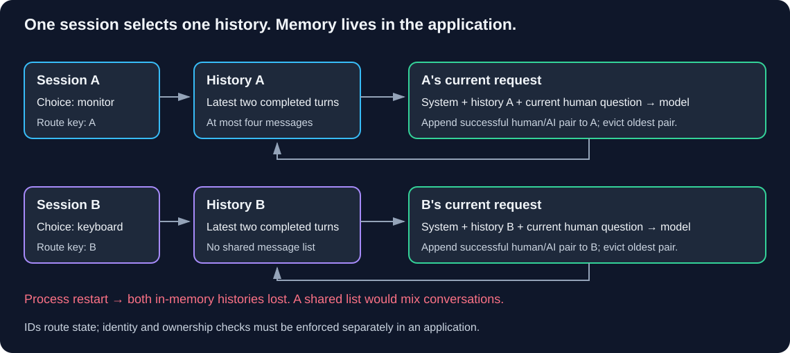

# Chapter 06 — Conversation History: Remember Within a Boundary

**Where do earlier turns live, and who is allowed to use them?**

> **Your goal:** Demonstrate bounded session history, isolation, eviction and loss on restart.<br>
> **You need:** [Chains and Runnables](05-chains-and-runnables.md), message roles and retained `first_call.py`; [stateless-service reasoning](../../../study-guides/cloud-architecture-patterns/scalability-patterns/docs/01-stateless-services.md) for the course's state capability.<br>
> **Effort:** 70-90 minutes, plus optional live calls; estimated.<br>
> **You will produce:** `history_lab.py`, A/B isolation checks, eviction/restart evidence and a per-session clear exercise. **Status:** Draft; local and live evidence must be reported separately.

**Fernwood** is the fictional organization used in this workbook to study internal notes and equipment-policy questions. Its synthetic material lets you inspect evidence and context without real employee data. QuickCart remains the recurring commerce case in the wider course.

**Starting state:** Create `history_lab.py` in the same learner project. The lab uses a sequential, in-memory store; it does not introduce a database or authenticated service. Keep Chapter 02's helper for the optional live route.

**Study route:** Compare stateless, manual and runnable-managed fixture modes. Inspect growth and restart behavior, repair the placeholder mismatch, then implement per-session clear. Manual history is the baseline; the wrapper is the documented compatibility comparison, not a reason to add an agent.

**Before executable steps:** work from your external `langchain-learning` root with Python 3.11 via uv. Follow the named dependency and file steps below; a copied snippet is not a verified project checkpoint. Offline formatting/fixture checks make no model calls. Hosted inference is paid; local inference uses downloaded models and compute. Before live runs, choose a spending budget, request count, time window and review plan. Preserve private evidence, never print keys, and stop any local service you started when finished. Detailed cleanup and historical verification limits remain in the [chapter record](lesson-contract.md#w-lc-06).

<details>
<summary>Reference: stable unit identity and project boundaries</summary>

**Unit:** W-LC-06. **Capability:** AI-STATE-01. [Course map](../../../README.md#ordered-capability-map) | [Project starting states](../docs/project-boundaries.md) | [Verification and cleanup](lesson-contract.md#w-lc-06). Current Draft status does not turn a historical provider run into fresh evidence.

</details>

[Workbook index](README.md) | [Next workbook chapter](07-embeddings-and-similarity.md)

## Learning objectives

- Demonstrate why an isolated follow-up lacks conversational context.
- Insert earlier message objects with `MessagesPlaceholder`.
- Implement manual and runnable-managed history with a shared bounded store.
- Verify two-session isolation, eviction, clearing, and process restart behavior.
- Explain message counts versus token limits and stored history versus model context.
- Distinguish session identifiers from authentication and runnable history from agent checkpoints.

## 1. Intuition: separate notebooks

A support worker keeps one notebook per conversation. If they receive “Which item did I choose?” without the earlier page, they cannot know the answer. If they open someone else's notebook, they may confidently answer the wrong question. If old pages are discarded, that context is gone.

Chapter 05's independent calls do not automatically carry earlier turns. Reusing the same Python model object does not give our ordinary calls conversational memory. We must store messages and include the relevant ones in the next request.

Our fictional users choose different equipment items. Session A chooses a monitor; session B chooses a keyboard. These choices are user statements, not policy evidence or approval decisions. Keeping them in history does not make them authoritative facts about the world.

### Pause and predict

Both users ask “Which item did I choose?” If the application stores every turn in one shared list, can different session labels protect their context?

<details><summary>Reveal the reasoning</summary>

No. Labels help only if the application actually selects separate state. A factory that returns one global history object for every ID still mixes conversations. Nor does knowing a session ID prove ownership of that conversation.

</details>

## 2. Three locations to distinguish

| Location | What it holds | Lifetime in this lab |
|---|---|---|
| Application store | Dictionary mapping session IDs to history objects | Current Python process only |
| History object | Last four messages: two completed human/AI turns | Until eviction, clear, or process exit |
| Formatted request | System instruction + retained history + current human question | Sent for the current invocation |

`MessagesPlaceholder("history")` inserts a list of message objects into a chat prompt. It preserves their roles; it does not load a database or stringify a transcript. The current question goes after history. The stable system instruction stays outside stored turns and is included each time.

Our bound is **four messages**, not four turns or four tokens. We append a human/AI pair after a successful call and evict oldest pairs. The current request can therefore contain up to six messages: one system, four historical, and one current human. The pending response is not yet part of that input.



**Diagram walkthrough:**

1. The application selects A's or B's history; IDs are routing keys in this illustration.
2. Each object retains its own latest two completed turns. No arrow moves B's messages into A's request.
3. The prompt combines the selected history with the system instruction and current question.
4. A successful response is appended with its human question, then old pairs are removed.
5. Process restart removes this entire in-memory dictionary. The diagram omits production identity checks and durable storage; neither is supplied by an ID string.

## 3. Prepare the learner project

**Working directory:** Learner-owned `langchain-learning` root, outside this repository. Create `history_lab.py` beside Chapter 02's exact `first_call.py`. Keep existing files unchanged. No new dependencies are required.

```powershell
uv sync --locked
```

Default execution uses a scripted fixture with no service or credential. For optional live calls, retain Chapter 02's route:

| Route | Private `.env` | Prerequisites |
|---|---|---|
| Hosted | `MODEL_PROVIDER=openai`, private `OPENAI_API_KEY` | `langchain-openai` installed; account access to `gpt-4o-mini` |
| Local | `MODEL_PROVIDER=local` | `langchain-ollama` installed; Ollama running with `llama3.1:8b` downloaded |

Both routes also use the previously installed `langchain-core` and `python-dotenv`. Imported `read_configuration()` loads `.env` beside `first_call.py`; existing shell variables take precedence. Follow Chapter 02 for installation and service diagnostics. Never put credentials or real employee data in this lab.

## 4. Build manual history first, then compare the wrapper

**Current compatibility note (2026-10-14):** The supplemental checkpoint on `langchain-core==1.6.10` emits a deprecation warning for `RunnableWithMessageHistory`. Keep manual history as the baseline; the wrapper below is a legacy comparison, not a recommendation for new persistent services. See the [executed mechanisms checkpoint](mechanisms-lab/README.md) and [current contract review](lesson-contract.md). Durable orchestration belongs to the deeper stateful module; suppressing a warning does not implement persistence.

**Version boundary:** Both the chapter's original route (langchain-core 1.6.9) and the 1.6.10 checkpoint emit a deprecation warning for `RunnableWithMessageHistory`, directing new agent persistence work to LangGraph. Manual history is this lab's default. The wrapper path remains an explicit compatibility exercise to understand existing runnable applications; do not suppress its warning or mistake it for the recommended agent API. `BaseChatMessageHistory` is likewise a compatibility interface; our small subclass implements the shared store contract for both demonstrations. See the [official core source](https://github.com/langchain-ai/langchain/blob/master/libs/core/langchain_core/runnables/history.py) and the agent comparison in Section 7.

**Complete runnable file — `history_lab.py`:** Create in your learner project root. Read `BoundedHistory`, then `make_chat()`. Its manual branch exposes the same read → invoke → append responsibility that the runnable wrapper manages.

```python
import argparse
import sys
from collections.abc import Sequence

from langchain_core.chat_history import BaseChatMessageHistory
from langchain_core.messages import AIMessage, BaseMessage, HumanMessage
from langchain_core.prompts import ChatPromptTemplate, MessagesPlaceholder
from langchain_core.runnables import RunnableLambda
from langchain_core.runnables.history import RunnableWithMessageHistory
from first_call import build_model, read_configuration


MAX_MESSAGES = 4
MAX_SESSIONS = 10
FOLLOWUP = "Which item did I choose?"
UNKNOWN = "I don't have your earlier choice in this conversation context."
TURNS = [
    ("A", "My chosen item is a monitor."),
    ("B", "My chosen item is a keyboard."),
    ("A", FOLLOWUP),
    ("B", FOLLOWUP),
]
GROWTH_TURNS = [
    ("A", "Please note that purchase approval is required."),
    ("A", "Please note that receipts are required."),
    ("A", FOLLOWUP),
    ("B", FOLLOWUP),
]


class BoundedHistory(BaseChatMessageHistory):
    """Synchronous, text-only, single-process teaching store."""

    def __init__(self, limit=MAX_MESSAGES):
        if limit < 2 or limit % 2:
            raise ValueError("Use a positive even message limit of at least two.")
        self.limit = limit
        self.messages: list[BaseMessage] = []

    def add_messages(self, messages: Sequence[BaseMessage]) -> None:
        pair = list(messages)
        if (len(pair) != 2 or not isinstance(pair[0], HumanMessage)
                or not isinstance(pair[1], AIMessage)):
            raise ValueError("This lab stores one completed human/AI pair at a time.")
        self.messages.extend(pair)
        del self.messages[:-self.limit]

    def clear(self) -> None:
        self.messages.clear()


def check_reply(message):
    if (not isinstance(message, AIMessage) or message.tool_calls
            or not isinstance(message.content, str)
            or not message.content.strip() or len(message.content) > 1000):
        raise ValueError("Expected a nonempty text-only AI reply under the lab limit.")
    return message


def make_prompt():
    return ChatPromptTemplate.from_messages([
        ("system", "You are the Fernwood conversation assistant. "
         "Answer in one short sentence using only the supplied conversation. "
         "If an earlier item choice is absent, say that it is unavailable. "
         "Do not infer policy approval or use another conversation's choices."),
        MessagesPlaceholder("history"),
        ("human", "{question}"),
    ])


def fixture_response(prompt_value):
    # Deterministic context probe, not an LLM or general memory algorithm.
    messages = prompt_value.to_messages()
    current = messages[-1].content
    if current == FOLLOWUP:
        for earlier in reversed(messages[:-1]):
            if isinstance(earlier, HumanMessage):
                if earlier.content == "My chosen item is a monitor.":
                    return AIMessage(content="You chose a monitor.")
                if earlier.content == "My chosen item is a keyboard.":
                    return AIMessage(content="You chose a keyboard.")
            if isinstance(earlier, AIMessage):
                if earlier.content in {"You chose a monitor.", "You chose a keyboard."}:
                    return AIMessage(content=earlier.content)
        return AIMessage(content=UNKNOWN)
    return AIMessage(content="Noted for this conversation.")


def make_chat(model, mode):
    store: dict[str, BoundedHistory] = {}

    def get_history(session_id):
        if session_id not in store:
            if len(store) >= MAX_SESSIONS:
                raise ValueError("Lab session capacity reached; remove unused session entries.")
            store[session_id] = BoundedHistory()
        return store[session_id]

    base = make_prompt() | model | RunnableLambda(check_reply)
    wrapped = None
    if mode == "runnable":
        wrapped = RunnableWithMessageHistory(
            base,
            get_history,
            input_messages_key="question",
            history_messages_key="history",
        )

    def ask(session_id, question):
        if session_id not in {"A", "B"}:
            raise ValueError("This CLI demonstration accepts only sessions A and B.")
        if not isinstance(question, str) or not question.strip() or len(question) > 500:
            raise ValueError("Supply a nonempty question of at most 500 characters.")
        if mode == "stateless":
            return base.invoke({"question": question, "history": []})
        if mode == "runnable":
            return wrapped.invoke(
                {"question": question},
                config={"configurable": {"session_id": session_id}},
            )
        history = get_history(session_id)
        reply = base.invoke({"question": question, "history": list(history.messages)})
        history.add_messages([HumanMessage(content=question), reply])
        return reply

    return ask, store


def snapshot(store):
    for session_id in sorted(store):
        history = store[session_id]
        roles = ",".join(message.type for message in history.messages)
        print(f"Session {session_id}: stored={len(history.messages)} roles={roles}")


def main():
    parser = argparse.ArgumentParser()
    parser.add_argument("--mode", choices=["stateless", "manual", "runnable"],
                        default="manual")
    parser.add_argument("--live", action="store_true")
    parser.add_argument("--growth", action="store_true")
    parser.add_argument("--probe", action="store_true")
    args = parser.parse_args()
    if args.probe and args.growth:
        parser.error("Choose either a fresh-process probe or the growth demonstration.")
    try:
        if args.live:
            provider, key = read_configuration()
            model = build_model(provider, key)
            print("Live route:", provider)
        else:
            model = RunnableLambda(fixture_response)
            print("OFFLINE SCRIPTED FIXTURE: no inference or quality claim.")
        ask, store = make_chat(model, args.mode)
        print("Starting stored sessions:", len(store))
        turns = [("A", FOLLOWUP)] if args.probe else list(TURNS)
        if args.growth:
            turns.extend(GROWTH_TURNS)
        for index, (session_id, question) in enumerate(turns, start=1):
            reply = ask(session_id, question)
            print(f"Turn {index} / {session_id}: {reply.content}")
            snapshot(store)
        return 0
    except Exception as exc:
        print(f"History lab failed ({type(exc).__name__}); check inputs, "
              "history configuration, or Chapter 02 service diagnostics. "
              "No automatic retry.", file=sys.stderr)
        return 1


if __name__ == "__main__":
    raise SystemExit(main())
```

### Explain the manual branch

`get_history()` selects or creates one object per session. `ask()` reads that object's messages, invokes the chain, and appends the current human message with the checked AI reply. A model/checking failure occurs before the append, so the failed turn is not recorded as successful. Retrying still costs another model call; it is not an exactly-once transaction.

### Explain the runnable branch

`RunnableWithMessageHistory` obtains history through the same factory, inserts it under `history`, and records the current question and reply on successful completion. `input_messages_key="question"` identifies the new user input; `history_messages_key="history"` identifies the placeholder. The session ID travels in `configurable`, not as a prompt variable. The wrapper manages lifecycle, while our history object's `add_messages()` supplies the retention policy. It does not automatically make storage durable or bounded.

We keep `AIMessage` through the history boundary rather than parsing it to a string before storage. `check_reply()` allows only this lab's short text replies, not tool-call conversations. A production implementation must support its actual message types and check persistence failures; history-write errors in runnable completion callbacks are not a transactional durability guarantee.

## 5. Observe missing context, then repair it

**Working directory:** Learner project root. Run all three offline variants:

```powershell
uv run --locked python history_lab.py --mode stateless
uv run --locked python history_lab.py --mode manual
uv run --locked python history_lab.py --mode runnable
```

| Observation | Stateless | Manual / runnable |
|---|---|---|
| Initial choices | Acknowledged but not saved | A and B each hold one pair |
| Turn 3: A follow-up | Earlier choice unavailable | Monitor |
| Turn 4: B follow-up | Earlier choice unavailable | Keyboard |
| Final retained messages | Zero stored sessions | A=4 and B=4; human/AI/human/AI |

These exact recall outputs belong to the fixture. It recognizes only fixed human choices and fixed AI recall messages; it is not a general language-understanding algorithm. Its purpose is to prove which context reaches the model boundary. Live responses should be assessed for the right item and uncertainty when context is absent, not compared character for character.

**Repair principle:** Keep session-keyed messages and insert them into the next request. Merely adding “remember what I said” to the system instruction does not supply the missing data.

### Test growth and eviction

```powershell
uv run --locked python history_lab.py --mode manual --growth
uv run --locked python history_lab.py --mode runnable --growth
```

After two additional A turns, both A's original choice and its earlier recall reply have been evicted. Turn 7 should report insufficient context; turn 8 should still recall B's keyboard. The fixture's unrelated-turn acknowledgments deliberately do not repeat the item, keeping this eviction test unambiguous. A real model may repeat an old fact in newer replies, so dropping the original turn is not proof the fact is absent from all retained messages. Inspect the actual context when assessing live eviction.

Counts never exceed four messages per session. With two sessions, at most eight historical messages are retained after each completed turn. The text limits constrain individual inputs/replies, but message counts are not token or exact memory-byte budgets. Metadata and provider accounting differ. Longer systems need token-aware context limits and appropriate retention/deletion policies, not just a list slice. This lab caps session creation too; the CLI uses only A and B.

### Test a real process restart

Run these as separate commands:

```powershell
uv run --locked python history_lab.py --mode runnable
uv run --locked python history_lab.py --mode runnable --probe
```

The second command starts a new Python process with zero stored sessions. The same A identifier retrieves no old choice; the fixture returns insufficient context. It then stores the new unanswered exchange as a pair. Nothing is written to disk, and a uv lockfile preserves dependencies, not conversation data. Repeat with `--mode manual` to observe the same lifetime boundary.

## 6. Optional live route and failure diagnosis

**Working directory:** Learner project root with one configured provider/service. Start with one four-call demonstration:

```powershell
uv run --locked python history_lab.py --live --mode runnable
```

You can use the same `--live` flag with `manual`, `stateless`, `--growth`, or `--probe`. Normal execution makes four calls, growth makes eight, and a fresh-process probe makes one. Each successful turn makes one call. Check hosted charges or local compute before comparisons; no automatic retry or provider switch occurs. Chapter 02's model identifiers, timeouts, and 200-token output limits remain in effect.

Record mode, provider/model, versions/date, A's and B's follow-up answers, message counts, and restart/eviction observations. A recall error with correct input context is a model error; wrong context is an application error. Fixture success establishes wiring, not live recall quality. Record unavailable routes as **not tested**.

| Symptom | Boundary | Diagnosis / repair |
|---|---|---|
| Follow-up unknown immediately | Context construction | Verify same store/process/session and the placeholder's messages |
| A answers with B's choice | Session routing | Ensure different IDs return different history objects |
| Missing `session_id` error in wrapper | Invocation configuration | Supply `config={"configurable": {"session_id": "A"}}` |
| History appears as one text blob | Prompt construction | Use message objects with `MessagesPlaceholder`, preserving roles |
| Counts grow without bound | Storage update | Apply retention on append, not just a prompt-only slice |
| Wrapper deprecation warning | Compatibility API | Expected in tested version; use manual route for this lesson and study agent checkpointing separately |
| Choice lost after restart | Store lifetime | Expected here; durable persistence is a separate implementation |
| Input/reply rejected | Lab contract | Respect 500/1000 character limits and text-only turns |
| Service failure | Model boundary | Use Chapter 02 checks; do not print exception contents or credentials |

**Safe failure experiment:** In `make_prompt()`, replace `MessagesPlaceholder("history")` with `MessagesPlaceholder("past")`. Both stateful paths should now fail because their mapping still supplies `history`. Restore the name and rerun. This demonstrates that history keys and prompt placeholders must agree; a session ID alone cannot repair a missing prompt field.

## 7. Choose a history mechanism deliberately

| Mechanism | Who manages updates? | State and identity |
|---|---|---|
| Manual list/store | Your application | Explicit load/invoke/append; this lab keys by session ID |
| `RunnableWithMessageHistory` (deprecated compatibility path) | Wrapper plus your history implementation | Runnable message lifecycle; this example uses `configurable.session_id` |
| Agent checkpointing | Agent/graph runtime plus configured checkpointer | Thread-scoped graph state; commonly `configurable.thread_id` |

Agent checkpointing is not a replacement class to drop into `MessagesPlaceholder`. It saves runtime state at execution boundaries, which may include messages and other agent state. In-memory checkpoints also disappear on restart; durable implementations need their own storage setup. We do not introduce an agent, LangGraph dependency, database, or checkpoint code in this chapter. See the official [short-term memory guide](https://docs.langchain.com/oss/python/langchain/short-term-memory) for that separate API.

### Sessions, identity, and concurrency

> [!IMPORTANT]
> A session ID selects state; it does not grant permission. The A/B fixture demonstrates separate sequential histories, not authenticated tenant isolation or safe concurrent writes.

A session ID selects state. Authentication establishes who is calling; authorization establishes whether that caller may access the selected conversation. This CLI's A/B allowlist is a demonstration constraint, not an ownership check. In a service, verify the authenticated user/tenant's access before history lookup; never trust an arbitrary client ID to grant access. Guess-resistant IDs do not replace this check.

The dictionary belongs to one process. Two workers have independent copies. Concurrent turns for the same session can race, read stale context, or overwrite expected ordering. This lab executes turns sequentially and provides no locks, shared database, TTL, durable transactions, or cross-worker coordination. A reusable class name does not solve those concerns.

Eviction removes records from this Python list, not necessarily from provider logs, tracing, or backups. Summarizing discarded history is another design choice with its own factual errors and privacy consequences. Historical user/model messages should not be promoted into trusted system instructions or treated as current policy evidence.

## 8. Independent exercise

Reduce retention to one completed turn, then add a clear operation for A. Deliver counts showing no more than two messages per session, an A follow-up after clear with insufficient context, and B's keyboard recall unchanged. Keep the system instruction in every request. Run the exercise offline in both stateful modes; assess live results separately if available.

<details><summary>Hint 1 — ownership</summary>

The history object owns retention. Changing only the prompt's visible tail does not reduce stored data. Clearing A must not clear the dictionary containing B.

</details>

<details><summary>Hint 2 — operations</summary>

Set `MAX_MESSAGES = 2` before creating histories. `make_chat()` returns the store for inspection; after seeding A and B, call `store["A"].clear()` and ask each session its follow-up again.

</details>

<details><summary>Show one reasonable solution</summary>

Set `MAX_MESSAGES` to 2. In `main()`, after the normal transcript loop, call `store["A"].clear()`, then print `ask("A", FOLLOWUP).content` and `ask("B", FOLLOWUP).content`, followed by `snapshot(store)`. Run manual and runnable modes without `--growth`. A should be unknown and B should retain keyboard; both stores end with one pair. This post-loop change is for stateful modes only, since stateless mode has no A entry. Restore the original lab afterward. In a real service, clear must itself be authorized and any durable deletion must follow its storage policy.

</details>

## 9. Knowledge checks

### Q1. Where is history stored in this lab?

<details><summary>Show answer</summary>

In a dictionary captured by `make_chat()` inside the current Python process. Model objects and uv do not store this conversation for us.

</details>

### Q2. Does a four-message bound mean four turns or four tokens?

<details><summary>Show answer</summary>

Neither. Here it means two completed human/AI turns. A request can also contain the system instruction and current human message, and token counts vary with content.

</details>

### Q3. Why is a session ID not authentication?

<details><summary>Show answer</summary>

It is a lookup key. Knowing or providing it does not prove identity or permission to read that conversation. Ownership checks belong before state access.

</details>

### Q4. Does the wrapper make history durable and bounded automatically?

<details><summary>Show answer</summary>

No. The chosen history implementation controls storage and retention. Our custom implementation is bounded but volatile; a database backend would need separate configuration and correctness checks.

</details>

### Q5. Does evicting the original choice guarantee a live model cannot repeat it?

<details><summary>Show answer</summary>

No. Newer retained replies may repeat it, or the model may guess. Inspect retained messages and assess grounding. The fixture's two intervening unrelated turns remove both the original choice and its recall reply for a deterministic test.

</details>

## 10. Revision and next step

| Remember | Meaning |
|---|---|
| Placeholder | Inserts message objects, not storage |
| Session factory | Selects the correct history object |
| Completed pair | Human question plus checked AI reply |
| Retention | Limits storage; discards useful context too |
| Restart | Loses this process's in-memory state |
| Checkpointer | Separate agent/graph state persistence mechanism |

- [ ] I observed missing context in stateless mode and correct A/B context in both stateful modes.
- [ ] I can locate the store, retained messages, and formatted request separately.
- [ ] I verified count limits, eviction, process restart, and per-session clear.
- [ ] I can explain why session IDs are not permission checks.
- [ ] I distinguish fixture results from live recall quality.

If follow-ups remain confusing, revisit Sections 2 and 4. If state seems persistent, repeat the separate-process probe. The next problem is finding relevant documents rather than remembering conversation turns; the course map's retrieval row begins with the guide named below, then reaches [W-LC-07 — Embeddings and Similarity](07-embeddings-and-similarity.md).

## Evidence reflection

Which state belongs to the caller and which resource can be shared? Explain how your answer changes after restart or when a different session asks the same question. Record the original attempt, observed result, repair and remaining uncertainty in your private learning log.

## Completion checkpoint

**You can now:** add bounded per-session history, demonstrate separate A/B context in this sequential lab, and explain why session IDs do not establish authentication or authorization.

**Show it:** fixture isolation, eviction, restart and per-session clear checks, with their single-process/sequential limits. Report live recall separately; a correct fixture transcript is not evidence of model memory quality.

**Next:** read [SG-RAG-00 — Retrieval foundations](../../../study-guides/retrieval-foundations/README.md), which starts the course map's AI-RETRIEVE-01 row before the offline checkpoint and W-LC-07.

## References  

Classification, effort, access and check date for these links: [W-LC source record](source-record.md).

- [RunnableWithMessageHistory](https://reference.langchain.com/python/langchain-core/runnables/history/RunnableWithMessageHistory).
- [BaseChatMessageHistory](https://reference.langchain.com/python/langchain-core/chat_history/BaseChatMessageHistory).
- [LangChain short-term memory and agent checkpointing](https://docs.langchain.com/oss/python/langchain/short-term-memory).


