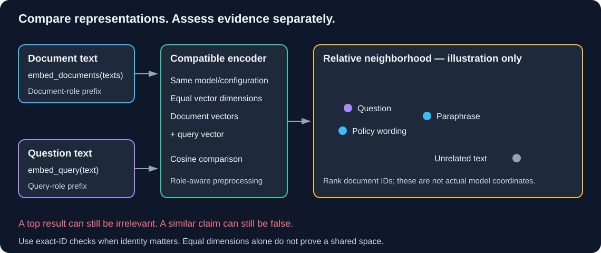

# Chapter 07 — Embeddings and Similarity: Rank Without Guessing Truth

**How can vectors rank related text, and what does similarity fail to prove?**

> **Your goal:** Compute similarity, diagnose invalid vectors and compare retrieval signals.<br>
> **You need:** [Retrieval foundations](../../../study-guides/retrieval-foundations/README.md), the [offline checkpoint](../02-rag-capstone-workbook/retrieval-lab/README.md), [Conversation History](06-conversation-history.md) and retained `first_call.py`.<br>
> **Effort:** 70-90 minutes, plus optional live embedding calls; estimated.<br>
> **You will produce:** `embedding_lab.py`, manual/NumPy calculations and a paraphrase/identifier comparison. **Status:** Draft; unpiloted.

Fernwood is the fictional organization used in this workbook for internal-note and equipment-policy questions. QuickCart supplies the wider course scenario; keep their synthetic corpora and project environments distinct.

**Study route:** Continue your external Python 3.11 `langchain-learning` project. Create `embedding_lab.py` beside `first_call.py`; run authored vectors and arithmetic checks first. Live embeddings require the chosen adapter, account or local model and a separate spending/resource allowance. Record fixture results separately from learned-model results.

<details>
<summary>Reference: unit identity, prerequisites and verification limits</summary>

> **Unit ID:** W-LC-07 · **Capability:** AI-RETRIEVE-01 · [Course map](../../../README.md#ordered-capability-map)
> **Status:** Draft · **Runtime:** your W-LC-00 learner project (Python 3.11 via uv) · **Contract, cleanup and verification:** [W-LC-07 record](lesson-contract.md#w-lc-07).

> **Study time:** 70–90 minutes, plus optional live embedding calls.  
> **Prerequisites:** [W-LC-06 — Conversation History](06-conversation-history.md), basic Python lists, and learner-created `first_call.py` from Chapter 02.<br>
> **Central question:** How can numeric vectors help find related text, and what does their similarity fail to prove?  
> **Running example:** Fernwood team-notes assistant.

[Previous on the course map: offline retrieval checkpoint](../02-rag-capstone-workbook/retrieval-lab/README.md) · [W-LC-06 — previous workbook chapter](06-conversation-history.md) · [Index](README.md) · [W-LC-08 — Next: Documents and Retrieval](08-documents-and-retrieval.md)

</details>

## Learning objectives

- Explain document/query embeddings and measure their dimensions.
- Calculate dot product, vector length, and cosine similarity manually and with NumPy.
- Compare paraphrases, unrelated questions, and exact identifiers with a keyword baseline.
- Reject zero vectors and mismatched dimensions instead of producing misleading scores.
- Configure hosted/local embedding routes without mixing their vector spaces.
- Distinguish similarity, task relevance, and factual truth.

## 1. Intuition: a map of related descriptions

A library can organize books by subject even when titles use different words. A person asking about “yearly desk spending” may need a document titled “home-office reimbursement.” Exact-word matching alone may miss that relationship.

An **embedding model** maps text to a numeric vector: an ordered list of values. Texts with related meanings may have nearby directions in that model's learned space. Individual coordinates generally do not correspond to human-readable topics such as “equipment” or “approval.” A vector is neither a generated answer nor a truth certificate.

Chapter 06 remembers a conversation. Here we compare a question with document text to find candidate evidence. These solve different problems: recalling a user's choice does not locate the current reimbursement policy.

### Pause and predict

An unrelated question receives a highest-ranked document. Does “highest” mean that document answers the question?

<details><summary>Reveal the reasoning</summary>

No. A ranking over a nonempty corpus always has a first item, even when all documents are irrelevant. Similarity compares representations; relevance depends on the user's task, and truth depends on evidence and authority. We need no-answer cases in evaluation.

</details>

## 2. Understand the vectors before using a store

| Term | Meaning |
|---|---|
| Document embedding | Vector for a candidate passage, produced through `embed_documents(list_of_texts)` |
| Query embedding | Vector for a search request, produced through `embed_query(text)` |
| Dimension | Number of coordinates in one vector, not document count or token count |
| Dot product | Sum of coordinate-wise products of same-sized vectors |
| Norm | Vector length; here the Euclidean/L2 norm |
| Cosine similarity | Dot product divided by the product of the two norms |

The two embedding methods express retrieval roles. Some models require different preprocessing for each role; methods with different names do not guarantee the adapter performs that preprocessing. We keep both roles explicit.

For nonzero vectors `a` and `b`:

```text
dot(a, b) = sum(a[i] * b[i])
norm(a) = sqrt(sum(a[i] ** 2))
cosine(a, b) = dot(a, b) / (norm(a) * norm(b))

a = [1, 2], b = [2, 1]
dot = 1*2 + 2*1 = 4
norm(a) = norm(b) = sqrt(5)
cosine = 4 / 5 = 0.8
```

This is a hand-designed arithmetic example, not an embedding of two real sentences. Cosine is mathematically between -1 and 1 for real nonzero vectors. That does **not** supply universal semantic bands such as “above 0.8 is relevant” or make 0.8 an 80% probability of correctness. Real score distributions depend on model, task, corpus, and preprocessing. Zero vectors have undefined cosine; unequal dimensions cannot be compared coordinate by coordinate.

We use [NumPy dot product](https://numpy.org/doc/stable/reference/generated/numpy.dot.html) and [norm](https://numpy.org/doc/stable/reference/generated/numpy.linalg.norm.html), then rank candidates ourselves. No vector store, retriever, or answer-generation model is involved yet.



**Diagram walkthrough:**

1. Document and query paths use one compatible model/configuration, with role-specific prefixes where required.
2. Both produce vectors with equal dimensions; equality of dimensions alone is necessary but not sufficient for compatibility.
3. The similarity calculation ranks document IDs relative to the current question.
4. Candidate text still needs relevance, source, and factual assessment. The pictured positions are illustrative, not measured model coordinates or calibrated confidence.

## 3. Prepare the learner project and route

**Working directory:** Learner-owned `langchain-learning` root, outside this repository. Create `embedding_lab.py` beside Chapter 02's exact `first_call.py`. We reuse its configuration loader, not its chat model constructor. Keep earlier files unchanged.

Install NumPy directly because this lab imports it:

```powershell
uv add numpy
uv sync --locked
```

Offline arithmetic and ranking need no service or key. For live embeddings, use one route:

| Route | Install if not already present | Private `.env` | Embedding model |
|---|---|---|---|
| Hosted | `uv add langchain-core langchain-openai python-dotenv` | `MODEL_PROVIDER=openai`, private `OPENAI_API_KEY` | `text-embedding-3-small` |
| Local | `uv add langchain-core langchain-ollama python-dotenv` | `MODEL_PROVIDER=local` | `nomic-embed-text:v1.5` |

Run `uv sync --locked` after route installation. The imported loader reads `.env` beside `first_call.py`; existing shell variables take precedence. Hosted embedding access is separate from chat-model access and may incur charges. Only fictional snippets are used here.

For the local route, complete Chapter 00's Ollama service checks, then download the **embedding** model. The chat model `llama3.1:8b` is not the encoder used here:

```powershell
ollama pull nomic-embed-text:v1.5
ollama list
```

The [Ollama model page](https://ollama.com/library/nomic-embed-text) identifies the embedding-only model/tag. Initial download needs network access and runtime needs local resources. Do not start downloads merely for the offline arithmetic exercise.

### Role-specific preprocessing

The [Nomic model card](https://huggingface.co/nomic-ai/nomic-embed-text-v1.5) prescribes `search_document: ` for retrieval documents and `search_query: ` for questions. The installed Ollama adapter forwards input text without adding these prefixes. Our `RetrievalEmbeddings` wrapper applies them exactly once on the local route. Hosted inputs remain unprefixed. These settings are part of the embedding configuration, not decoration that can be changed independently after indexing.

## 4. Build a manual ranking lab

**Complete runnable file — `embedding_lab.py`:** Create in the learner project root. The offline vectors are deliberately authored fixtures, not vectors extracted from a model.

```python
import argparse
import re
import sys

import numpy as np
from langchain_core.embeddings import Embeddings
from first_call import read_configuration


DOCS = [
    ("D01", "Fernwood home-office equipment reimbursement is INR 12000 per "
     "calendar year, combined across a monitor, keyboard, or ergonomic chair."),
    ("D02", "Remote desk purchases have one combined yearly ceiling of twelve "
     "thousand rupees for a screen, typing device, or ergonomic seat."),
    ("D03", "Orientation begins on the first Monday at 09:30 IST."),
    ("D04", "Device asset QZ-1042 is assigned to the training room."),
    ("D05", "Device asset QZ-1043 is assigned to the library."),
]
QUERIES = {
    "paraphrase": "How much can I spend on home office equipment each year?",
    "unrelated": "When does the lunar shuttle depart?",
    "identifier": "QZ-1042",
}
TOY_DOCUMENTS = [[1, 0, 0], [0.9, 0.1, 0], [0, 1, 0], [0, 0, 1], [0, 0.05, 1]]
TOY_QUERIES = {
    "paraphrase": [1, 0.05, 0],
    "unrelated": [0.3, 0.4, 0.2],
    "identifier": [0, 0, 1],
}


def as_vector(values):
    vector = np.asarray(values, dtype=float)
    if vector.ndim != 1 or vector.size == 0 or not np.isfinite(vector).all():
        raise ValueError("Expected a nonempty finite one-dimensional vector.")
    norm = float(np.linalg.norm(vector))
    if not np.isfinite(norm) or norm == 0:
        raise ValueError("Cosine requires a finite nonzero vector norm.")
    return vector, norm


def cosine(left, right):
    a, a_norm = as_vector(left)
    b, b_norm = as_vector(right)
    if a.shape != b.shape:
        raise ValueError("Embedding dimensions differ.")
    score = float(np.dot(a / a_norm, b / b_norm))
    return float(np.clip(score, -1.0, 1.0))  # Clip floating-point roundoff only.


def tokens(text):
    # Tiny lexical baseline: preserve hyphenated identifiers, ignore common words.
    stop = {"a", "an", "the", "is", "to", "of", "on", "in", "for", "and",
            "how", "much", "can", "i", "each", "when", "does"}
    return set(re.findall(r"[a-z0-9]+(?:-[a-z0-9]+)*", text.lower())) - stop


def keyword_rank(query):
    ranked = [(doc_id, len(tokens(query) & tokens(text))) for doc_id, text in DOCS]
    return sorted((pair for pair in ranked if pair[1] > 0),
                  key=lambda pair: (-pair[1], pair[0]))


class FixtureEmbeddings(Embeddings):
    def embed_documents(self, texts):
        if texts != [text for _, text in DOCS]:
            raise ValueError("Fixture supports only the fixed document list.")
        return [list(vector) for vector in TOY_DOCUMENTS]

    def embed_query(self, text):
        case = next(name for name, query in QUERIES.items() if query == text)
        return list(TOY_QUERIES[case])


class RetrievalEmbeddings(Embeddings):
    def __init__(self, encoder, local):
        self.encoder = encoder
        self.local = local

    def embed_documents(self, texts):
        prefix = "search_document: " if self.local else ""
        return self.encoder.embed_documents([prefix + text for text in texts])

    def embed_query(self, text):
        prefix = "search_query: " if self.local else ""
        return self.encoder.embed_query(prefix + text)


def build_embeddings(provider, key):
    if provider == "openai":
        from langchain_openai import OpenAIEmbeddings

        encoder = OpenAIEmbeddings(
            model="text-embedding-3-small", api_key=key,
            request_timeout=30, max_retries=0,
        )
    elif provider == "local":
        from langchain_ollama import OllamaEmbeddings

        encoder = OllamaEmbeddings(
            model="nomic-embed-text:v1.5", base_url="http://localhost:11434",
            client_kwargs={"timeout": 180},
        )
    else:
        raise ValueError("Unknown embedding provider.")
    return RetrievalEmbeddings(encoder, local=provider == "local")


def rank(encoder, cases):
    document_vectors = encoder.embed_documents([text for _, text in DOCS])
    if len(document_vectors) != len(DOCS):
        raise ValueError("Expected one vector per document.")
    dimensions = {as_vector(vector)[0].size for vector in document_vectors}
    if len(dimensions) != 1:
        raise ValueError("Document embedding dimensions differ.")
    print("Documents:", len(DOCS), "Dimension:", next(iter(dimensions)))
    for case in cases:
        query = QUERIES[case]
        query_vector = encoder.embed_query(query)
        scored = [(doc_id, cosine(query_vector, vector))
                  for (doc_id, _), vector in zip(DOCS, document_vectors)]
        scored.sort(key=lambda pair: (-pair[1], pair[0]))
        print("Case:", case, "Query:", query)
        print("Cosine top 3:", [(doc_id, round(score, 4)) for doc_id, score in scored[:3]])
        print("Keyword matches:", keyword_rank(query))
        print("Assess candidate relevance and evidence; scores are not truth confidence.")


def main():
    parser = argparse.ArgumentParser()
    parser.add_argument("--live", action="store_true")
    parser.add_argument("--case", choices=["all", *QUERIES], default="all")
    parser.add_argument("--failure", choices=["zero", "dimension"])
    args = parser.parse_args()
    if args.failure:
        right = [0, 0] if args.failure == "zero" else [1, 2, 3]
        try:
            cosine([1, 2], right)
        except ValueError:
            print("Deliberate invalid-vector rejection; no service called.", file=sys.stderr)
            return 2
        raise RuntimeError("Expected invalid vectors to fail.")
    try:
        print("Hand calculation cosine:", round(cosine([1, 2], [2, 1]), 4))
        if args.live:
            provider, key = read_configuration()
            encoder = build_embeddings(provider, key)
            print("Live embedding route:", provider, "Model:", encoder.encoder.model)
            print("Nomic retrieval prefixes enabled:", encoder.local)
        else:
            encoder = FixtureEmbeddings()
            print("OFFLINE HAND-DESIGNED VECTORS: not measured semantic performance.")
        rank(encoder, list(QUERIES) if args.case == "all" else [args.case])
        return 0
    except Exception as exc:
        print(f"Embedding lab failed ({type(exc).__name__}); check vectors, "
              "model/configuration, and service. No automatic retry/provider switch.",
              file=sys.stderr)
        return 1


if __name__ == "__main__":
    raise SystemExit(main())
```

### Follow the types

`embed_documents()` takes five strings and returns five lists of floats. `embed_query()` takes one string and returns one list of floats. NumPy converts each vector to a one-dimensional array for arithmetic; `cosine()` returns a float. The ranking pairs that score with a document ID. We never treat a ranked ID as an answer.

`RetrievalEmbeddings` implements the same interface as its underlying encoder, preserving query/document roles while adding local prefixes. Feed it raw text, not already-prefixed text. All documents are embedded once per run, outside the query loop. This is manual in-memory indexing for five snippets; we do not persist vectors or create a vector database yet.

## 5. Compare the fixed cases

D01 restates the [shared equipment policy](shared-materials.md). D02 is a teaching paraphrase of that limit, not an independent authority. D03 is unrelated orientation text. D04/D05 are invented asset records whose IDs differ by one digit; they are not additional official Fernwood policy documents.

**Working directory:** Learner project root. Start offline:

```powershell
uv run --locked python embedding_lab.py
```

Expect cosine 0.8 for the hand calculation, five documents, and three-dimensional fixture vectors. The authored paraphrase vector ranks D01/D02 first; the identifier vector ranks D04 then D05. The unrelated query still produces a cosine ranking because the program always chooses three candidates. Those placements were chosen by the author; they are not evidence that an embedding model performed well.

The keyword baseline lowercases text, preserves hyphenated identifiers, removes a small stopword set, and counts distinct shared tokens. It is neither BM25 nor a production search engine. It may miss synonyms and number words, and it does not understand negation or authority. No positive overlap produces an empty match list. Unlike cosine scores, these scores are integer token counts; do not compare their numeric magnitudes directly.

| Case | Human relevance judgment | What to compare |
|---|---|---|
| Paraphrase | D01/D02 address the combined annual limit | Can meaning-based ranking recover a differently worded passage? Does the keyword baseline miss it? |
| Unrelated lunar shuttle | None of these documents answers it | Does your system confuse a top result with actual support? |
| Exact `QZ-1042` | D04 is the exact record; D05 is a different asset | Does semantic similarity blur the identifier distinction? Does exact-token matching preserve it? |

### Run your selected live route

After installing/configuring the route, run:

```powershell
uv run --locked python embedding_lab.py --live
```

This invokes `embed_documents()` once for five snippets and `embed_query()` three times. An adapter can split a method call into multiple service requests; do not assume four billable API requests. No chat generation occurs. Hosted mode sends snippets/questions to the configured hosted embedding endpoint; local mode explicitly targets local Ollama. There is no silent hosted fallback.

Record the model/tag, measured dimension, prefix policy, date, dependency/server versions, top IDs/scores, and keyword matches for each case. Assess relevance yourself. Do not expect identical ranks or scores across models, or assert that the paraphrase always beats the unrelated document. Measure actual behavior. If the service is unavailable, record **not tested**.

To rerun only the exact-ID query:

```powershell
uv run --locked python embedding_lab.py --live --case identifier
```

This still re-embeds all five documents, since this chapter has no persistent index. Consider cost before repeated runs; caching and persistence belong to the next chapter.

## 6. Diagnose arithmetic and compatibility failures

**Working directory:** Learner project root. These deliberate failures occur before provider configuration:

```powershell
uv run --locked python embedding_lab.py --failure zero
$LASTEXITCODE
uv run --locked python embedding_lab.py --failure dimension
$LASTEXITCODE
```

Both should exit 2. The first refuses division by a zero norm; the second refuses unequal coordinate counts. To repair the arithmetic experiment, change the failing `right` vector to `[2, 1]` and replace the final `raise RuntimeError(...)` in that branch with `return 0`. Rerun: the calculation should succeed. Restore both deliberate failures afterward. Do not “repair” real model incompatibility by padding or truncating vectors to fit.

| Symptom | Boundary | Check / repair |
|---|---|---|
| NumPy import fails | Project dependency | Run uv add/sync and use the learner project's `uv run` |
| Zero, nonfinite, or nested vector | Numeric contract | Inspect response shape; reject invalid vectors |
| Dimension mismatch | Model/configuration | Re-embed documents and queries with compatible settings |
| Same dimension but nonsense ranks | Embedding space/preprocessing | Compare exact model revision, dimensions, normalization, and role prefixes |
| Ollama model missing | Separate embedding model | Pull `nomic-embed-text:v1.5`; downloading the chat model is insufficient |
| Hosted access/connection error | Service/account | Use Chapter 02 diagnostics; constructor success is not account access |
| High rank for an unrelated question | Ranking semantics | Assess support; do not interpret a rank as a relevance guarantee |
| Neighboring asset ID ranks highly | Identifier precision | Use exact-ID filtering or lexical/hybrid retrieval when the task requires it |

## 7. Similarity, relevance, and truth

> [!IMPORTANT]
> Highest-ranked means closest among the candidates considered. It does not establish that any candidate is relevant, current or permitted. Keep no-answer queries in your evaluation.

| Question | Meaning | How to assess |
|---|---|---|
| Similar? | Vectors point in related directions | Model-dependent metric/ranking |
| Relevant? | Passage helps satisfy this request | Task-specific human labels and retrieval evaluation |
| True/current/authorized? | Claim is accurate, current, and usable by this caller | Source verification, dates, permissions, and domain checks |

Two nearly identical sentences with opposite amounts can be close in embedding space. Negated statements may share most wording. A fake policy can look semantically relevant. Similarity cannot replace checking the requested amount, exact asset ID, policy version, or access rights.

### Keep indexing and querying compatible

Use the same embedding model/version and dimension setting for stored documents and incoming queries. Use its documented complementary query/document preprocessing, not necessarily identical prefixes. Equal vector lengths do not prove shared coordinate meaning: two unrelated 768-dimensional models are not interchangeable.

When changing model, dimension, role-prefix policy, or other space-affecting preprocessing, rebuild stored document vectors and keep configurations separate. Do not compare hosted document vectors with local query vectors. Record your configuration alongside an eventual index; a mutable model tag alone may not identify exact weights forever. This lab measures dimensions instead of hardcoding them and does not change provider defaults for dimensionality.

### Choose retrieval for the task

Semantic embeddings can recover paraphrases. Keyword/exact matching can preserve names, codes, and rare identifiers. Neither always wins. Hybrid retrieval combines signals but needs a defined combination/reranking method and evaluation; adding raw token counts to cosine scores is not a justified default. This chapter compares both independently before introducing stores and retrievers.

## 8. Independent exercise

First calculate cosine for `[3, 4]` and `[4, 3]` by hand, then verify using `cosine()`. Next add a separate exact-ID check for `QZ-1042` and nonexistent `QZ-9999`. Deliver the two results, matching document IDs, and an explanation of why neither cosine nor an ID match proves the record is current.

<details><summary>Hint 1 — arithmetic</summary>

Each vector has norm 5. Divide the dot product by 25; the result is similarity, not confidence.

</details>

<details><summary>Hint 2 — identifier handling</summary>

The tokenizer preserves hyphens and lowercases identifiers. Check membership of the full lowercased ID, not a substring such as `104`.

</details>

<details><summary>Show one reasonable solution</summary>

The dot product is 24, so cosine is 24/25 = 0.96. Add this illustrative helper above `main()` and call it from the offline branch when checking the exercise:

```python
def exact_asset_hits(asset_id):
    return [doc_id for doc_id, text in DOCS if asset_id.lower() in tokens(text)]
```

`exact_asset_hits("QZ-1042")` returns `["D04"]`; `exact_asset_hits("QZ-9999")` returns `[]`. Print `cosine([3, 4], [4, 3])` to check arithmetic. These use existing imports/data and require no new embeddings or fixture edits. Exact matching establishes token presence; version/authority checks still establish whether the asset record is usable.

</details>

## 9. Knowledge checks

### Q1. What does embedding dimension measure?

<details><summary>Show answer</summary>

Coordinates per vector. It is not the number of documents, tokens, or facts, and matching dimensions alone do not prove compatibility.

</details>

### Q2. Why keep document and query embedding methods separate?

<details><summary>Show answer</summary>

They express different retrieval roles. Models may require role-specific preprocessing; our Nomic route uses complementary prefixes with one shared model.

</details>

### Q3. Is cosine 0.8 an 80% confidence score?

<details><summary>Show answer</summary>

No. It measures angle-related similarity. Interpreting relevance thresholds needs model/task-specific evaluation; factual confidence does not follow from it.

</details>

### Q4. Why does the unrelated question still receive cosine candidates?

<details><summary>Show answer</summary>

The program sorts every document and takes three, without a support classifier or calibrated cutoff. A top rank is relative to the corpus, not proof that an answer exists.

</details>

### Q5. Can changing embedding models be repaired by truncating vectors to equal length?

<details><summary>Show answer</summary>

No. Coordinate meaning and model-specific configuration must agree. Rebuild document vectors with the chosen compatible setup instead of forcing shapes to fit.

</details>

## 10. Revision and next step

| Remember | Meaning |
|---|---|
| Embedding | Numeric text representation, not an answer |
| Cosine | Dot divided by product of nonzero norms |
| Top-k | Relative candidates; support is a separate question |
| Keyword baseline | Shared-token signal, not semantic understanding |
| Exact ID | Preserve complete identifier when required |
| Compatibility | Same space, dimensions, and documented role preprocessing |

- [ ] I calculated 0.8 and 0.96 and rejected zero/mismatched vectors.
- [ ] I compared all three cases against the keyword baseline.
- [ ] I can explain why a top result is not necessarily relevant or true.
- [ ] I can configure one embedding route and explain the local prefixes.
- [ ] I know which changes require rebuilding document vectors.

Repeat Section 2 if the arithmetic is unclear, and Sections 5–7 if scores feel like confidence. Next, [W-LC-08 — Documents and Retrieval](08-documents-and-retrieval.md) will add document metadata, chunking, and a persistent index so we do not embed the corpus on every query run.

## Evidence reflection

Which assumption makes a cosine ranking useful, and what would change with a different model or query? Explain why nearest does not mean authorized or answerable. Record the original attempt, observed result, repair and remaining uncertainty in your private learning log.

## Completion checkpoint

**You can now:** compute cosine similarity by hand and with NumPy, compare embeddings against a keyword baseline, and reject zero or mismatched vectors.

**Show it:** your manual and NumPy results side by side, plus the paraphrase and identifier comparison.

**Next:** [W-LC-08 — Documents and Retrieval](08-documents-and-retrieval.md).

## References  

Classification, effort, access and check date for these links: [W-LC source record](source-record.md).

- [OpenAIEmbeddings integration](https://docs.langchain.com/oss/python/integrations/embeddings/openai) and [OllamaEmbeddings integration](https://docs.langchain.com/oss/python/integrations/embeddings/ollama).
- [Nomic model/task prefixes](https://huggingface.co/nomic-ai/nomic-embed-text-v1.5), [Ollama model tag](https://ollama.com/library/nomic-embed-text), and [Ollama embeddings guidance](https://docs.ollama.com/capabilities/embeddings).
- [NumPy dot](https://numpy.org/doc/stable/reference/generated/numpy.dot.html) and [norm](https://numpy.org/doc/stable/reference/generated/numpy.linalg.norm.html).


