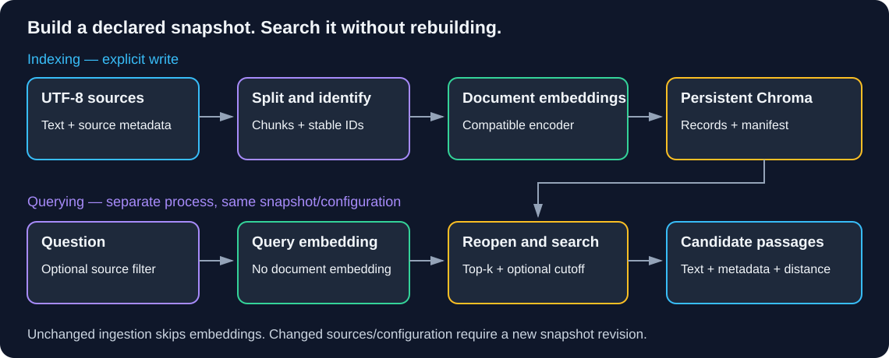
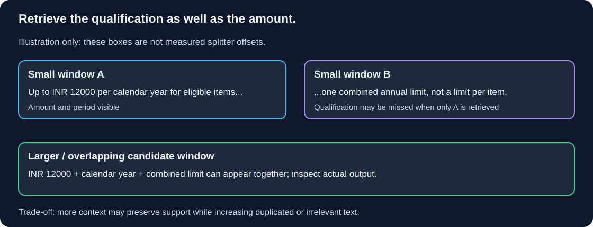

# Chapter 08 — Documents and Retrieval: Build Once, Inspect Every Handoff

> **Study time:** 100–130 minutes, plus optional live indexing/PDF practice.  
> **Prerequisites:** [Embeddings and Similarity](07-embeddings-and-similarity.md), learner-created `embedding_lab.py` and `first_call.py`.  
> **Central question:** How do we turn files into a reproducible searchable snapshot without re-indexing on every question?  
> **Running example:** Fernwood team-notes assistant.

[Previous: Embeddings and Similarity](07-embeddings-and-similarity.md) · [Index](README.md) · [Next: Grounded RAG](09-grounded-rag.md)

## Learning objectives

- Load UTF-8 files into documents with source IDs and metadata.
- Inspect character-based chunks and explain overlap, boundaries, and token limits.
- Compare two chunk configurations on fixed questions using passage-level evidence.
- Persist a Chroma index, reopen it in another process, and query without document embedding.
- Explain top-k, distance cutoffs, filters, and empty results.
- Apply an explicit rerun/revision policy and inspect optional PDF text extraction.

## 1. Intuition: a catalog and its source pages

A library builds its catalog when books arrive, not whenever someone asks a question. A catalog entry must identify the book and useful passage; “the book exists” is insufficient if the relevant sentence is missing from the page shown.

Chapter 07 re-embedded five snippets on every run. That was useful for understanding vectors, but a growing corpus needs separate **indexing** and **querying**. Indexing loads files, splits text, embeds chunks, and stores records. Querying embeds a question and searches an existing snapshot.

### Pause and predict

You edit a policy file after indexing. Should an ordinary query silently update the index?

<details><summary>Reveal the reasoning</summary>

No. Querying should search the declared snapshot. A separate ingestion action must detect source changes and apply a documented update policy. This lab refuses to overwrite changed snapshots and requires a new revision, keeping old chunks from lingering unnoticed.

</details>

## 2. Define the records and boundaries

| Term | Meaning in this lab |
|---|---|
| `Document.page_content` | Searchable text from a file or chunk |
| `Document.metadata` | Source filename, source ID, effective date, and later chunk offsets/IDs |
| Source ID | Corpus identity such as `FW-EQUIPMENT-001`; not proof of authority |
| Chunk | Smaller searchable text unit copied from a document |
| Overlap | Target amount of shared boundary text; not guaranteed identical overlap after separator-aware splitting |
| Chunk ID | Deterministic hash of source identity, offset, and chunk text |
| Vector store | Stores vectors with text/metadata and supports similarity queries |
| Retriever | Runnable interface returning candidate `Document` objects for a query |

`RecursiveCharacterTextSplitter` tries separators such as paragraph breaks, newlines, spaces, then characters. Our settings use `len`, so sizes are **characters**, not tokens. Unicode characters, bytes, and model tokens have different counts. A 500-character chunk is not a promise of fitting every model's context window. Headers may land in separate chunks; copying source identity into metadata preserves it even when the header is absent from chunk text. See the [recursive splitter guide](https://docs.langchain.com/oss/python/integrations/splitters/recursive_text_splitter).

We compare **small: 180 characters / 30 overlap** and **large: 500 / 80**. Small chunks may separate an amount from its combined-limit qualification. Larger chunks may preserve that context but include irrelevant material and cost more to embed/pass onward. More overlap can reduce boundary loss while duplicating text and storage. Neither configuration is universally better.



**Diagram walkthrough:**

1. UTF-8 files become documents, then chunks with metadata and stable IDs.
2. Document embeddings are created during explicit indexing and saved to Chroma.
3. A later process verifies the manifest and reopens the same collection.
4. Query embedding plus optional source filter retrieves candidate chunks. That path does not load/split/re-embed the files.
5. Source text still needs support assessment; this chapter does not generate answers.



**Diagram walkthrough:** The illustration splits an allowance sentence and its qualification into different windows. Overlap or a larger window can carry both, but separator-aware splitting and actual lengths determine the result. Inspect real chunks below; the picture is not a transcript of the splitter's measured offsets.

## 3. Prepare documents and dependencies

**Working directory:** Your learner-owned `langchain-learning` project, outside this repository.

```powershell
uv add langchain-text-splitters langchain-chroma
uv sync --locked
New-Item -ItemType Directory -Force knowledge
```

Save the five complete filename-labeled snippets from [Shared Learning Materials, Section 1](shared-materials.md#1-create-the-learner-documents-when-instructed) as UTF-8 files in `knowledge/`:

```text
knowledge/
  team-handbook.txt
  equipment-policy.txt
  vpn-guide.txt
  remote-work-faq.txt
  documentation-guide.txt
```

Copy the text inside each fence, including source ID/effective-date headers, without the fence markers. These supplied documents are the required corpus; no downloads, original sample application, or private company files are prerequisites. We link the single shared copy so later chapters use the same evidence.

Keep Chapter 07's exact `embedding_lab.py`: we import its `build_embeddings()` wrapper so local document/query prefixes stay compatible. Do not substitute its five-snippet fixture; this chapter's fixture accepts arbitrary chunks using deterministic token hashing. It demonstrates storage mechanics, not semantic embedding quality.

Offline indexing needs no model service. For live use, retain `MODEL_PROVIDER=openai` with private `OPENAI_API_KEY`, or `MODEL_PROVIDER=local` with Ollama running and `nomic-embed-text:v1.5` downloaded. Chapter 07 supplies complete adapter installation, model download, and configuration instructions. Both routes use local Chroma persistence; hosted mode still sends embedding inputs to the hosted service.

Append `chroma_store/` to the learner project's `.gitignore` using your editor. Generated databases/manifests contain corpus-derived data and can be rebuilt. Never place these artifacts in the workbook folder or commit private source files/credentials.

## 4. Build an inspectable, revisioned retrieval lab

**Complete runnable file — `retrieval_lab.py`:** Create beside `embedding_lab.py`. Paths resolve beside the script. `inspect` performs no embeddings; `index` writes a snapshot; `query`/`compare` only search existing snapshots.

```python
import argparse
import hashlib
import json
import re
import sys
from pathlib import Path

import numpy as np
from langchain_chroma import Chroma
from langchain_core.documents import Document
from langchain_core.embeddings import Embeddings
from langchain_text_splitters import RecursiveCharacterTextSplitter
from embedding_lab import build_embeddings
from first_call import read_configuration


ROOT = Path(__file__).resolve().parent
SETTINGS = {"small": (180, 30), "large": (500, 80)}
FILES = ["team-handbook.txt", "equipment-policy.txt", "vpn-guide.txt",
         "remote-work-faq.txt", "documentation-guide.txt"]
CASES = [
    ("A02", "What is the annual home-office reimbursement limit?"),
    ("A04", "What do I submit for equipment reimbursement, and by when?"),
    ("A06", "What should I do if VPN sign-in succeeds but connection fails?"),
    ("U03", "What is the VPN server's IP address?"),
]


def digest(text):
    return hashlib.sha256(text.encode("utf-8")).hexdigest()


class HashEmbeddings(Embeddings):
    """Offline lexical fixture, not a trained semantic model."""

    def embed_query(self, text):
        vector = np.zeros(128)
        for token in re.findall(r"[a-z0-9]+", text.lower()):
            vector[int(digest(token)[:8], 16) % 128] += 1
        norm = np.linalg.norm(vector)
        if norm == 0:
            raise ValueError("Fixture requires at least one alphanumeric token.")
        return (vector / norm).tolist()

    def embed_documents(self, texts):
        return [self.embed_query(text) for text in texts]


def load_documents():
    documents = []
    for filename in FILES:
        text = (ROOT / "knowledge" / filename).read_text(encoding="utf-8-sig")
        source = re.search(r"^Source ID: (.+)$", text, re.MULTILINE)
        date = re.search(r"^Effective date: (.+)$", text, re.MULTILINE)
        if not source or not date or not text.strip():
            raise ValueError("Corpus file needs source ID, effective date, and text.")
        documents.append(Document(page_content=text, metadata={
            "source": filename, "source_id": source[1].strip(),
            "effective_date": date[1].strip(),
        }))
    if len({doc.metadata["source_id"] for doc in documents}) != len(documents):
        raise ValueError("Source IDs must be unique.")
    return documents


def make_chunks(setting):
    size, overlap = SETTINGS[setting]
    splitter = RecursiveCharacterTextSplitter(
        chunk_size=size, chunk_overlap=overlap, length_function=len,
        add_start_index=True,
    )
    chunks = splitter.split_documents(load_documents())
    for chunk in chunks:
        start = chunk.metadata["start_index"]
        if start < 0:
            raise ValueError("Could not locate chunk in its source.")
        chunk.metadata["chunk_id"] = digest(
            chunk.metadata["source"] + ":" + chunk.metadata["source_id"]
            + ":" + str(start) + ":" + chunk.page_content
        )
    return chunks


def encoder_profile(live):
    if not live:
        return HashEmbeddings(), "fixture-hash128-v1"
    provider, key = read_configuration()
    encoder = build_embeddings(provider, key)
    profile = (provider + ":" + encoder.encoder.model
               + (":nomic-prefixes-v1" if encoder.local else ":default-dimensions"))
    return encoder, profile


def location(profile, setting, revision):
    return ROOT / "chroma_store" / (digest(profile)[:12] + "_" + setting + "_" + revision)


def open_store(path, encoder, create):
    return Chroma(
        collection_name="fernwood_notes", persist_directory=str(path),
        embedding_function=encoder,
        collection_configuration={"hnsw": {"space": "cosine"}},
        create_collection_if_not_exists=create,
    )


def index(encoder, profile, setting, revision):
    chunks = make_chunks(setting)
    ids = [chunk.metadata["chunk_id"] for chunk in chunks]
    desired = {"format": 1, "profile": profile, "setting": list(SETTINGS[setting]),
               "source_hashes": {doc.metadata["source"]: digest(doc.page_content)
                                 for doc in load_documents()}, "ids": ids}
    path = location(profile, setting, revision)
    manifest = path / "manifest.json"
    if manifest.exists():
        if json.loads(manifest.read_text(encoding="utf-8")) != desired:
            raise ValueError("Snapshot changed: choose a new --revision and rebuild.")
        store = open_store(path, encoder, False)
        if set(store.get(include=[])["ids"]) != set(ids):
            raise ValueError("Stored IDs differ from manifest; use a new revision.")
        print("Unchanged snapshot: skipped embedding. Chunks:", len(ids))
        return
    store = open_store(path, encoder, True)
    if store.get(include=[])["ids"]:
        raise ValueError("Incomplete snapshot found; use a new revision.")
    store.add_documents(chunks, ids=ids)
    if set(store.get(include=[])["ids"]) != set(ids):
        raise ValueError("Index verification failed; no completed manifest written.")
    temporary = path / "manifest.tmp"
    temporary.write_text(json.dumps(desired, indent=2), encoding="utf-8")
    temporary.replace(manifest)
    print("Indexed chunks:", len(ids), "Path:", path)


def reopen(encoder, profile, setting, revision):
    path = location(profile, setting, revision)
    manifest = path / "manifest.json"
    if not manifest.exists():
        raise ValueError("No completed snapshot: run index for this configuration.")
    saved = json.loads(manifest.read_text(encoding="utf-8"))
    if saved["profile"] != profile or saved["setting"] != list(SETTINGS[setting]):
        raise ValueError("Embedding/chunk configuration mismatch.")
    store = open_store(path, encoder, False)
    if set(store.get(include=[])["ids"]) != set(saved["ids"]):
        raise ValueError("Snapshot IDs differ from manifest.")
    return store


def search(store, question, k, max_distance=None, source=None):
    options = {"filter": {"source_id": source}} if source else {}
    matches = store.similarity_search_with_score(question, k=k, **options)
    if max_distance is not None:
        matches = [(doc, distance) for doc, distance in matches if distance <= max_distance]
    for doc, distance in matches:
        print("Distance:", round(distance, 4), "Metadata:", doc.metadata)
        print(doc.page_content, "\n")
    if not matches:
        print("No candidate chunks passed the filter/cutoff.")
    return matches


def main():
    parser = argparse.ArgumentParser()
    parser.add_argument("command", choices=["inspect", "index", "query", "compare"])
    parser.add_argument("--setting", choices=SETTINGS, default="small")
    parser.add_argument("--revision", default="v1")
    parser.add_argument("--live", action="store_true")
    parser.add_argument("--question", default=CASES[0][1])
    parser.add_argument("--k", type=int, default=3)
    parser.add_argument("--max-distance", type=float)
    parser.add_argument("--source")
    args = parser.parse_args()
    if not re.fullmatch(r"[A-Za-z0-9_-]{1,32}", args.revision):
        parser.error("Revision must be 1-32 letters, digits, underscores, or hyphens.")
    if not 1 <= args.k <= 20 or not args.question.strip():
        parser.error("Use k between 1 and 20 and a nonempty question.")
    if args.max_distance is not None and not 0 <= args.max_distance <= 2:
        parser.error("Cosine-distance cutoff must be between 0 and 2.")
    try:
        if args.command == "inspect":
            chunks = make_chunks(args.setting)
            print("Chunks:", len(chunks))
            for chunk in chunks:
                print("Characters:", len(chunk.page_content), "Metadata:", chunk.metadata)
                print(repr(chunk.page_content))
            return 0
        encoder, profile = encoder_profile(args.live)
        print("Embedding profile:", profile)
        if not args.live:
            print("OFFLINE HASH FIXTURE: storage test, not semantic performance.")
        if args.command == "index":
            index(encoder, profile, args.setting, args.revision)
        elif args.command == "query":
            store = reopen(encoder, profile, args.setting, args.revision)
            search(store, args.question, args.k, args.max_distance, args.source)
        else:
            for setting in SETTINGS:
                store = reopen(encoder, profile, setting, args.revision)
                print("CHUNK SETTING:", setting)
                for case_id, question in CASES:
                    print("CASE:", case_id, question)
                    search(store, question, args.k, args.max_distance, args.source)
        return 0
    except Exception as exc:
        print(f"Retrieval lab failed ({type(exc).__name__}). Check source files, "
              "snapshot/configuration, dependencies, or embedding service. "
              "Use a new revision for changed/incomplete snapshots.", file=sys.stderr)
        return 1


if __name__ == "__main__":
    raise SystemExit(main())
```

### Understand the ingestion policy

The stable chunk ID uses filename, source ID, starting character offset, and content. The same unchanged source/settings produce the same IDs. Changed content or offsets can change IDs, so this lab treats each revision as an **immutable snapshot** rather than upserting new chunks beside obsolete ones.

The manifest records source hashes, chunk IDs, chunk settings, and embedding profile. An unchanged rerun verifies IDs and skips `add_documents()` entirely: no new document embeddings and no duplicates. A changed corpus/settings under the same snapshot is rejected. An incomplete index without a completed manifest is refused if it contains records; choose a fresh revision. No recursive deletion is part of the lab.

The manifest is written after indexing and verified ID count/set, using a temporary file replacement. This is a single-writer teaching workflow, not a transaction spanning the database and manifest or a concurrent ingestion service. Do not run two index writers on the same revision. For live cost, do not assume a failed build made no embedding calls.

## 5. Inspect, index, then reopen

**Working directory:** Learner project root. Inspect both settings before creating vectors:

```powershell
uv run --locked python retrieval_lab.py inspect --setting small
uv run --locked python retrieval_lab.py inspect --setting large
```

Find the allowance amount and its combined-limit sentence. Note which chunks contain both. Check that every chunk carries filename, source ID, effective date, start offset, and chunk ID; metadata must survive splitting. Confirm sizes do not exceed their configured character limit for these inputs. Inspecting text is not a token-budget measurement.

Build two offline snapshots, then rerun the small build:

```powershell
uv run --locked python retrieval_lab.py index --setting small
uv run --locked python retrieval_lab.py index --setting large
uv run --locked python retrieval_lab.py index --setting small
```

The third command must report `Unchanged snapshot: skipped embedding.` Its stored ID set/count must stay unchanged. Chroma saves to the configured local directory; no separate `.persist()` call is required in the tested integration. See [Chroma persistence and search](https://docs.langchain.com/oss/python/integrations/vectorstores/chroma).

Query from a **new process**:

```powershell
uv run --locked python retrieval_lab.py query --setting small --question "What do I submit for equipment reimbursement, and by when?"
```

It reopens the manifest/index and prints candidate text/metadata/distances. Only the question is embedded. It does not call `make_chunks()` or `add_documents()`. You may edit source files afterward, but ordinary queries still search the recorded snapshot; a query does not check or ingest current file contents. To refresh, explicitly index a new revision.

### Compare two chunk settings against fixed questions

```powershell
uv run --locked python retrieval_lab.py compare --k 3
```

Keep provider/profile, corpus, questions, revision, k, and distance/filter settings fixed. Change only the chunk setting. Use the shared case expectations, not filenames alone:

| Case | Required passage facts | Small candidates contain all facts? | Large candidates contain all facts? |
|---|---|---|---|
| A02 | INR 12000, per calendar year, one combined limit | | |
| A04 | Itemized receipt, People Operations, within 30 calendar days after purchase | | |
| A06 | Record error code, contact #it-help, do not disable MFA/share passwords | | |
| U03 | No VPN server IP is supplied | Related candidates are not the missing IP | Same assessment |

For each answerable case, score a hit only if the **union of retrieved passages** contains every required fact; record whether one chunk contains them or several are needed. A matching source ID without the required passage is not a hit. Record 0–3 hits for each setting, chunk counts, duplication, and irrelevant text. This chapter's small comparison is a subset of the shared eight-case evaluation, not a general benchmark. The fixture verifies the workflow; repeat with real embeddings to assess semantic retrieval quality.

**Observed author fixture run, k=3:** Small produced 35 chunks and covered A02/A06 but missed A04's receipt passage (2/3). Large produced 10 chunks and covered all three (3/3). Both returned candidates for U03 without supplying an IP address. Large chunks also carried unrelated sections; this result is a worked storage/coverage observation, not a claim that large chunks or token hashing perform best with real embeddings. Record your own results, especially near tied distances.

### Live indexing and querying

With the Chapter 07 route ready, repeat explicit indexing with `--live`, then query using the same flag:

```powershell
uv run --locked python retrieval_lab.py index --live --setting small
uv run --locked python retrieval_lab.py index --live --setting large
uv run --locked python retrieval_lab.py compare --live --k 3
```

Profile-derived paths keep fixture/hosted/local vectors separate. Local mode retains the Nomic document/query prefixes from Chapter 07. Building both settings embeds each set of chunks; comparing makes eight query-embedding invocations. Adapters may batch/split service requests. There is no chat model call, automatic retry, or provider switch. Record actual versions, model/tag, configuration, date, cost/resource observations, and relevance results. An unavailable live route is **not tested**, not a passing semantic evaluation.

## 6. Top-k, thresholds, and empty candidates

`k=3` requests up to three nearest records, not three true facts or three distinct source files. Metadata filters and collection size can reduce that count. Nearby chunks can duplicate one another. An unrelated query can still receive candidates.

This collection explicitly uses **cosine distance**, `1 - cosine_similarity`: lower is closer. The raw `similarity_search_with_score()` values here are distances, not Chapter 07's higher-is-better cosine similarities or calibrated relevance probabilities. Metric configuration matters; Chroma's default metric need not be cosine. See [Chroma collection configuration](https://docs.trychroma.com/docs/collections/configure).

`--max-distance` filters the retrieved top-k after searching. For example, `--max-distance 0.4` is an experiment, not a recommended universal cutoff. It can remove relevant passages or retain irrelevant ones and cannot retrieve missing evidence. Calibrate using answerable and unsupported cases; keep an explicit empty-candidate branch.

These commands demonstrate filtering and emptiness:

```powershell
uv run --locked python retrieval_lab.py query --source FW-EQUIPMENT-001 --max-distance 0.4
uv run --locked python retrieval_lab.py query --source FW-MISSING-999
```

The second uses a nonexistent source ID and should return no candidates, without changing the index. The first may return zero or more, depending on scores. Neither empty results nor nearest matches alone establish whether the real-world answer exists.

### Retriever interface

**Illustrative fragment — not runnable independently:** `store` is a reopened compatible Chroma instance. This is an alternative search call, not an extra step required by the CLI:

```python
retriever = store.as_retriever(search_type="similarity", search_kwargs={"k": 3})
documents = retriever.invoke("What is the annual reimbursement limit?")
```

The input is a string and output is a list of `Document` objects, without the raw distance pairs displayed by our diagnostic search. A retriever selects candidates; it does not produce an answer or verify citations. Do not add this call after every CLI search unless you intend another query embedding.

### Rebuild and failure practice

Append a harmless fictional revision note to one learner source file. Running `index` again with the same configuration/revision must fail rather than mixing old/new chunks. Build with `--revision v2`, then query with the same revision:

```powershell
uv run --locked python retrieval_lab.py index --setting small --revision v2
uv run --locked python retrieval_lab.py query --setting small --revision v2
```

The old v1 remains a separate snapshot. Restore source text for subsequent fixed-corpus comparisons, and use the matching revision. Changed model weights/configuration, dimensions, prefixes, splitting code, or embedding preprocessing likewise require a fresh build/revision. The simple profile cannot detect every code or mutable-tag change; record those changes yourself and never reuse old vectors just because dimensions match.

| Symptom | Boundary | Repair |
|---|---|---|
| Missing/invalid text file | Loading | Copy all five supplied UTF-8 files and required headers |
| Relevant sentence split away | Chunking | Inspect offsets/text; compare larger chunks/overlap |
| No completed snapshot | Lifecycle/configuration | Index the matching profile/setting/revision first |
| Changed/incomplete snapshot | Ingestion policy | Use a fresh revision; do not append guessed replacement chunks |
| Query uses old text | Snapshot freshness | Explicitly build and select a new revision |
| Empty candidates | Filter/cutoff/corpus | Inspect source filter and distances; do not invent support |
| Embedding service error | Provider | Use Chapter 07 checks without logging secrets |

## 7. Optional PDF extraction exercise

PDF is an optional input format, not a required dependency of the text-file route. Supply your own **small, text-based, unencrypted PDF containing fictional/public tutorial content**, saved as `inputs/notes.pdf` in the learner project. This workbook provides no PDF download. Use no private employee/customer information. Scanned pages may need OCR, which is outside this exercise.

**Working directory:** Learner project root.

```powershell
uv add pypdf
uv sync --locked
```

**Complete runnable file — `pdf_inspect.py`:** Create beside `retrieval_lab.py`. This exercise extracts/inspects pages only; it does not add PDFs to the five-file index.

```python
import argparse
from pathlib import Path

from pypdf import PdfReader
from langchain_core.documents import Document


def main():
    parser = argparse.ArgumentParser()
    parser.add_argument("path", type=Path)
    args = parser.parse_args()
    reader = PdfReader(args.path)
    if reader.is_encrypted:
        parser.error("Use an unencrypted tutorial PDF.")
    for page_number, page in enumerate(reader.pages, start=1):
        text = page.extract_text() or ""
        if not text.strip():
            print("No extracted text on page", page_number, "(OCR may be needed).")
            continue
        doc = Document(page_content=text, metadata={
            "source": args.path.name, "page": page_number,
        })
        print(doc.metadata, "Characters:", len(doc.page_content))
        print(doc.page_content)


if __name__ == "__main__":
    main()
```

```powershell
uv run --locked python pdf_inspect.py inputs/notes.pdf
```

Compare extracted text with the PDF: headings, reading order, tables, page numbers, and missing content. Our page metadata is **one-based**, matching ordinary reader page numbering. Extraction success is not proof of faithful layout or complete content. Missing/corrupt files need repair before ingestion; empty text must not be embedded as meaningful evidence. See [pypdf extraction guidance](https://pypdf.readthedocs.io/en/stable/user/extract-text.html).

If you later add PDF chunks, preserve page/source identity, define IDs and revision policy, and update evaluation before indexing. Do not silently feed the optional PDF into the fixed five-document benchmark.

## 8. Independent exercise

Compare `k=1` with `k=3` using the two existing chunk snapshots, without re-indexing. Deliver the passage-level hit table, a case where context is split or extra text is retrieved, and the nonexistent-source empty result. Explain why more candidates do not automatically improve support.

<details><summary>Hint 1 — controlled comparison</summary>

Keep all existing source/index settings fixed. Change only k; use `compare --k 1` and `compare --k 3` against already built snapshots.

</details>

<details><summary>Hint 2 — evidence</summary>

Check every required fact in the printed text. Two chunks from the right file can still omit the needed sentence, and three overlapping chunks can repeat the same fact.

</details>

<details><summary>Show one reasonable solution</summary>

Run both compare commands, score the three answerable cases by required-fact coverage, and record duplicated/irrelevant text separately. Run `query --source FW-MISSING-999` and retain the empty result. A configuration can trade context coverage against extra text; report actual outcomes rather than declaring k=3 universally superior. Querying must leave the manifest/ID set unchanged and make no document-embedding calls. If live embeddings are unavailable, label all quality observations as fixture results.

</details>

## 9. Knowledge checks

### Q1. Why copy source identity into chunk metadata?

<details><summary>Show answer</summary>

The file header may be in another chunk. Metadata keeps provenance available with each retrieved passage, but provenance alone does not prove support.

</details>

### Q2. Does 30-character overlap guarantee 30 shared tokens?

<details><summary>Show answer</summary>

No. Our splitter counts characters and respects separators. Token counts differ, and actual overlap can be smaller than the configured target.

</details>

### Q3. What happens on unchanged repeated ingestion?

<details><summary>Show answer</summary>

The manifest and stored IDs are verified, then indexing is skipped. We do not re-embed or append duplicate records. Changed snapshots require a new revision.

</details>

### Q4. Is the raw Chroma score a higher-is-better confidence value?

<details><summary>Show answer</summary>

No. This explicitly configured collection returns cosine distance: lower is closer. It remains a retrieval metric, not factual confidence.

</details>

### Q5. Why can searching return an empty list?

<details><summary>Show answer</summary>

No records may satisfy a metadata filter, or all top-k candidates may exceed the chosen distance cutoff. Empty results need explicit handling, not invented evidence.

</details>

## 10. Revision and next step

| Remember | Meaning |
|---|---|
| Indexing | Load → split → document embeddings → persist |
| Querying | Reopen → query embedding → candidates |
| Metadata | Provenance and inspection fields |
| Chunk ID | Deterministic record identity within the snapshot |
| Manifest | Snapshot/configuration record, not universal freshness detection |
| Top-k/cutoff | Candidate selection, not truth verification |

- [ ] I created and inspected all five UTF-8 sources and both chunk settings.
- [ ] I verified unchanged ingestion skips embedding and does not duplicate IDs.
- [ ] I reopened/queryed from a new process without re-indexing.
- [ ] I compared required passage facts, including the unsupported IP question.
- [ ] I observed an empty filter result and can rebuild into a new revision.

Revisit Sections 4–6 if lifecycle or distance semantics are unclear. Next, [Grounded RAG](09-grounded-rag.md) will format retrieved passages as evidence and generate an answer while assessing support. That chapter remains a scaffold until implemented.

## References  

- [Recursive splitter](https://docs.langchain.com/oss/python/integrations/splitters/recursive_text_splitter).
- [LangChain Chroma integration](https://docs.langchain.com/oss/python/integrations/vectorstores/chroma) and [Chroma collection configuration](https://docs.trychroma.com/docs/collections/configure).
- [pypdf text extraction](https://pypdf.readthedocs.io/en/stable/user/extract-text.html).


