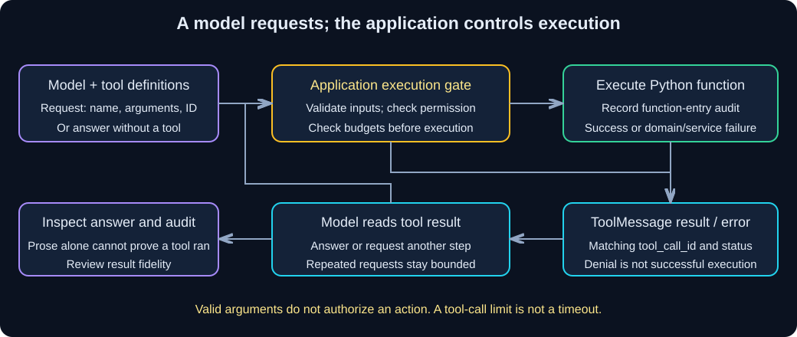

# Chapter 11 — Tools and Agents: A Request Is Not Execution

**Who decides whether a model-requested function actually runs?**

> **Your goal:** Trace validation, trusted permission, execution budgets and tool results.<br>
> **You need:** [Models and Messages](02-models-and-messages.md), [Structured Output](04-structured-output.md), retained `first_call.py` and the evidence boundaries from chapters 09-10.<br>
> **Effort:** 100-130 minutes, plus optional live evaluation; estimated.<br>
> **You will produce:** `tools_lab.py`, correlated message/audit traces and invalid/denied/failure/loop checks. **Status:** Draft; fixture and live evidence remain separate.

**Fernwood** is the fictional organization used here for internal-note and equipment-policy questions. Use synthetic material throughout; these labs do not establish a deployed identity or authorization system.

**Starting state:** Continue the same learner project. Create `tools_lab.py` beside `first_call.py` and follow only this chapter's dependency additions. The default scripted model exercises real local tool/runtime wiring, not live model choice.

**Study route:** Inspect the direct function and schema, follow manual dispatch, then compare the managed runtime. Attempt failure and budget scenarios before the independent change. No real account mutation or consequential external action is needed.

**Before executable steps:** use Python 3.11 via uv from the learner project named above, following each section's working directory. Default fixture checks make no paid model calls, and this chapter starts no server or interface process. Before optional hosted inference, choose a budget, request count, execution window and review plan; local models require their own compute allowance. Preserve private evidence and follow the chapter's cleanup/verification record below.

<details>
<summary>Reference: stable unit identity and historical verification limits</summary>

> **Unit ID:** W-LC-11 · **Capability:** AI-TOOLS-01 · [Course map](../../../README.md#ordered-capability-map)
> **Status:** Draft · **Runtime:** your W-LC-00 learner project (Python 3.11 via uv) · **Contract, cleanup and verification:** [W-LC-11 record](lesson-contract.md#w-lc-11).
> **Study time:** 100–130 minutes, plus optional live evaluation.  
> **Prerequisites:** [W-LC-02 — Models and Messages](02-models-and-messages.md), [W-LC-04 — Structured Output](04-structured-output.md), and learner-created `first_call.py`. Chapters 09–10 provide the evidence-versus-instructions context.<br>
> **Central question:** Who decides whether a model-requested function actually runs?  
> **Running example:** Fernwood team-notes assistant.

</details>

[Previous core chapter](10-conversational-rag.md) | [Workbook index](README.md) | [Next core step](12-streaming-and-interfaces.md)

## Learning objectives

- Turn a deterministic Python function into a typed tool and inspect its input schema.
- Trace a model request, argument validation, application authorization, execution, tool result, and final answer.
- Use `create_agent` and inspect messages alongside an execution audit.
- Test no-tool responses, invalid arguments, execution failures, denied requests, and bounded loops.
- Compare deterministic routing with an agent and explain the limits of validation.

## 1. Intuition: the request slip and the cashier

A customer writes a request on a slip. The slip does not operate the till or prove the customer may withdraw money. A worker checks its contents, checks permission, and then performs the permitted operation.

A **tool** exposes a callable function and its input schema to a model. A **tool call** is the model's structured request: a name, argument object, and call ID. For the application-defined Python tools in this lesson, the model does not execute Python. Application code or the agent runtime invokes the function.

Fernwood learners will calculate a remaining amount from a **user-supplied hypothetical cap and spending total**. This is arithmetic, not a live employee balance, reimbursement approval, or a replacement for the policy evidence in Chapter 09. For example, a cap of INR 12000 and spending of INR 3500 leaves INR 8500. Nothing here submits a claim or transfers money.

### Pause and predict

A request has valid integers and names the correct tool. Does that authorize execution?

<details><summary>Reveal the reasoning</summary>

No. Schema validation checks input shape and constraints. Authorization checks whether this caller may perform this operation on these resources. This lesson uses an application-owned permission flag to make the distinction visible; a real service must derive permission from authenticated identity and policy, not a model argument or user-written “approved” text.

</details>

## 2. Understand the mechanism



**Diagram walkthrough:**

1. The application sends tool definitions with messages. A model may answer directly or return one or more structured calls.
2. The application checks the name, arguments, permission, and execution budget before invoking a tool. The model's request alone proves none of these checks passed.
3. A `ToolMessage` returns the result or a controlled error with the matching `tool_call_id`. The requesting `AIMessage` stays in the conversation before those results.
4. The model reads the result and produces a final answer, or requests another tool. We bound this loop and inspect what actually executed.

| Object | Meaning | What it does not prove |
|---|---|---|
| Tool schema | Allowed name, fields, types, constraints, description | Caller permission or correct business meaning |
| `AIMessage.tool_calls` | Parsed model requests | That the function ran |
| `ToolMessage` | Correlated result/error supplied by application | That the model will describe it faithfully |
| Execution audit | Function-entry record in this lab | Durable, tamper-proof production auditing |
| Final assistant text | Model's explanation | Tool use, factual correctness, or authorization |

An **agent** repeatedly chooses model/tool steps until it finishes or hits a limit. A **router** selects among predetermined paths, often once. Chapter 10 used a fixed rewrite → retrieve → answer path. Use that predictable path when the work is known; an agent is useful when tool selection or the next step depends on intermediate results.

## 3. Hands-on starting state

Use the separate learner project containing `first_call.py`, `pyproject.toml`, and `uv.lock`, outside this workbook repository. Create `tools_lab.py`; leave previous learner files unchanged. No vector index, external website, or Wikipedia package is required.

From that learner project root, in PowerShell:

```powershell
uv add langchain
uv sync --locked
```

`langchain` supplies `create_agent` and middleware and resolves its LangGraph dependencies. Existing `langchain-core`, `pydantic`, `langchain-openai`, `langchain-ollama`, and `python-dotenv` come from earlier chapters. Fresh package resolution may differ from the author's baseline; keep your own lockfile and record versions.

Default runs use a scripted model with real tools and a real agent runtime. To try live tool calling, retain Chapter 00's configuration: `MODEL_PROVIDER=openai` and a working key for `gpt-4o-mini`, or `MODEL_PROVIDER=local` with Ollama running and `llama3.1:8b` downloaded. No embedding model is involved. A provider adapter supporting tools does not guarantee that every model will choose the right tool or arguments.

## 4. Build step by step

First inspect `remaining_rupees`: ordinary deterministic Python. Next inspect `AllowanceInput` and `make_tool`: the schema and wrapper that expose it. Then read `manual` before `managed`. The scripted model is a test driver; it intentionally emits the desired request/error case and does not establish model competence.

**Complete runnable file — `tools_lab.py`**

Create this file in the learner project root. Dependencies, configuration, and routes are given above. Amounts are whole rupees; the restrictive teaching schema rejects strings, booleans, negatives, and values above INR 12000 rather than coercing them.

```python
import argparse
import json

from langchain.agents import create_agent
from langchain.agents.middleware import (
    ModelCallLimitMiddleware, ToolCallLimitMiddleware, wrap_tool_call,
)
from langchain_core.language_models.chat_models import BaseChatModel
from langchain_core.messages import AIMessage, HumanMessage, SystemMessage, ToolMessage
from langchain_core.outputs import ChatGeneration, ChatResult
from langchain_core.tools import tool
from pydantic import BaseModel, ConfigDict, Field, ValidationError

from first_call import build_model, read_configuration, text_from_blocks

RULES = (
    "Use remaining_allowance for requested hypothetical remaining-amount arithmetic. "
    "Do not use a tool for a greeting. Amounts are whole INR. Never claim live "
    "account access, entitlement, approval, or payment. If a tool reports an error "
    "or denial, explain it without inventing a result. Do not retry a failed call."
)
QUESTIONS = {
    "tool": "Calculate the hypothetical remaining amount: cap INR 12000, spent INR 3500.",
    "no-tool": "Hello! Briefly greet me; no calculation is needed.",
    "invalid": "Calculate remaining with cap 'twelve thousand' and spent 3500; do not guess a conversion.",
    "failure": "Calculate remaining for a hypothetical cap of 2000 and spending of 3500.",
    "denied": "Calculate remaining for cap 12000 and spending 3500.",
    "loop": "For the budget test, keep calling the remaining tool with cap 12000 and spent 3500.",
}


def remaining_rupees(cap_rupees, spent_rupees):
    if spent_rupees > cap_rupees:
        raise ValueError("Spending exceeds the supplied cap.")
    return cap_rupees - spent_rupees


class AllowanceInput(BaseModel):
    model_config = ConfigDict(extra="forbid")
    cap_rupees: int = Field(strict=True, ge=0, le=12000, description="Hypothetical cap in whole INR")
    spent_rupees: int = Field(strict=True, ge=0, le=12000, description="Hypothetical spending in whole INR")


def make_tool(audit):
    @tool("remaining_allowance", args_schema=AllowanceInput)
    def remaining_allowance(cap_rupees: int, spent_rupees: int) -> str:
        """Calculate remaining whole INR from supplied hypothetical amounts; not approval or account lookup."""
        audit.append({"cap_rupees": cap_rupees, "spent_rupees": spent_rupees})
        return json.dumps({"remaining_rupees": remaining_rupees(cap_rupees, spent_rupees),
                           "basis": "supplied hypothetical amounts; no approval"})
    return remaining_allowance


class ScriptedToolModel(BaseChatModel):
    scenario: str = "tool"

    @property
    def _llm_type(self):
        return "scripted-tool-fixture"

    def bind_tools(self, tools, **kwargs):
        # Fixture accepts definitions; live adapters serialize them for the service.
        return self

    def _generate(self, messages, stop=None, run_manager=None, **kwargs):
        results = [message for message in messages if isinstance(message, ToolMessage)]
        if self.scenario == "no-tool":
            response = AIMessage(content="Hello! No calculation was requested.")
        elif results and self.scenario != "loop":
            response = AIMessage(content="Tool reported: " + str(results[-1].content))
        else:
            args = {"cap_rupees": 12000, "spent_rupees": 3500}
            if self.scenario == "invalid":
                args["cap_rupees"] = "twelve thousand"
            elif self.scenario == "failure":
                args["cap_rupees"] = 2000
            response = AIMessage(content="", tool_calls=[{
                "name": "remaining_allowance", "args": args,
                "id": "call_" + str(len(results) + 1), "type": "tool_call",
            }])
        return ChatResult(generations=[ChatGeneration(message=response)])


def error_message(call, text):
    return ToolMessage(content=text, tool_call_id=call["id"], status="error")


def dispatch(call, selected_tool, permitted):
    if call["name"] != selected_tool.name:
        return error_message(call, "Unknown tool; no execution.")
    try:
        AllowanceInput.model_validate(call["args"])
    except ValidationError:
        return error_message(call, "Invalid amounts; no execution. Use whole INR integers 0-12000.")
    if not permitted:
        return error_message(call, "Application denied execution; no calculation performed.")
    try:
        return selected_tool.invoke(call)
    except ValueError:
        return error_message(call, "Calculation failed: spending exceeds supplied cap; no result.")


def manual(model, selected_tool, question, permitted):
    messages = [SystemMessage(content=RULES), HumanMessage(content=question)]
    bound = model.bind_tools([selected_tool])
    requests = 0
    for _ in range(3):
        response = bound.invoke(messages)
        messages.append(response)
        if response.invalid_tool_calls:
            raise ValueError("Unparseable tool request; no further execution.")
        if not response.tool_calls:
            return messages
        print("REQUESTED:", response.tool_calls)
        for call in response.tool_calls:
            if requests >= 2:
                raise RuntimeError("Manual tool-request budget exhausted; no final answer.")
            requests += 1
            messages.append(dispatch(call, selected_tool, permitted))
    raise RuntimeError("Manual model-call budget exhausted; no final answer.")


def managed(model, selected_tool, question, permitted):
    @wrap_tool_call
    def gate(request, handler):
        call = request.tool_call
        if call["name"] != selected_tool.name:
            return error_message(call, "Unknown tool; no execution.")
        try:
            AllowanceInput.model_validate(call["args"])
        except ValidationError:
            return error_message(call, "Invalid amounts; no execution. Use whole INR integers 0-12000.")
        if not permitted:
            return error_message(call, "Application denied execution; no calculation performed.")
        try:
            return handler(request)
        except ValueError:
            return error_message(call, "Calculation failed: spending exceeds supplied cap; no result.")

    agent = create_agent(
        model=model, tools=[selected_tool], system_prompt=RULES,
        middleware=[ModelCallLimitMiddleware(run_limit=3, exit_behavior="error"),
                    ToolCallLimitMiddleware(run_limit=2, exit_behavior="error"), gate],
    )
    state = agent.invoke({"messages": [HumanMessage(content=question)]},
                         config={"recursion_limit": 20})
    return state["messages"]


def inspect_messages(messages):
    for message in messages:
        print("MESSAGE:", message.type, "CONTENT:", message.content)
        if isinstance(message, AIMessage):
            print("TOOL REQUESTS:", message.tool_calls)
        if isinstance(message, ToolMessage):
            print("RESULT FOR:", message.tool_call_id, "STATUS:", message.status)
    print("FINAL TEXT:", text_from_blocks(messages[-1]))


def main():
    parser = argparse.ArgumentParser()
    parser.add_argument("--mode", choices=["manual", "agent"], default="manual")
    parser.add_argument("--case", choices=QUESTIONS, default="tool")
    parser.add_argument("--live", action="store_true")
    args = parser.parse_args()
    audit = []
    selected_tool = make_tool(audit)
    print("DIRECT FUNCTION:", remaining_rupees(12000, 3500))
    print("TOOL NAME:", selected_tool.name)
    print("SCHEMA:", json.dumps(selected_tool.args_schema.model_json_schema(), indent=2))
    if not args.live:
        print("SCRIPTED MODEL: requests are fixtures; real Python tools/runtime execute.")
    try:
        if args.live:
            provider, key = read_configuration()
            model = build_model(provider, key)
        else:
            model = ScriptedToolModel(scenario=args.case)
        runner = manual if args.mode == "manual" else managed
        messages = runner(model, selected_tool, QUESTIONS[args.case], args.case != "denied")
        inspect_messages(messages)
        return 0
    except Exception as exc:
        print(f"Run stopped ({type(exc).__name__}); no final answer accepted. "
              "Check budgets, provider/model support, and tool contract.")
        return 1
    finally:
        print("FUNCTION-ENTRY AUDIT:", audit)


if __name__ == "__main__":
    raise SystemExit(main())
```

### Trace the manual path before the managed path

`bind_tools` makes the definitions available; it does not execute the function. The first response can contain `tool_calls` instead of prose. `dispatch` validates requested arguments and checks the trusted application flag. It invokes the tool with the full call object so LangChain returns a `ToolMessage` with the matching ID. We append that after the requesting assistant message, then ask the model to respond to the result.

`create_agent` manages this message/tool loop. The `gate` middleware retains application checks around tool execution. Middleware sees model requests; the model does not get to set `permitted`. Our error handling returns controlled messages for the two expected failure categories. Other exceptions stop the run; avoid sending raw internal exception text to models or users.

The function-entry audit records even an execution that subsequently raises. Thus `failure` has an audit entry but no successful result. `invalid` and `denied` have no entry. The direct-function demonstration printed at startup does not use the decorated tool or its audit; distinguish that known arithmetic check from model-requested execution.

## 5. Run and verify

From the learner project root, in PowerShell:

```powershell
uv run tools_lab.py --mode manual --case tool
uv run tools_lab.py --mode agent --case tool
uv run tools_lab.py --mode agent --case no-tool
uv run tools_lab.py --mode agent --case invalid
uv run tools_lab.py --mode agent --case failure
uv run tools_lab.py --mode agent --case denied
uv run tools_lab.py --mode agent --case loop
```

Repeat failure cases with `--mode manual` to compare who manages the loop. The fixture `loop` command deliberately exits nonzero when its budget is exhausted; that is the expected bounded-stop outcome. Other fixture cases return zero when a final response is produced, including a final explanation of an error. Zero exit does not mean every requested calculation succeeded.

For the successful case, expect:

```text
DIRECT FUNCTION: 8500
... AI message requests remaining_allowance with cap_rupees=12000, spent_rupees=3500 ...
... tool result contains remaining_rupees: 8500 and the matching call ID ...
FUNCTION-ENTRY AUDIT: [{'cap_rupees': 12000, 'spent_rupees': 3500}]
```

The trace above is abbreviated explanatory output; the program prints the full schema/messages. Fixtures use `call_1`; live services choose their own IDs and prose. Verify correlation rather than exact IDs.

| Case | Fixture acceptance criteria |
|---|---|
| `tool` | One requested call, one successful tool message, one audit entry, remaining INR 8500 |
| `no-tool` | Direct greeting, no tool requests/results, empty audit |
| `invalid` | String amount rejected; error message; empty audit |
| `failure` | Integers satisfy schema, but spending exceeds cap; error message and one attempted execution |
| `denied` | Valid request blocked by application permission flag; error message and empty audit |
| `loop` | At most two tool executions; run stops at a configured limit without accepting final prose |

For live testing, add `--live`, starting with `tool` and `no-tool`. Requests in the other scenarios are adversarial or intentionally unsuitable: a live model may ask clarification rather than emit invalid arguments, or may decline to loop. Record what happened rather than assuming the fixture's call shape. A no-tool answer claiming “I checked your account” is a failure even if no function ran. Compare final prose with the actual messages and audit.

### Checkpoint

Find the assistant request ID, the corresponding `ToolMessage.tool_call_id`, its status, and the matching function-entry audit. Explain whether the tool was merely requested, rejected before execution, attempted and failed, or completed successfully. Do not infer any of these from the final sentence alone.

## 6. Diagnose failures and limits

> [!IMPORTANT]
> A tool request, a function-entry audit and a completed business operation are different observations. Trace the call ID and outcome; neither valid arguments nor a confident final sentence grants permission or proves success.

Run `invalid`, then `failure`. Both produce error results, but at different boundaries. A string fails the typed input schema before function entry. Spending above the cap is structurally valid yet fails the domain rule inside the function. Restore the successful amounts with `--case tool` and verify the result.

The manual loop permits at most three model calls and two tool requests; all requests consume its request budget, including rejected ones. The managed loop uses run-scoped middleware limits of three model calls and two tool calls, with `exit_behavior="error"`. Budget checks prevent additional allowed execution; tool-call accounting in middleware should not be confused with successful business operations. This synchronous single-tool fixture tests the boundary directly.

`recursion_limit=20` is a separate LangGraph step bound, not “20 model calls,” a wall-clock timeout, or a financial budget. Provider timeouts/retry settings come from `first_call.py`. Counts do not cancel a hung Python function, bound token usage, or guarantee a deadline. Real network tools need their own timeouts, bounded responses, and deliberate retry policy. Retrying a write can duplicate an action unless it is designed for safe repetition.

| Symptom | Likely cause | Diagnostic check | Repair |
|---|---|---|---|
| Assistant mentions a tool but audit is empty | Prose rather than a structured call, validation rejection, or denial | Inspect `tool_calls` and tool-message status | Diagnose the boundary; never treat prose as execution |
| Request has no matching result | Manual protocol incomplete | Compare call IDs and message order | Append one result per processed call; stop clearly on budget failure |
| Real tool fails despite valid fields | Domain rule or service failure | Inspect audit and controlled error category | Correct inputs or repair service; no fabricated result |
| Agent keeps requesting calls | Model fails to finish or recover | Inspect repeat requests and counters | Retain limits; improve descriptions/prompts; measure behavior |
| Live adapter rejects tool definitions | Unsupported model/API or incompatible schema | Compare model capability and exact package versions | Use the documented tool-capable route; preserve fixture checks |
| Valid request must not run | Caller lacks permission | Check application policy, not argument validity | Deny before execution; do not ask the model to authorize itself |

## 7. Decisions and limitations

For fixed arithmetic with known inputs, call the validated function directly: an agent adds model latency, token cost, and nondeterministic selection. A router can select a calculator or retrieval path with a fixed workflow. An agent is justified when intermediate tool results determine the next useful step, provided execution remains observable and bounded.

Our schema restricts numbers; it does not prove they came from a real account or policy. The upper bound is a teaching constraint consistent with the example, not a lookup of current entitlement. This tool performs no writes and needs no interactive approval. A future payment or claim-submission tool would need caller/resource authorization and an explicit application decision before committing the operation. Validation and authorization remain different checks.

Tool outputs are data, potentially untrusted. A network response saying “ignore the rules” must not become application authority. Descriptions, schema checks, and prompts cannot guarantee safe agent behavior. This exercise has no shell, arbitrary code execution, payment, or unrestricted browsing tools.

### Optional extension: Wikipedia

Wikipedia is **not required** for any lab or pass criterion above. If you later add the community Wikipedia integration in your learner project, its dependencies are `langchain-community` and `wikipedia`, in addition to this chapter's packages:

```powershell
uv add langchain-community wikipedia
uv sync --locked
```

The community integration exposes `WikipediaQueryRun` backed by `WikipediaAPIWrapper`; consult the [official API reference](https://reference.langchain.com/python/langchain-community/tools/wikipedia/tool). This optional extension needs network access, can fail or return ambiguous pages, and supplies general reference material rather than Fernwood policy. Limit returned text and inspect source relevance. Keep it out of required offline tests. The extension was not executed in author verification; installing packages alone does not establish a working lookup.

## 8. Independent exercise: prove a denied request did not run

In your learner copy, add a test case with valid numeric arguments but a false application permission flag. Compare manual and managed traces. Then test `spent_rupees=True`, a negative amount, and an extra unexpected field by modifying the fixture arguments one at a time. Keep actual side effects absent.

**Deliverables:** schema, requested call, tool result/status, audit, final answer, and a boundary explanation for each case. **Pass:** every invalid/denied request has an empty function-entry audit; a successful INR 12000/3500 calculation has exactly one entry and returns INR 8500. Explain why the allowed arithmetic does not authorize reimbursement.

<details><summary>Hint 1 — concept</summary>

Test the application's execution boundary, not whether a model promises to obey. An intentionally scripted request makes rejection reproducible.

</details>

<details><summary>Hint 2 — narrower implementation hint</summary>

Use the existing `denied` case for authorization. Modify the `args` dictionary in `ScriptedToolModel` for each schema case. `strict=True` prevents Python's boolean-as-integer behavior from accepting `True`; `extra="forbid"` rejects undeclared keys. Restore the fixture afterward.

</details>

<details><summary>Worked reasoning</summary>

A request can be syntactically valid and still denied by the application. That produces an error `ToolMessage` correlated to the request ID and zero function entries. Invalid arguments stop before permission/execution; valid but inconsistent amounts reach the function and raise. The audit distinguishes these paths. Successful subtraction establishes only the result for supplied numbers, not ownership, policy eligibility, or permission to submit a claim.

</details>

## 9. Knowledge checks

<details><summary>1. Does `bind_tools` run Python?</summary>

No. It provides definitions to the model. Application dispatch or the managed runtime executes a requested function after applicable checks.

</details>

<details><summary>2. Why preserve the requesting assistant message before the tool result?</summary>

The result answers a particular structured request. The message order and matching call ID establish that protocol; a standalone result loses the request context.

</details>

<details><summary>3. Why does the failure case have an audit entry?</summary>

Its fields satisfy the input schema, so the function starts. The domain rule then rejects spending above cap. Function entry is different from successful completion.

</details>

<details><summary>4. Is a recursion limit a timeout?</summary>

No. It bounds graph steps. Model-call limits, tool-call limits, timeouts, token budgets, and business permissions address different constraints.

</details>

<details><summary>5. When should you prefer direct routing to an agent?</summary>

When the required operation/path is already known and predictable. An agent adds value when choosing subsequent steps requires intermediate results, at the cost of additional uncertainty and execution controls.

</details>

## 10. Revision and next step

| Question | Recall |
|---|---|
| What does a model return? | A structured request or a direct answer |
| Who executes application tools? | Application code or its agent runtime |
| What does validation check? | Input shape/types/constraints; not caller permission |
| What proves a tool attempt here? | Correlated messages plus the function-entry audit |
| How do repeated calls stop? | Explicit model/tool budgets and a separate graph-step bound |

Before moving on:

- [ ] I ran the direct function, inspected the tool schema, and traced the manual loop.
- [ ] I compared manual messages with `create_agent` messages.
- [ ] I tested no-tool, invalid, failure, denial, and loop-limit cases.
- [ ] I distinguished attempted execution from successful completion.
- [ ] I can explain validation versus authorization without relying on model promises.
- [ ] I labeled fixture, simulated-provider, and live results separately.

The assistant's execution is now inspectable, but learners still wait for complete terminal responses. [W-LC-12 — Chapter 12](12-streaming-and-interfaces.md) introduces streaming and interfaces while preserving control over state and resource lifecycles.

## Evidence reflection

Which decision belongs to trusted application policy rather than model-selected tool arguments? Explain what failed, what effect was prevented and what a real provider would still require. Record the original attempt, observed result, repair and remaining uncertainty in your private learning log.

## Completion checkpoint

**You can now:** turn a function into a typed tool, keep authorization in application code, and test invalid, denied, failing and looping tool calls.

**Show it:** your tool tests and the execution audit beside the message trace.

**Next:** [W-LC-12 — Streaming and Interfaces](12-streaming-and-interfaces.md).

## References  

Classification, effort, access and check date for these links: [W-LC source record](source-record.md).

- [Official tools documentation](https://docs.langchain.com/oss/python/langchain/tools): typed definitions and execution responsibilities.
- [Official agents documentation](https://docs.langchain.com/oss/python/langchain/agents): `create_agent` and message/tool loops.
- [Official middleware documentation](https://docs.langchain.com/oss/python/langchain/middleware/built-in): model/tool call limits and error behavior.
- [W-LC-04 — Chapter 04](04-structured-output.md): schema validation and its limits.


