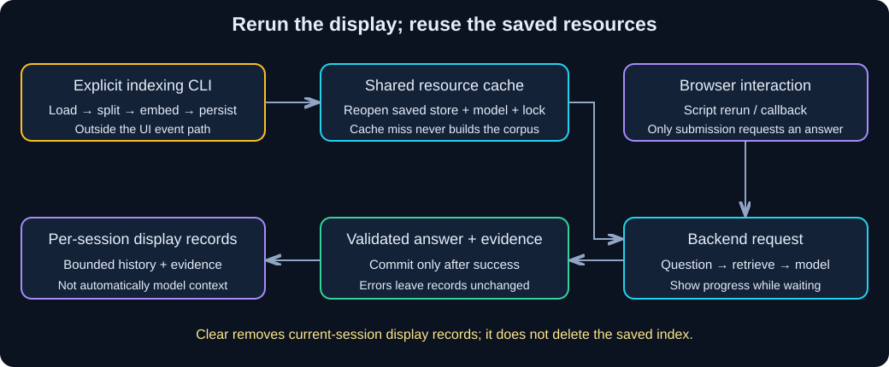

# Chapter 12 — Streaming and Interfaces: Show Progress, Preserve State

**What runs again during an interface interaction, and what state must remain separate?**

> **Your goal:** Show progress and evidence while preserving session and resource boundaries.<br>
> **You need:** [Grounded RAG](09-grounded-rag.md) and its files, response blocks from Chapter 02 and history ownership from Chapter 06.<br>
> **Effort:** 100-130 minutes, plus optional Gradio/live practice; estimated.<br>
> **You will produce:** Terminal streaming, a tested backend and a Streamlit session-clear/error demonstration. **Status:** Draft; fixture and live evidence remain separate.

**Fernwood** is the fictional organization used here for internal-note and equipment-policy questions. Use synthetic material throughout; these labs do not establish a deployed identity or authorization system.

**Starting state:** Continue `langchain-learning`. Retain the earlier RAG/index helpers; create `terminal_stream.py`, `interface_backend.py` and `streamlit_app.py` in the specified order. Gradio is optional, not a second required interface.

**Study route:** Start with offline terminal streaming, then inspect the backend before launching Streamlit. Verify evidence, safe errors, reruns and per-session clearing without re-indexing. Display history and model context are different responsibilities.

**Before executable steps:** use Python 3.11 via uv from the learner project named above, following each section's working directory. Default fixture checks make no paid model calls. Local interfaces start processes that you must stop when finished. Before optional hosted inference, choose a budget, request count, execution window and review plan; local models require their own compute allowance. Preserve private evidence and follow the chapter's cleanup/verification record below.

<details>
<summary>Reference: stable unit identity and historical verification limits</summary>

> **Unit ID:** W-LC-12 · **Capability:** AI-EVAL-01 · [Course map](../../../README.md#ordered-capability-map)
> **Status:** Draft · **Runtime:** your W-LC-00 learner project (Python 3.11 via uv) · **Contract, cleanup and verification:** [W-LC-12 record](lesson-contract.md#w-lc-12).
> **Study time:** 100–130 minutes, plus optional Gradio/live practice.  
> **Prerequisites:** [W-LC-09 — Chapter 09](09-grounded-rag.md) and its complete learner files; message blocks from Chapter 02 and history boundaries from Chapter 06.<br>
> **Central question:** What runs again when a user interacts, and what should survive that rerun?  
> **Running example:** Fernwood team-notes assistant.

</details>

[Previous core chapter](11-tools-and-agents.md) | [Workbook index](README.md) | [Next core step](13-debugging-testing-and-evaluation.md)

## Learning objectives

- Consume model text chunks in the terminal and distinguish partial from complete output.
- Build a Streamlit interface over a separately tested answer function.
- Separate cached resources, per-session displayed history, and actual model context.
- Show loading, evidence, validation failures, and safe errors without indexing on reruns.
- Clear displayed history without deleting an index or another session's state.
- Run an optional complete Gradio interface using the same backend.

## 1. Intuition: a progress board and a filing cabinet

A service desk can show “looking up your request” before it has an answer. Its progress board changes often; its filing cabinet should not be rebuilt whenever the display changes. Likewise, a UI can rerun its script when a widget changes while reusing an existing index connection.

**Streaming** delivers output in pieces before generation completes. It improves perceived responsiveness, but does not ensure a faster total response, lower cost, or correct content. A chunk can contain part of a word, no visible text, or metadata; it is not necessarily one token or one sentence.

### Pause and predict

The screen shows “The allowance is INR 12…” and then the connection fails. Is that a valid completed answer? Does displaying earlier chat turns mean the next model call receives them?

<details><summary>Reveal the reasoning</summary>

Neither follows. The text is incomplete and must be labeled interrupted. Displayed history becomes model context only when application code explicitly includes it. In this chapter, the RAG interfaces deliberately answer standalone questions independently.

</details>

## 2. Understand the mechanism



**Diagram walkthrough:**

1. Indexing remains an explicit Chapter 08 command, outside either UI.
2. Streamlit reruns the script on interaction. `st.cache_resource` reuses a backend for the selected fixture/live route; a cache miss only reopens a completed snapshot.
3. `st.session_state` holds that browser session's displayed question/answer/evidence records. It is never placed in the shared resource cache.
4. Only an explicit submission calls the backend. Retrieval and generation produce a validated response, then the UI commits a display record.
5. Clearing removes display records; it does not drop the resource cache or delete stored vectors.

| State | Owner/lifetime | Sent to the answer model? |
|---|---|---|
| Persisted Chroma snapshot | Learner project; survives server restart | Selected passage text only |
| Backend + lock | Server process resource; shared across sessions using the same cache key | No |
| Display records | Current Streamlit browser session; bounded to ten exchanges | No |
| Current question + retrieved passages | One backend request | Yes, on the live route |
| Partial terminal stream | One generation; incomplete until iteration ends | Output, not retained history |

This lesson uses standalone RAG, not Chapter 10's conversational rewrite store. A follow-up such as “And its limit?” still needs explicit conversational resolution. Adding a chat-shaped display alone does not implement memory.

## 3. Hands-on starting state

Use your separate learner project root containing `first_call.py`, `embedding_lab.py`, `retrieval_lab.py`, and `rag_lab.py`. Create the new Python files below there, outside this workbook repository.

From that root, in PowerShell:

```powershell
uv add streamlit
uv sync --locked
uv run retrieval_lab.py index --setting large --revision v1
```

Keep Chapter 09's five fictional knowledge files and completed snapshot. Neither UI loads/splits documents or builds an index. A missing snapshot produces a setup error; fix it with the explicit indexing command.

For live mode, retain Chapter 00's `.env`: hosted `MODEL_PROVIDER=openai` with an actual key, or `MODEL_PROVIDER=local` with Ollama running. Chat models remain `gpt-4o-mini` / `llama3.1:8b`; RAG embeddings remain `text-embedding-3-small` / `nomic-embed-text:v1.5`. Prepare the matching live index with `uv run retrieval_lab.py index --live --setting large --revision v1` before selecting live mode. Terminal streaming alone needs only the chat model.

## 4. Build step by step

### Step 1 — stream plain text in the terminal

**Complete runnable file — `terminal_stream.py`**

Create this file in the learner project root. It needs earlier core/provider packages, not Streamlit. The default fixture emits predefined chunks without calling a service. `--fail` deliberately interrupts the fixture; it cannot be combined with live mode.

```python
import argparse
from langchain_core.messages import AIMessageChunk, HumanMessage
from first_call import build_model, read_configuration, text_from_blocks


def fixture_chunks(fail=False):
    for index, text in enumerate(["Streaming ", "shows ", "partial ", "text."]):
        if fail and index == 2:
            raise ConnectionError("Synthetic interruption")
        yield AIMessageChunk(content=text)


def main():
    parser = argparse.ArgumentParser()
    parser.add_argument("--live", action="store_true")
    parser.add_argument("--fail", action="store_true")
    args = parser.parse_args()
    if args.live and args.fail:
        parser.error("--fail is an offline fixture only.")
    combined = ""
    try:
        if args.live:
            provider, key = read_configuration()
            chunks = build_model(provider, key).stream([
                HumanMessage(content="Explain streaming in one short sentence.")
            ])
        else:
            chunks = fixture_chunks(args.fail)
        print("PARTIAL OUTPUT: ", end="", flush=True)
        for chunk in chunks:
            text = text_from_blocks(chunk)
            print(text, end="", flush=True)
            combined += text
        if not combined.strip():
            raise ValueError("No visible text received.")
        print("\nCOMPLETE: stream ended normally; content still requires review.")
        return 0
    except Exception as exc:
        print(f"\nINTERRUPTED ({type(exc).__name__}); partial output is not a completed answer.")
        return 1


if __name__ == "__main__":
    raise SystemExit(main())
```

Run from the learner project root:

```powershell
uv run terminal_stream.py
uv run terminal_stream.py --fail
uv run terminal_stream.py --live
```

Fixture success prints `Streaming shows partial text.` followed by `COMPLETE`. The failure prints only the initial pieces, then `INTERRUPTED`, and exits nonzero. Live chunks and wording vary. The fixture does not demonstrate real network latency. `flush=True` requests immediate terminal output; buffering and rendering can still affect what you observe.

This is ordinary chat-model `.stream()`, not an agent's graph-event stream. It extracts standardized text blocks and ignores nontext blocks. Do not treat reasoning, tool-call fragments, or metadata as ordinary answer text. For structured RAG JSON, accumulate the complete response and validate it before treating it as accepted output; the following interfaces show progress and then the validated result rather than exposing raw JSON fragments as an answer.

### Step 2 — isolate a reusable, tested backend

**Complete runnable file — `interface_backend.py`**

Create this file beside `rag_lab.py`. It reuses that chapter's prompt, scripted response, and validator. The fixture knows only the fixed allowance question; other questions generally abstain. The backend accepts no chat history. A process-local lock serializes use of the shared store/model; it does not make a multi-process deployment safe by itself.

```python
from threading import RLock
from langchain_core.runnables import RunnableLambda
from first_call import build_model, read_configuration, text_from_blocks
from rag_lab import ABSTAIN, ANNUAL, PROMPT, RagAnswer, format_evidence, parse_response, scripted_response
from retrieval_lab import encoder_profile, reopen


def validate_question(question):
    if not isinstance(question, str) or not question.strip() or len(question) > 1000:
        raise ValueError("Enter a question of 1-1000 characters.")
    return question.strip()


class Backend:
    def __init__(self, live=False):
        self.lock = RLock()
        encoder, self.profile = encoder_profile(live)
        self.store = reopen(encoder, self.profile, "large", "v1")
        if live:
            provider, key = read_configuration()
            self.model = build_model(provider, key)
        else:
            self.model = RunnableLambda(scripted_response)

    def answer(self, question):
        question = validate_question(question)
        with self.lock:
            pairs = self.store.similarity_search_with_score(question, k=3)
            docs = [doc for doc, distance in pairs]
            data = format_evidence(question, docs)
            if not docs:
                result = RagAnswer(status="insufficient_evidence", answer=ABSTAIN, source_ids=[])
            else:
                response = self.model.invoke(PROMPT.invoke({"evidence": data}))
                result = parse_response(text_from_blocks(response), docs)
            evidence = [{"source_id": doc.metadata["source_id"],
                         "chunk_id": doc.metadata["chunk_id"],
                         "distance": float(distance), "text": doc.page_content}
                        for doc, distance in pairs]
            return {"question": question, "answer": result.model_dump(), "evidence": evidence}


if __name__ == "__main__":
    import json
    print(json.dumps(Backend().answer(ANNUAL), indent=2))
```

Test it before creating a UI, from the learner project root:

```powershell
uv run interface_backend.py
```

Expect status `answered`, the combined INR 12000/calendar-year limit, supporting ID `FW-EQUIPMENT-001`, and three candidate records with full passage text. Source membership and schema validation still do not establish factual support. Review claims as taught in Chapter 09. No function here calls `index`, `load_documents`, `make_chunks`, or document embedding.

### Step 3 — add Streamlit presentation

**Complete runnable file — `streamlit_app.py`**

Create this file beside the backend. It needs the `streamlit` dependency installed above. The route checkbox is app configuration, not a model instruction. Changing route clears displayed records to avoid mixing fixture and live outputs. If you change `.env` or models while the server is running, restart it so cached configuration is rebuilt.

```python
import streamlit as st
from interface_backend import Backend, validate_question

st.set_page_config(page_title="Fernwood notes", page_icon="📘")
st.title("Fernwood notes assistant")
st.caption("Ask standalone questions. Display history is not sent to the model.")
live = st.checkbox("Use configured live provider", value=False)
if st.session_state.get("route") != live:
    st.session_state.route = live
    st.session_state.records = []


@st.cache_resource
def get_backend(live):
    return Backend(live)


if st.button("Clear displayed history"):
    st.session_state.records = []


def render(record):
    with st.chat_message("user"):
        st.text(record["question"])
    with st.chat_message("assistant"):
        st.text(record["answer"]["answer"])
        st.caption("Status: " + record["answer"]["status"])
        st.write("Claimed supporting IDs:", record["answer"]["source_ids"])
        with st.expander("Retrieved candidates — review claim support"):
            for passage in record["evidence"]:
                st.caption(passage["source_id"] + " | chunk " + passage["chunk_id"])
                st.caption("Cosine distance: " + str(round(passage["distance"], 4)))
                st.text(passage["text"])


for record in st.session_state.records:
    render(record)

question = st.chat_input("Ask about Fernwood policy (maximum 1000 characters)")
if question is not None:
    try:
        question = validate_question(question)
    except ValueError:
        st.warning("Enter a question of 1-1000 characters.")
    else:
        try:
            with st.spinner("Opening saved resources, retrieving evidence, and preparing an answer…"):
                record = get_backend(live).answer(question)
        except Exception:
            st.error("The request failed. Check the matching completed index, provider configuration, "
                     "service availability, and response contract. No answer was saved; retry explicitly.")
        else:
            st.session_state.records = (st.session_state.records + [record])[-10:]
            st.rerun()
```

Launch from the learner project root:

```powershell
uv run streamlit run streamlit_app.py --server.address 127.0.0.1 --server.port 8501
```

Open the local address printed by Streamlit. Stop with Ctrl+C in that terminal. The UI keeps at most ten completed exchanges per browser session. Invalid input is rejected before resource loading. Failed requests show a generic error and commit no record. The app does not automatically retry paid calls. `st.text` displays source/model content as plain text rather than interpreting it as HTML.

`get_backend(live)` can run on a cache miss, but it only **reopens** a completed snapshot; it never indexes. `Backend` contains a lock because cached resources can be shared across users. Conversation records belong in `session_state`, not in that shared object. A process restart or cache eviction can reopen the resource again. Credentials/configuration are process-level in this demo; do not deploy this cache as a per-user credential store.

## 5. Run and verify

Start in fixture mode and ask the exact shared question:

```text
What is the annual home-office reimbursement limit?
```

| Action | Expected behavior |
|---|---|
| Submit allowance question | Spinner, then validated combined annual allowance and evidence |
| Submit VPN server-IP question | Exact abstention and empty supporting IDs; related candidates may remain visible |
| Submit whitespace or over 1000 characters | Validation message; no backend call or new record |
| Toggle route | Display records cleared; selected route needs its matching snapshot/configuration |
| Submit another question | Reuses cached resource for that route; does not rebuild documents |
| Clear displayed history | Current session's records disappear; saved Chroma snapshot remains |
| Open a separate browser session | Separate display records; resource can be shared |
| Ask “And its limit?” | No automatic conversational resolution; display history is not model context |

Use browser sessions with independent session state, such as a separate private window, for the isolation check. Visible old messages do not prove they were included in a prompt: inspect `Backend.answer`, whose inputs are only the current question and freshly retrieved passages.

The spinner is progress feedback, not token streaming. The terminal exercise demonstrates incremental text; this RAG UI waits for contract validation. If you later stream draft answers, label them provisional, handle interruption explicitly, and only save the accepted final answer after validation. Animating an already-complete answer is not model streaming.

## 6. Diagnose a failure safely

Stop the server. In your learner copy of `interface_backend.py`, temporarily change the `reopen` revision from `v1` to `missing-ui-test` (choose a revision you have not built). Restart and submit the allowance question. Expect a safe setup error, no saved response, and no index creation. Restore `v1`, restart, and rerun. Do not delete your index for this exercise.

Also run `uv run terminal_stream.py --fail`. It must report interruption after partial output. A partial display must never be silently committed as a successful RAG answer.

| Symptom | Likely cause | Diagnostic check | Repair |
|---|---|---|---|
| Indexing output on every click | Ingestion placed in UI path | Search learner UI/backend for indexing calls | Keep ingestion in explicit CLI; reopen completed snapshot only |
| Chat disappears on rerun | History stored in a local variable | Inspect `session_state.records` | Store bounded display state per session |
| One user's messages appear for another | History put in shared cache/global list | Inspect resource contents and state ownership | Keep records in per-session state |
| Old provider still used | Cached backend retains old configuration | Compare selected route and process configuration | Restart after `.env`/model changes; reopen matching profile |
| Spinner ends with error | Missing snapshot, unavailable provider, or invalid response | Run backend/Chapter 09 CLI separately | Fix failing boundary, then retry explicitly |
| Follow-up misses the topic | Display history omitted from model context by design | Inspect actual backend inputs | Ask standalone question or deliberately integrate Chapter 10 |

## 7. Optional complete Gradio interface

This is an alternative local UI over the same backend, not a prerequisite. Install its additional dependency in the learner project root:

```powershell
uv add gradio
uv sync --locked
```

**Complete runnable file — `gradio_app.py`**

Create beside `interface_backend.py`. A process-level environment variable selects the route: `WORKBOOK_LIVE=1` enables Chapter 00's configured live provider; otherwise use the fixture. The browser sends no credentials. `gr.State` owns per-session display records; no record list is stored in the backend. This app uses an explicit submit button rather than streaming chat output.

```python
import os
import gradio as gr
from interface_backend import Backend, validate_question

LIVE = os.environ.get("WORKBOOK_LIVE", "0") == "1"
backend = None


def submit(question, records):
    global backend
    records = list(records or [])
    try:
        question = validate_question(question)
    except ValueError:
        return records, "Enter a question of 1-1000 characters.", records
    try:
        if backend is None:
            backend = Backend(LIVE)
        record = backend.answer(question)
    except Exception:
        return records, "Request failed. Check index/provider/service/response contract; retry explicitly.", records
    records = (records + [record])[-10:]
    return records, "Complete. Review the answer and candidate passages in the display.", records


def build_ui():
    with gr.Blocks(title="Fernwood notes") as demo:
        gr.Markdown("# Fernwood notes assistant\nStandalone questions; display history is not model context.")
        gr.Markdown("Route: " + ("configured live provider" if LIVE else "offline scripted fixture"))
        records = gr.State([])
        question = gr.Textbox(label="Question", placeholder="What is the annual home-office reimbursement limit?")
        with gr.Row():
            ask = gr.Button("Ask")
            clear = gr.Button("Clear displayed history")
        status = gr.Textbox(label="Request status", interactive=False)
        display = gr.JSON(label="Completed answers and retrieved evidence", value=[])
        ask.click(submit, [question, records], [display, status, records],
                  concurrency_limit=1, concurrency_id="fernwood-backend", show_progress="full")
        clear.click(lambda: ([], "Displayed history cleared.", [], ""),
                    outputs=[display, status, records, question], queue=True,
                    concurrency_limit=1, concurrency_id="fernwood-backend")
    return demo


if __name__ == "__main__":
    build_ui().queue().launch(server_name="127.0.0.1", server_port=7860, share=False)
```

The shared queue concurrency group serializes submit/clear callbacks, including lazy resource creation. The backend's own lock protects its query/model work. Loading feedback comes from Gradio's queued progress indicator; the status field is updated on completion. Errors leave display state unchanged. Gradio's JSON component renders the structured evidence; it is not a claim that citations have been verified.

Launch from the learner project root, in PowerShell:

```powershell
$env:WORKBOOK_LIVE = "0"
uv run gradio_app.py
```

For live mode, stop the server, set `$env:WORKBOOK_LIVE = "1"`, and rerun after building the matching live snapshot. Open the printed local URL; stop with Ctrl+C. `share=False` creates no public sharing tunnel. Repeat the Streamlit allowance, unsupported-question, validation, clear, and session-isolation checks. Restarting loses display state, not the saved index.

## 8. Decisions and limitations

> [!IMPORTANT]
> Partial streamed text has not passed final answer validation. Keep provisional progress distinct from a completed answer, and clear stale content on failure rather than leaving an earlier result visible.

UI reruns are not conversation turns. Put model calls behind submissions, keep ingestion out of rendering, and choose state lifetimes deliberately. A shared resource cache improves reuse but requires thread-safety and a clear configuration boundary. This single-process teaching app serializes work; production capacity, cancellation, authentication, permissions, timeouts, and cleanup need further design.

Streaming reduces time to first visible text; total generation can still take just as long. Users may act on drafts before corrections arrive. For structured output, completion and validation are useful acceptance boundaries. Neither validation nor a polished interface proves grounding; keep passage inspection available.

Displayed evidence may contain sensitive data in a real application. The fictional corpus avoids that issue for the lab; a real service must authorize retrieval before display and control logs/history retention. Clear-history here removes current UI records only; it does not erase provider records, server logs, caches, or source files. The app makes no account-deletion promise.

## 9. Independent exercise

Add a visible “Standalone mode” label and demonstrate two requests: the full allowance question followed by “And its limit?” Record the backend inputs and explain why the second request does not inherit the first. Then deliberately integrate Chapter 10 in your learner copy if you want conversational behavior, keeping per-session conversation state outside the shared cache.

**Deliverables:** state-lifetime table, two request traces, clear-history behavior, and proof that reruns never invoke ingestion. **Pass:** current question is the only conversational input in standalone mode; clear removes current-session records; repeated submissions query the existing snapshot without document embedding.

<details><summary>Hint 1 — concept</summary>

A chat widget is presentation. Memory requires explicit storage and inclusion in model requests.

</details>

<details><summary>Hint 2 — narrower implementation hint</summary>

Inspect `Backend.answer(question)` and `PROMPT.invoke`: neither accepts display records. To check ingestion, intercept `embed_documents` in a learner verification script and fail if it is called during UI submissions; query embedding must remain permitted.

</details>

<details><summary>Worked reasoning</summary>

The cache contains a backend/store/model/lock. Session state contains display records. Each answer call retrieves using the current standalone question, then supplies only that question and selected passages. Clearing display records leaves the backend and snapshot intact. Conversational integration would require a separate per-session history lifecycle and rewrite step, not merely passing the shared display list into a global backend.

</details>

## 10. Knowledge checks

<details><summary>1. Is every streamed chunk one token?</summary>

No. Chunks can contain arbitrary text segments, nontext content, or metadata. Extract the content you intend to display and handle empty text.

</details>

<details><summary>2. Why is history excluded from `st.cache_resource`?</summary>

Resources may be shared across sessions. User conversation/display records need per-session ownership to avoid mixing users' state.

</details>

<details><summary>3. Does reopening an index mean rebuilding it?</summary>

No. Reopening connects to a completed snapshot. Loading, splitting, and document embedding are ingestion operations performed separately.

</details>

<details><summary>4. Why does this RAG UI show a spinner rather than raw streamed JSON?</summary>

The complete response must pass the answer contract before acceptance. Partial JSON may fail or change; a spinner communicates progress without presenting it as a valid answer.

</details>

<details><summary>5. What does Clear displayed history erase?</summary>

Current-session UI records only. It does not delete vectors, documents, provider logs, or all server state.

</details>

## 11. Revision and next step

- [ ] I streamed terminal output and observed an interrupted stream.
- [ ] I tested the backend before opening a UI.
- [ ] I can explain resource cache versus session display state versus model context.
- [ ] I tested allowance, unsupported question, invalid input, safe errors, and clearing.
- [ ] I verified no indexing occurs on reruns or submissions.
- [ ] I labeled live and optional-interface checks honestly.

The interface now exposes progress and evidence. [W-LC-13 — Chapter 13](13-debugging-testing-and-evaluation.md) turns these checks into systematic diagnosis and evaluation rather than relying on a few successful demonstrations.

## Evidence reflection

Which UI rerun/state assumption would cause duplicate work or history leakage? Explain your regression evidence and what remains visually or interactively unverified. Record the original attempt, observed result, repair and remaining uncertainty in your private learning log.

## Completion checkpoint

**You can now:** stream model output, build a Streamlit interface over a separately tested answer function, and keep cached resources, displayed history and model context apart.

**Show it:** an interface run with evidence, a safe error and per-session clearing without re-indexing. State whether each observation used fixtures or live inference. Stop UI processes with Ctrl+C after retaining your evidence; clearing display history does not delete the index or provider-held data.

**Next:** [W-LC-13 — Debugging, Testing and Evaluation](13-debugging-testing-and-evaluation.md).

## References  

Classification, effort, access and check date for these links: [W-LC source record](source-record.md).

- [LangChain models](https://docs.langchain.com/oss/python/langchain/models): standalone model streaming and message chunks.
- [Streamlit execution flow](https://docs.streamlit.io/develop/api-reference/execution-flow): rerun behavior and explicit control flow.
- [Streamlit resource cache](https://docs.streamlit.io/develop/api-reference/caching-and-state/st.cache_resource): shared-resource lifecycle and thread-safety responsibilities.
- [Gradio source and documentation](https://github.com/gradio-app/gradio): optional Blocks, State, event queues, and launch configuration; installed signatures were also inspected.
- [W-LC-09 — Chapter 09](09-grounded-rag.md): prompt/validation contract and index profiles.

