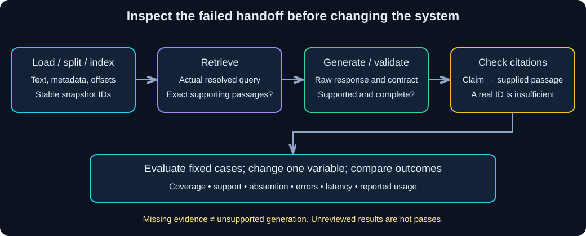

# Chapter 13 — Debugging, Testing, and Evaluation: Locate the Failed Handoff

> **Study time:** 110–150 minutes, plus optional live evaluation and evidence review.  
> **Prerequisites:** [Retrieval](08-documents-and-retrieval.md), [Grounded RAG](09-grounded-rag.md), [Conversational RAG](10-conversational-rag.md), and their complete learner files.  
> **Central question:** Which stage failed, and what evidence would show that a change helped?  
> **Running example:** Fernwood team-notes assistant.

[Previous: Streaming and Interfaces](12-streaming-and-interfaces.md) · [Index](README.md) · [Next: LangGraph and LangSmith](14-langgraph-and-langsmith.md)

## Learning objectives

- Locate failures at configuration, ingestion, retrieval, rewrite, generation, citation, and interface boundaries.
- Write offline tests for validation, metadata, session isolation, and unchanged-ingestion behavior.
- Run a separate, explicitly selected live evaluation against fixed shared cases.
- Measure retrieval coverage, answer support, citation correctness, abstention, latency, and reported usage.
- Compare one-variable changes, including changes that do not improve results.
- Demonstrate finite retries, timeout errors, and sanitized diagnostics.

## 1. Intuition: inspect the relay handoff

If a relay team drops a baton, replacing the final runner may not fix the handoff. Similarly, an incorrect assistant answer can begin with the wrong source file, a missing chunk, a misleading rewrite, unsupported generation, or a UI showing stale state.

**Debugging** explains a particular failure. **Testing** checks a specified contract repeatedly. **Evaluation** estimates usefulness and reliability on a chosen set of tasks. Passing a JSON parser test does not establish policy-answer quality; a good answer on one question does not establish session isolation.

### Pause and predict

An answer cites `FW-EQUIPMENT-001` but says INR 99999. Should you adjust the citation parser, retrieval, or answer prompt first?

<details><summary>Reveal the reasoning</summary>

Inspect the supplied passage first. If it contains INR 12000 and the necessary qualifications, retrieval succeeded and generation contradicted evidence. If it omitted the amount, retrieval coverage also failed. Source-ID membership alone cannot identify either error. Diagnose from the actual handoffs before choosing a repair.

</details>

## 2. Understand the mechanism



**Diagram walkthrough:** Start with the question and configuration. Check the loaded sources and stored chunk IDs, then the exact query and retrieved passages. Only after confirming evidence coverage should you assess generation and citations. Evaluate results against fixed cases rather than changing questions after a failure. History rewriting and UI rendering are additional boundaries, not replacements for those checks.

| Stage | Symptom | Evidence to inspect | Specific diagnostic command/check |
|---|---|---|---|
| Environment | Import/configuration failure | Interpreter, lockfile, provider configuration | `uv run python --version`; `uv sync --locked` |
| Source/chunking | Missing facts or wrong metadata | Source text, offsets, chunk IDs | `uv run retrieval_lab.py inspect --setting large` |
| Snapshot | Missing/stale/mismatched index | Profile, revision, manifest | `uv run retrieval_lab.py index --setting large --revision v1` verifies unchanged fixture snapshot |
| Retrieval | Related document but no supporting passage | Query, k, exact chunks, distances | `uv run retrieval_lab.py query --setting large --k 3 --question "What is the annual home-office reimbursement limit?"` |
| Rewrite | Correct answer to wrong topic | Original, retained history, standalone query | `uv run conversation_rag_lab.py --case compare` |
| Generation/citations | Contradictory amount or invented ID | Raw response, contract, supplied passages | `uv run rag_lab.py --case all` |
| Tools | Claimed execution without a real result | Request/result IDs, function-entry audit | `uv run tools_lab.py --mode agent --case denied` |
| Interface | Repeated calls, mixed history, stale output | Submission path, session records, cache | Run Chapter 12's backend CLI before the UI |

Run commands from your **learner project root**, not this workbook repository. These commands default to offline fixtures. Add live flags only deliberately after preparing the matching profile. Do not print `.env`, keys, complete provider error bodies, or private prompts to diagnose configuration.

## 3. Hands-on starting state

Keep previous learner files unchanged. Create `test_workbook.py`, `evaluate_rag.py`, and `retry_lab.py` in your separate learner project. Tests use real temporary Chroma stores and the fictional corpus. They do not require a live service.

From the learner project root, in PowerShell:

```powershell
uv add --dev pytest
uv add httpx
uv sync --locked
uv run retrieval_lab.py index --setting small --revision v1
uv run retrieval_lab.py index --setting large --revision v1
```

`pytest` is a development dependency; `httpx` is explicitly declared for the retry example even if already installed transitively. Other packages come from Chapters 07–10. For optional live evaluation, prepare each configuration with the same commands plus `--live`, using Chapter 00's configured hosted or local route. Indexing has its own document-embedding cost and must not occur inside the evaluation query loop.

## 4. Build step by step

### Step 1 — test contracts without model services

**Complete runnable file — `test_workbook.py`**

Create in the learner project root. Run with pytest, not as a normal application. `tmp_path` gives the ingestion test its own directory; copying the five fictional sources does not modify your source/index directories. Monkeypatching restores module state after the test.

```python
import json
import shutil

import pytest
from langchain_core.documents import Document
from pydantic import ValidationError

import retrieval_lab as retrieval
from conversation_rag_lab import ConversationRag, MAX_TURNS
from rag_lab import ABSTAIN, RagAnswer, parse_response


@pytest.mark.parametrize("payload", [
    {"status": "unknown", "answer": "x", "source_ids": []},
    {"status": "answered", "answer": "x", "source_ids": []},
    {"status": "insufficient_evidence", "answer": "No idea", "source_ids": []},
    {"status": "insufficient_evidence", "answer": ABSTAIN, "source_ids": ["invented"]},
])
def test_invalid_answer_contract(payload):
    with pytest.raises(ValidationError):
        RagAnswer.model_validate(payload)


def test_source_membership_is_not_truth():
    doc = Document(page_content="The cap is INR 12000.",
                   metadata={"source_id": "FW-EQUIPMENT-001"})
    payload = {"status": "answered", "answer": "The cap is INR 99999.",
               "source_ids": ["invented"]}
    with pytest.raises(ValueError):
        parse_response(json.dumps(payload), [doc])
    payload["source_ids"] = ["FW-EQUIPMENT-001"]
    # This passes membership despite the false amount: a documented limitation.
    assert parse_response(json.dumps(payload), [doc]).status == "answered"


def test_chunk_metadata_and_offsets():
    sources = {doc.metadata["source"]: doc for doc in retrieval.load_documents()}
    chunks = retrieval.make_chunks("large")
    assert chunks and len({doc.metadata["chunk_id"] for doc in chunks}) == len(chunks)
    for chunk in chunks:
        source = sources[chunk.metadata["source"]]
        start = chunk.metadata["start_index"]
        assert start >= 0
        assert source.page_content[start:start + len(chunk.page_content)] == chunk.page_content
        assert chunk.metadata["source_id"] == source.metadata["source_id"]
        assert chunk.metadata["effective_date"] == source.metadata["effective_date"]


def test_sessions_are_isolated_and_bounded():
    app = ConversationRag(store=None)  # State-only test; never invokes a model/store.
    app.remember("A", "Equipment topic", "Topic acknowledged")
    app.remember("B", "VPN topic", "Topic acknowledged")
    assert app.sessions["A"] is not app.sessions["B"]
    for number in range(MAX_TURNS + 1):
        app.remember("A", "Turn " + str(number), "Acknowledged")
    assert len(app.sessions["A"]) == MAX_TURNS
    assert app.sessions["B"][0]["user"] == "VPN topic"
    app.clear("A")
    assert "A" not in app.sessions and "B" in app.sessions
    assert ConversationRag(store=None).sessions == {}


def test_unchanged_ingestion_and_query_do_not_reembed(tmp_path, monkeypatch):
    shutil.copytree(retrieval.ROOT / "knowledge", tmp_path / "knowledge")
    monkeypatch.setattr(retrieval, "ROOT", tmp_path)

    class CountingEmbeddings(retrieval.HashEmbeddings):
        def __init__(self):
            self.document_batches = 0

        def embed_documents(self, texts):
            self.document_batches += 1
            return super().embed_documents(texts)

    encoder = CountingEmbeddings()
    profile = "fixture-test-dedup-v1"
    retrieval.index(encoder, profile, "large", "v1")
    before = encoder.document_batches
    store = retrieval.reopen(encoder, profile, "large", "v1")
    ids = set(store.get(include=[])["ids"])
    assert before > 0 and ids
    retrieval.index(encoder, profile, "large", "v1")
    assert encoder.document_batches == before
    assert set(store.get(include=[])["ids"]) == ids

    def forbid_document_embedding(texts):
        raise AssertionError("Query attempted document embedding")

    monkeypatch.setattr(encoder, "embed_documents", forbid_document_embedding)
    reopened = retrieval.reopen(encoder, profile, "large", "v1")
    assert reopened.similarity_search("annual home-office reimbursement limit", k=1)
```

Run from the learner project root:

```powershell
uv run pytest -q test_workbook.py
```

Expect eight passing test items (the parametrized test expands into four). A failure is useful evidence: inspect its boundary rather than loosening the assertion to match a bug. The source-membership limitation test intentionally shows what validation cannot prove; it is not an endorsement of the false answer. The duplicate-ingestion test checks both stable record IDs and skipped document embedding, since unchanged record count alone could hide expensive repeated upserts.

### Step 2 — collect evaluation evidence separately

**Complete runnable file — `evaluate_rag.py`**

Create beside the previous learner scripts. This evaluates the four-case **subset** already used in Chapter 08: A02, A04, A06, U03. Expand to all cases in [shared materials](shared-materials.md) before claiming broader coverage. The fixture answers only A02; its other abstentions are not a useful quality baseline for a general model.

```python
import argparse
import json
import re
from pathlib import Path
from time import perf_counter

from langchain_core.runnables import RunnableLambda
from first_call import build_model, read_configuration, text_from_blocks
from rag_lab import ABSTAIN, PROMPT, RagAnswer, format_evidence, parse_response, scripted_response
from retrieval_lab import CASES, encoder_profile, reopen

GOLD = {
    "A02": {"source": "FW-EQUIPMENT-001", "terms": ["INR 12000", "per calendar year", "combined"]},
    "A04": {"source": "FW-EQUIPMENT-001", "terms": ["itemized receipt", "People Operations", "30 calendar days", "after purchase"]},
    "A06": {"source": "FW-VPN-001", "terms": ["error code", "#it-help", "Never disable", "share a password"]},
    "U03": {"source": None, "terms": []},
}


def collect(store, model, case_id, question, k):
    started = perf_counter()
    row = {"case_id": case_id, "question": question, "k": k,
           "expected_answerable": GOLD[case_id]["source"] is not None,
           "review": {"retrieval_support": None, "answer_support": None,
                      "citation_correctness": None, "notes": "Not yet reviewed"}}
    try:
        pairs = store.similarity_search_with_score(question, k=k)
        docs = [doc for doc, distance in pairs]
        retrieval_done = perf_counter()
        evidence = [{"source_id": doc.metadata["source_id"],
                     "chunk_id": doc.metadata["chunk_id"], "distance": float(distance),
                     "text": doc.page_content} for doc, distance in pairs]
        row["evidence"] = evidence
        gold = GOLD[case_id]
        matching = [doc.page_content for doc in docs if doc.metadata["source_id"] == gold["source"]]
        row["source_hit_proxy"] = bool(matching) if gold["source"] else None
        # Union of matching passages, not proof that a single chunk or answer is sufficient.
        text = "\n".join(matching).lower()
        row["required_terms_proxy"] = all(term.lower() in text for term in gold["terms"]) if gold["source"] else None
        data = format_evidence(question, docs)
        row["usage"] = None
        if docs:
            response = model.invoke(PROMPT.invoke({"evidence": data}))
            row["usage"] = response.usage_metadata
            row["raw_response"] = text_from_blocks(response)
            result = parse_response(row["raw_response"], docs)
        else:
            result = RagAnswer(status="insufficient_evidence", answer=ABSTAIN, source_ids=[])
        row["answer"] = result.model_dump()
        row["abstained"] = result.status == "insufficient_evidence"
        row["contract_valid"] = True
        row["retrieval_seconds"] = retrieval_done - started
    except Exception as exc:
        row["contract_valid"] = False
        row["error_type"] = type(exc).__name__  # Never serialize raw provider exceptions.
    row["total_seconds"] = perf_counter() - started
    return row


def main():
    parser = argparse.ArgumentParser()
    parser.add_argument("--live", action="store_true")
    parser.add_argument("--setting", choices=["small", "large"], default="large")
    parser.add_argument("--k", type=int, default=3)
    parser.add_argument("--revision", default="v1")
    parser.add_argument("--output", type=Path, required=True)
    args = parser.parse_args()
    if args.output.exists():
        parser.error("Output exists; choose a new filename to preserve the previous run.")
    if not 1 <= args.k <= 20 or not re.fullmatch(r"[A-Za-z0-9_-]{1,32}", args.revision):
        parser.error("Use k 1-20 and a revision of 1-32 letters, digits, _ or -.")
    try:
        encoder, profile = encoder_profile(args.live)
        store = reopen(encoder, profile, args.setting, args.revision)
        if args.live:
            provider, key = read_configuration()
            model = build_model(provider, key)
        else:
            model = RunnableLambda(scripted_response)
        with args.output.open("x", encoding="utf-8") as output:
            for case_id, question in CASES:
                row = collect(store, model, case_id, question, args.k)
                row.update({"profile": profile, "setting": args.setting,
                            "revision": args.revision, "fixture": not args.live,
                            "chat_model": getattr(model, "model_name", getattr(model, "model", "scripted"))})
                output.write(json.dumps(row, ensure_ascii=False) + "\n")
                output.flush()
                print(case_id, "valid:", row["contract_valid"], "seconds:", round(row["total_seconds"], 3))
        print("Saved evidence; semantic review is still required:", args.output)
        return 0
    except Exception as exc:
        print(f"Evaluation setup/write failed ({type(exc).__name__}); check index, provider, and output path.")
        return 1


if __name__ == "__main__":
    raise SystemExit(main())
```

Run the offline collector independently of pytest, from the learner project root:

```powershell
uv run evaluate_rag.py --setting large --k 3 --output fixture-large-k3.jsonl
```

Expect four rows; review fields start as `null`, not automatic passes. Row-level errors remain in the dataset and the collector continues. Successful file writing exits zero even if some rows failed: count `contract_valid=false` separately. Setup/write failure exits nonzero. Existing output names are rejected before evaluation, avoiding accidental overwrite and unnecessary paid calls.

For explicitly selected live evaluation after creating the matching live index:

```powershell
uv run evaluate_rag.py --live --setting large --k 3 --output live-large-k3.jsonl
```

This makes four query-embedding calls and up to four chat calls, with no document embedding. Hosted calls can incur cost; local calls consume resources and require running models. There is no automatic retry in this collector. Keep private credentials out of evaluation files. The records contain fictional source and model text; use access/retention controls for real data.

### Step 3 — demonstrate timeouts and finite retries

**Complete runnable file — `retry_lab.py`**

Create in the learner project root. This uses HTTPX's actual exception/timeout configuration with a **simulated transport**; no network server or model is contacted. The transport injects timeout errors, so this is not a measurement of real socket deadline enforcement. It retries only read-only lookup-style requests and only the listed transient failure classes/statuses.

```python
import argparse
import httpx


def lookup(client, attempts=2):
    if not 1 <= attempts <= 3:
        raise ValueError("Use 1-3 attempts.")
    for attempt in range(1, attempts + 1):
        try:
            response = client.get("https://fixture.invalid/notes")
            response.raise_for_status()
            return response.json()
        except (httpx.TimeoutException, httpx.NetworkError) as exc:
            retryable = True
            category = type(exc).__name__
        except httpx.HTTPStatusError as exc:
            retryable = exc.response.status_code in (429, 502, 503, 504)
            category = "HTTPStatusError"
        print("Attempt", attempt, "failed:", category)  # No URL, credentials, or response body.
        if not retryable or attempt == attempts:
            raise RuntimeError("Lookup failed within its retry budget.") from None


def main():
    parser = argparse.ArgumentParser()
    parser.add_argument("--case", choices=["recover", "timeout", "fatal"], default="recover")
    args = parser.parse_args()
    count = 0

    def transport(request):
        nonlocal count
        count += 1
        if args.case == "fatal":
            return httpx.Response(400, json={"internal": "must not be logged"})
        if args.case == "timeout" or count == 1:
            raise httpx.ReadTimeout("Synthetic detail must not be logged", request=request)
        return httpx.Response(200, json={"status": "ok"})

    try:
        with httpx.Client(transport=httpx.MockTransport(transport),
                          timeout=httpx.Timeout(0.05), follow_redirects=False) as client:
            print(lookup(client, attempts=2))
        return 0
    except RuntimeError:
        print("Lookup unavailable; no fabricated result.")
        return 1
    finally:
        print("Transport attempts:", count)


if __name__ == "__main__":
    raise SystemExit(main())
```

From the learner project root:

```powershell
uv run retry_lab.py --case recover
uv run retry_lab.py --case timeout
uv run retry_lab.py --case fatal
```

Expect two attempts then success; two attempts then nonzero failure; and one attempt then nonzero failure, respectively. The tiny fixture makes no retry delay. Real transient-service recovery should add bounded backoff/jitter and respect service retry guidance; delay also counts toward total latency. A per-operation timeout is not an end-to-end deadline: attempts, queue waits, and retries add up. Do not blindly retry writes or payments. SDK retries multiplied by your outer retry loop can exceed the intended budget; Chapter 00's hosted model sets `max_retries=0` and a 30-second timeout, while local client timeout is 180 seconds. Record both layers before changing them.

## 5. Measure and review

Use the captured rows and the shared golden-case table. Review each row **before** averaging. Leave unreviewed judgments `null`; never turn missing data into a pass. Put 1 for pass, 0 for fail, or a reasoned `not_applicable` in a learner review copy, and preserve the original collected run.

| Measure | How to judge/calculate | Important limit |
|---|---|---|
| Retrieval source-hit proxy | Rows with expected source among retrieved IDs / answerable rows | Right document may contain the wrong chunk |
| Passage support | Human-reviewed answerable rows with all required facts in supplied passages / answerable rows | Check qualifications, contradictions, and source currency |
| Required-terms proxy | Runner's case-insensitive term coverage across matching passages | Lexical proxy; not semantic proof, and terms may span chunks |
| Answer support | Reviewed answered rows whose every factual claim is supported / reviewed answered rows | Report correct completeness separately; a supported but incomplete answer can fail the task |
| Citation correctness | Claimed source references that support their associated claims / reviewed claimed references | Valid ID membership is weaker; avoid credit for irrelevant real sources |
| Unsupported abstention | Unsupported rows with contract-valid abstention / unsupported rows | Related passages must not justify invented facts |
| False abstention | Answerable rows that abstain / answerable rows | Diagnose whether evidence was missing or generation failed |
| Latency | Per-row retrieval and total seconds; report median/range and errors | Setup/index time excluded; fixture timing is not live performance |
| Usage | Record `usage` as reported per chat response; aggregate only compatible reported fields | `null` means unavailable, not zero; embedding usage/cost not captured here |

Report numerators/denominators, failed rows, unreviewed rows, and `not_applicable` rows. For no cited references, citation accuracy has no denominator: report N/A rather than 100%. Never drop parser/timeouts from the report to make quality appear better. Separate “contract-valid,” “factually supported,” and “answers the task completely.”

For A02, check INR 12000, **per calendar year**, **combined** across eligible items. For A04, check itemized receipt, People Operations, and 30 calendar days after purchase. For A06, check error code, #it-help, and no disabling MFA/sharing passwords. U03 has no IP evidence and should abstain. The fixture's A04/A06 abstentions are expected limitations, not model-quality failures you can fix by tweaking an LLM prompt.

**Worked review — author's large/k=3 fixture run:** required-terms coverage was 3/3 answerable cases. Only A02 was answered; its supplied allowance passage supported the complete answer and its single claimed source, giving answer support 1/1 answered rows and citation correctness 1/1 claimed references after manual review. U03 abstained correctly (1/1 unsupported cases), but A04 and A06 also abstained (false abstention 2/3 answerable cases). All four rows were contract-valid. Thus high retrieval coverage coexisted with poor overall task completion. Usage was unavailable, not zero. These counts describe this tiny scripted run only.

### Exact equality versus semantic judgment

Exact equality suits IDs, status values, schema keys, the required abstention sentence, and deterministic arithmetic. It is usually too strict for paraphrased answers: “within thirty calendar days” can express the same policy as “within 30 calendar days.” Semantic review must still preserve amount, period, scope, recipient, negation, and timing.

An LLM judge can help apply a rubric but can be inconsistent, biased toward style, fooled by injected text, or wrong about evidence. Give it question, source passages, answer, and explicit criteria; compare a sample against human judgments and inspect disagreements. Repeated judgments do not manufacture ground truth. Record judge model/prompt/version, separate judge cost, and uncertain outcomes. No paid judge or LangSmith account is required for this chapter.

## 6. Change one variable and compare

First hold corpus, profile, revision, k, cases, and fixture responder constant, changing **only chunk setting**:

```powershell
uv run evaluate_rag.py --setting small --k 3 --output fixture-small-k3.jsonl
uv run evaluate_rag.py --setting large --k 3 --output fixture-large-k3-repeat.jsonl
```

In Chapter 08's author fixture comparison, required passage coverage was 2/3 small versus 3/3 large across A02/A04/A06. Recheck the captured passages; a source hit alone would conceal the missed receipt details. A coverage improvement does not automatically improve this scripted responder's A04/A06 answers, since it does not implement those answers.

Now hold the large setting constant and change **only k**:

```powershell
uv run evaluate_rag.py --setting large --k 1 --output fixture-large-k1.jsonl
uv run evaluate_rag.py --setting large --k 3 --output fixture-large-k3-comparison.jsonl
```

Chapter 09 already observed that A02 at k=1 had enough allowance evidence. More passages need not improve that answer and can add irrelevant context. Record a non-improving result honestly: same supported answer, more supplied characters, and possibly different latency. Do not claim extra passages always help or infer live quality from fixture retrieval.

| Run | Changed variable | Coverage / answer / abstention | Evidence size and latency | Decision |
|---|---|---|---|---|
| Baseline | None | Record actual counts and review outcomes | Record rows | Keep as reference |
| Candidate | One named variable | Record improvements **and regressions** | Compare same case set | Accept, reject, or collect more evidence |
| Non-improving change | Larger k for an already-covered case | Same supported answer is no improvement | Note extra context | Prefer simpler choice unless broader cases justify it |

For live comparisons, use explicit `--live` on both runs and the same model/configuration. Outputs may vary even at temperature zero. Repeat a small fixed set when results are unstable; report spread and disagreements rather than declaring a winner from one changed sentence. This four-case sample is too small to estimate general reliability or make strong statistical claims.

## 7. Diagnose and repair a failure

Use A04 to practice: inspect whether the receipt/deadline passage was supplied. If not, diagnose retrieval coverage and compare chunking/k. If supplied but the model omits the deadline, diagnose generation completeness. If the answer names a real source whose supplied passage lacks the deadline, diagnose citation support too. A single row can have multiple failed stages.

For a deliberate contract failure in your learner copy, temporarily change `source_ids` in the Chapter 09 scripted answer to an invented ID. Run the evaluator: A02 should record `contract_valid=false` and `error_type=ValueError`, while preserving retrieved evidence for diagnosis. Restore the fixture and rerun to a **new filename**. Do not “fix” the test by allowing unknown sources.

Use the retry example to distinguish transient timeout recovery from a permanent bad request. Preserve failed-run evidence, repair one cause, and rerun the same case. A safe diagnostic names the stage, case ID, configuration, and error category; it does not need a raw secret-bearing stack trace or provider body.

## 8. Independent exercise

Extend the collector to all eight answerable and five unsupported cases in [shared materials](shared-materials.md). Add a human-review rubric for every case before changing the system. Compare one parameter, include at least one non-improving or regressing case, and retain both datasets.

**Deliverables:** offline test results, run configuration, per-case evidence/review table, metric numerators/denominators, latency/usage availability, and a justified accept/reject decision. **Pass:** no unsupported numeric fact is credited; parser failures are visible; each proposed repair names its failed stage; untested live results remain labeled untested.

<details><summary>Hint 1 — concept</summary>

Coverage and abstention answer different questions. Improving nearest-document hits may still leave the required fact missing.

</details>

<details><summary>Hint 2 — narrower implementation hint</summary>

Extend `CASES` locally and `GOLD` together; the current collector imports only the four Chapter 08 cases. Required terms are diagnostics, not the final rubric. Preserve exact shared questions and source IDs. Do not teach the fixture all answers and describe that as model evaluation.

</details>

<details><summary>Worked reasoning</summary>

An unsupported retirement-percentage question must abstain even if a handbook chunk is returned. A documentation-retention question must not substitute the 90-day review cycle for retention duration. A supported paraphrase of orientation time can pass semantic review without exact prose equality, but a missing sender fails completeness. These distinctions require per-case judgments before a meaningful aggregate score.

</details>

## 9. Knowledge checks

<details><summary>1. Why test both record IDs and embedding calls on repeated ingestion?</summary>

An upsert can preserve record count while re-embedding every document. Stable IDs alone do not prove unchanged ingestion is skipped.

</details>

<details><summary>2. Does a retrieval source hit prove passage coverage?</summary>

No. A different chunk from the same document may omit the needed fact. Inspect the exact supplied passages.

</details>

<details><summary>3. What does unavailable usage mean?</summary>

It means usage was not reported/captured, not that the request used zero tokens or had zero cost. This collector also omits embedding usage.

</details>

<details><summary>4. Why can raising k be a non-improving change?</summary>

The needed passage may already be present. Extra passages can add context cost and distraction without changing support or completeness.

</details>

<details><summary>5. Why not retry every error?</summary>

Invalid inputs and permanent bad requests need correction, while repeated writes can duplicate side effects. Restrict retries to known transient failures, bound attempts, and account for inner SDK retries and timeouts.

</details>

## 10. Revision and next step

- [ ] I can locate a failure from its recorded handoffs.
- [ ] I ran offline contract/metadata/isolation/ingestion tests without a model service.
- [ ] I kept live evaluation explicitly separate from offline tests.
- [ ] I reviewed support and citations independently of schema validity.
- [ ] I reported abstention, failed rows, latency, and unavailable usage honestly.
- [ ] I compared one-variable changes, including a non-improving result.
- [ ] I observed timeout recovery, exhausted retries, and a non-retried bad request.

The pipeline is now measurable without an external evaluation account. [Chapter 14](14-langgraph-and-langsmith.md) introduces optional explicit graph control and trace inspection while keeping these offline checks useful.

## References  

- [pytest monkeypatch documentation](https://docs.pytest.org/en/stable/how-to/monkeypatch.html): scoped dependency replacement and cleanup.
- [LangChain testing overview](https://docs.langchain.com/oss/python/langchain/test): testing application behavior separately from service integration.
- [LangSmith evaluation concepts](https://docs.langchain.com/langsmith/evaluation-concepts): datasets and evaluator responsibilities; an account is optional here.
- [HTTPX timeout documentation](https://www.python-httpx.org/advanced/timeouts/): per-operation timeout behavior.
- [Shared materials](shared-materials.md): corpus, golden cases, and evaluation log.

