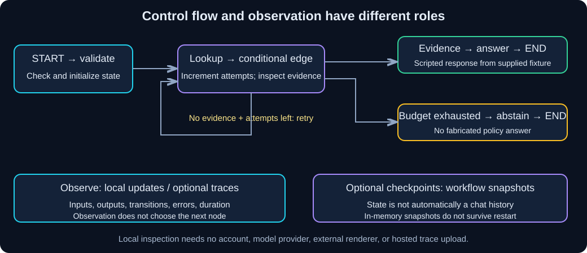

# Chapter 14 — LangGraph and LangSmith: Control Flow and Observation (Optional)

> **Unit ID:** W-LC-14 · **Capability:** AI-GRAPH-01 · [Course map](../../../README.md#ordered-capability-map)
> **Status:** Draft · **Runtime:** your W-LC-00 learner project (Python 3.11 via uv) · **Contract, cleanup and verification:** [W-LC-14 record](lesson-contract.md#w-lc-14).

> **Study time:** 70–100 minutes, plus optional hosted tracing.  
> **Prerequisites:** Python functions/dictionaries, [W-LC-05 — Chains and Runnables](05-chains-and-runnables.md), and [W-LC-13 — Debugging and Evaluation](13-debugging-testing-and-evaluation.md).<br>
> **Central question:** What controls the next step, and what records what happened?  
> **Running example:** Fernwood team-notes assistant.

[W-LC-13 — Previous: Debugging and Evaluation](13-debugging-testing-and-evaluation.md) · [Index](README.md) · [W-LC-15 — Next: Guided Integration](15-guided-integration-lab.md)

**Optional route:** You can skip this chapter and proceed to Chapter 15. The core workbook, integration lab, and assessment must not depend on this chapter's code or a LangSmith account. The complete local lab below needs neither a model service nor an external account.

For the required deeper course route after this optional introduction, continue to [SG-GRAPH-00](../../../study-guides/stateful-orchestration/README.md) and [W-GRAPH-01](../../langgraph/approval-workflow/README.md): durable SQLite checkpoints, approval/revocation, crash recovery and independent quorum work. The original Fernwood integration still does not depend on this optional chapter.

## Learning objectives

- Explain LangChain composition, LangGraph control flow, and LangSmith observation as distinct responsibilities.
- Build a graph with explicit state, nodes, fixed edges, and a bounded conditional retry path.
- Inspect local node updates and distinguish workflow state, messages, and checkpoints.
- Optionally trace the fictional workflow with LangSmith and explain what data is uploaded.
- Identify advanced persistence and corrective-RAG topics that require further study.

## 1. Intuition: route map and journey log

A route map decides where a delivery goes next. A journey log records where it actually went and how long it took. Reading a log does not move the delivery; having a route map does not prove the delivered contents were correct.

**LangGraph** makes workflow steps and transitions explicit. **LangSmith** records execution traces for inspection and can support evaluation workflows. **LangChain** supplies models, tools, prompts, and composition; Chapter 11's `create_agent` already used LangGraph underneath. You do not need to rewrite every simple chain as a custom graph.

| Responsibility | Example | This lesson |
|---|---|---|
| Composition | Prompt → model → parser | Earlier chapters; can be used inside a graph node |
| Control flow | Lookup → retry, answer, or abstain | Explicit LangGraph nodes and conditional edges |
| Observation | Inspect inputs, outputs, errors, duration | Local updates; optional LangSmith trace tree |
| Quality judgment | Is the answer supported and complete? | Chapter 13's evidence rubric; traces alone cannot decide |

### Pause and predict

A trace shows that the answer node ran successfully. Does that prove its policy answer is correct? Does saving graph state mean it contains a chat history?

<details><summary>Reveal the reasoning</summary>

No to both. Successful execution can produce a wrong answer. State contains only the fields you define; this graph has no message list. A checkpoint saves workflow state, not an automatic conversation or proof of truth.

</details>

## 2. Understand the mechanism



**Diagram walkthrough:**

1. `START` enters a validation node; invalid questions stop with an error.
2. A lookup node increments an attempt counter and returns either fictional evidence or an empty string.
3. A conditional edge selects answer when evidence exists, lookup again when the attempt budget permits, or abstention when it is exhausted.
4. Answer/abstention nodes lead to `END`. Updates describe what each node changed, not streamed model tokens.
5. Optional checkpoints record state snapshots; optional tracing records execution spans. Neither defines a new transition.

**State** is the current workflow data. A **node** reads state and returns a partial update. An **edge** selects the next node. **Compilation** checks the graph structure and creates the runnable. A **reducer** determines how updates combine; without a custom reducer, this lesson's field updates replace previous values. `TypedDict` documents field types but does not enforce input validation at runtime, so the validation node checks explicitly.

## 3. Hands-on starting state

Use your separate learner project root containing `pyproject.toml`; create `graph_lab.py` there, outside this workbook repository. This lab is self-contained and does not import earlier learner scripts or read a vector index.

From that learner project root, in PowerShell:

```powershell
uv add langgraph langsmith python-dotenv
uv sync --locked
```

These may already be installed transitively; declaring them directly makes the imports explicit. No OpenAI/Ollama model, embedding call, LangSmith account, or API key is needed for local runs. The deterministic lookup and answer are **fixtures**, not semantic retrieval or generated policy reasoning. They isolate graph mechanics.

## 4. Build step by step

Read the file in four passes: `WorkflowState`, node functions, `route`, and `build_graph`. Then inspect `main` to see the difference between local updates, checkpoint inspection, and optional tracing.

**Complete runnable file — `graph_lab.py`**

Create this file in your learner project root. It uses the allowance example from [shared materials](shared-materials.md), but its question matching is intentionally exact and its answer is scripted. `retry` simulates a first lookup miss, while `missing` simulates no evidence on either attempt. No graph node makes a network request.

```python
import argparse
import json
import os
from pathlib import Path
from typing import Literal, TypedDict
from uuid import uuid4

from dotenv import load_dotenv
from langgraph.checkpoint.memory import InMemorySaver
from langgraph.graph import END, START, StateGraph
from langsmith import tracing_context

QUESTION = "What is the annual home-office reimbursement limit?"
ABSTAIN = "I don't have reliable information on that in the provided documents."
PASSAGE = ("Each employee may request reimbursement of up to INR 12000 per calendar "
           "year for a monitor, keyboard, or ergonomic chair. This is one combined "
           "annual limit, not a separate limit for each item.")
MAX_ATTEMPTS = 2


class WorkflowState(TypedDict):
    question: str
    scenario: Literal["answer", "retry", "missing"]
    attempts: int
    passage: str
    answer: str
    source_ids: list[str]


def validate(state):
    question = state["question"]
    if not isinstance(question, str) or not question.strip() or len(question) > 1000:
        raise ValueError("Use a question of 1-1000 characters.")
    if state["scenario"] not in ("answer", "retry", "missing") or state["attempts"] != 0:
        raise ValueError("Start a fresh workflow with a known scenario and zero attempts.")
    return {"question": question.strip(), "passage": "", "answer": "", "source_ids": []}


def lookup(state):
    attempt = state["attempts"] + 1
    available = (state["question"] == QUESTION and state["scenario"] != "missing"
                 and not (state["scenario"] == "retry" and attempt == 1))
    return {"attempts": attempt, "passage": PASSAGE if available else ""}


def route(state):
    if state["passage"]:
        return "answer"
    if state["attempts"] < MAX_ATTEMPTS:
        return "retry"
    return "abstain"


def answer(state):
    if state["passage"] != PASSAGE:
        raise ValueError("Fixture answer requires the exact supplied allowance passage.")
    return {"answer": "Up to INR 12000 per calendar year, combined across eligible items.",
            "source_ids": ["FW-EQUIPMENT-001"]}


def abstain(state):
    return {"answer": ABSTAIN, "source_ids": []}


def build_graph(checkpointer=None):
    builder = StateGraph(WorkflowState)
    builder.add_node("validate", validate)
    builder.add_node("lookup", lookup)
    builder.add_node("answer", answer)
    builder.add_node("abstain", abstain)
    builder.add_edge(START, "validate")
    builder.add_edge("validate", "lookup")
    builder.add_conditional_edges("lookup", route,
                                  {"answer": "answer", "retry": "lookup", "abstain": "abstain"})
    builder.add_edge("answer", END)
    builder.add_edge("abstain", END)
    return builder.compile(checkpointer=checkpointer)


def initial_state(scenario, question=QUESTION):
    return {"question": question, "scenario": scenario, "attempts": 0,
            "passage": "", "answer": "", "source_ids": []}


def main():
    parser = argparse.ArgumentParser()
    parser.add_argument("--case", choices=["answer", "retry", "missing"], default="answer")
    parser.add_argument("--question", default=QUESTION)
    parser.add_argument("--checkpoint", action="store_true")
    parser.add_argument("--trace", action="store_true")
    parser.add_argument("--show-graph", action="store_true")
    parser.add_argument("--limit", type=int, default=10)
    args = parser.parse_args()
    if not 1 <= args.limit <= 30:
        parser.error("Use a recursion limit of 1-30.")
    load_dotenv(Path(__file__).resolve().parent / ".env", override=False)
    if args.trace:
        key = os.environ.get("LANGSMITH_API_KEY", "").strip()
        if not key or key.startswith("<"):
            parser.error("Optional tracing needs your private LANGSMITH_API_KEY.")
    graph = build_graph(InMemorySaver() if args.checkpoint else None)
    config = {"recursion_limit": args.limit, "run_name": "fernwood-graph-lab"}
    if args.checkpoint:
        config["configurable"] = {"thread_id": str(uuid4())}
    if args.show_graph:
        print(graph.get_graph().draw_mermaid())  # Local text; no image service.
    final = initial_state(args.case, args.question)
    try:
        # Explicitly disables hosted tracing for local runs, even if env tracing is on.
        with tracing_context(enabled=args.trace,
                             project_name=os.environ.get("LANGSMITH_PROJECT", "fernwood-graph-lab")):
            for update in graph.stream(final, config=config, stream_mode="updates"):
                print("NODE UPDATE:", json.dumps(update))
                # Safe for this sequential graph with replace-only fields, not a generic reducer.
                for patch in update.values():
                    final.update(patch)
            print("FINAL:", json.dumps(final))
            if args.checkpoint:
                snapshot = graph.get_state(config)
                print("CHECKPOINT ATTEMPTS:", snapshot.values["attempts"])
                print("PENDING NODES:", snapshot.next)
        if args.trace:
            print("Tracing requested; verify delivery in your configured LangSmith project.")
        return 0
    except Exception as exc:
        print(f"Graph stopped ({type(exc).__name__}); no completed answer accepted. "
              "Inspect local node updates and the execution limit.")
        return 1


if __name__ == "__main__":
    raise SystemExit(main())
```

The local `final.update` mirror is valid because these nodes execute sequentially and every field uses replacement semantics. For concurrent nodes or custom reducers, use LangGraph's own final state rather than assuming dictionary update reproduces state combination. The program uses `stream` once; it does not call `invoke` afterward and accidentally execute the workflow a second time.

## 5. Run and inspect locally — no account required

From the learner project root, in PowerShell:

```powershell
uv run graph_lab.py --case answer --show-graph
uv run graph_lab.py --case retry
uv run graph_lab.py --case missing --checkpoint
```

| Case | Node sequence | Final attempt count / outcome |
|---|---|---|
| `answer` | validate → lookup → answer | 1 / supported scripted allowance |
| `retry` | validate → lookup → lookup → answer | 2 / supported scripted allowance |
| `missing` | validate → lookup → lookup → abstain | 2 / exact abstention and no source IDs |

For retry, the first lookup update should contain `attempts: 1` and an empty passage. The next lookup supplies the passage and `attempts: 2`. That sequence is evidence of the conditional path; final prose alone would not reveal it. `--show-graph` prints Mermaid source describing structure, including possible paths that may not run. It requires no external renderer.

The domain bound is `MAX_ATTEMPTS=2`. `recursion_limit=10` is an additional graph-superstep guard, not ten model calls or a timeout. This graph has no model calls. A finite count does not cancel a hanging node; real service nodes still need timeout/retry policy as taught in Chapter 13.

### State, messages, and checkpoints

| Concept | This graph | What to avoid assuming |
|---|---|---|
| Workflow state | Question, scenario, counter, passage, answer, source IDs | All state is automatically sent to a model |
| Chat messages | None | Graph state is inherently conversation history |
| Checkpoint | Optional saved state snapshot at graph boundaries | It proves factual correctness or provides authentication |
| Thread ID | Unique identifier grouping this checkpointed run | Knowing it authorizes access to that state |
| Trace | Execution observations, inputs/outputs/timing/errors | It controls the workflow or guarantees successful delivery |

`--checkpoint` uses `InMemorySaver`, then reads the final snapshot with `get_state`. `snapshot.next` should be empty after completion. The saver lives only in this process; it does not survive restart. Without a checkpointer, the graph still computes state for its current execution, but there is no saved snapshot to retrieve afterward.

This CLI creates a fresh thread ID for each run and demonstrates inspection, not resuming a prior process. Durable checkpoint storage, resume/interrupt semantics, migrations, concurrency, ownership, and recovery are further-study topics. Checkpoints can contain sensitive passages just as traces can.

## 6. Optional LangSmith tracing

**Skip this section if you prefer local inspection.** It does not affect workbook completion. Hosted tracing needs a LangSmith account/workspace, an appropriate API key, network access, and permission to send the fictional workflow data. No model-provider key is needed for this graph.

Append the following configuration to your **learner project's private `.env`**, preserving its existing entries. Replace the placeholder in your editor; do not commit the file or paste a real key into workbook notes.

**Configuration — optional additions to `.env`**

```dotenv
LANGSMITH_API_KEY=<your-private-langsmith-key>
LANGSMITH_PROJECT=fernwood-graph-lab
```

Use the [official tracing setup](https://docs.langchain.com/langsmith/observability-quickstart) to select the correct endpoint for your workspace region; add `LANGSMITH_ENDPOINT` when required. The CLI's explicit `tracing_context` turns upload on only for `--trace`, so setting a tracing environment variable alone does not opt this particular lab into hosted tracing. Other learner scripts may follow different tracing configuration rules.

From the learner project root:

```powershell
uv run graph_lab.py --case retry --trace
```

Open your LangSmith tracing project and find the run named `fernwood-graph-lab`. Inspect the root run and child node spans: validation, the two lookup attempts, and answer. Depending on SDK presentation, routing operations may appear as additional child spans. Compare node inputs/outputs, attempt counter, errors, and durations with the local updates. There is no model-token usage to inspect in this deterministic graph.

Trace submission can be asynchronous. A completed local graph or “Tracing requested” message does not prove the trace arrived; verify it in the service. Missing traces can reflect endpoint/key/project configuration, permissions, sampling, connectivity, or delivery errors. Diagnose configuration without printing secrets. Local inspection remains available even when hosted delivery is unavailable.

### What data leaves the process?

Hosted tracing can record question text, retrieved/simulated passages, state fields, node outputs, metadata, errors, and timing. Private/internal schema fields are not automatically hidden from streaming or traces. This lesson uses fictional data and an explicitly selected upload flag; for real workloads, decide what may be sent, redact sensitive fields before capture, and check workspace access and retention settings. Hiding inputs/outputs does not necessarily hide sensitive metadata or error text. Review the [official data-masking controls](https://docs.langchain.com/langsmith/mask-inputs-outputs) rather than assuming tracing is harmless logging.

Neither a checkpoint nor a LangSmith project is an authorization boundary by itself. Do not store credentials in graph state, run metadata, or questions. If a live local model is later added, local inference plus hosted tracing can still upload prompt/content data.

## 7. Diagnose a failure

Run these deliberately failing commands from the learner project root:

```powershell
uv run graph_lab.py --case retry --limit 1
uv run graph_lab.py --question " "
```

The first should stop with `GraphRecursionError` before a completed answer. The second should stop with `ValueError` in validation. Both exit nonzero. Restore the normal limit and a valid question, then rerun the same case. Do not “repair” a loop by raising the graph limit without checking the attempt counter and conditional edge.

| Symptom | Diagnostic check | Repair |
|---|---|---|
| Endless lookup or graph-step failure | Does lookup increment attempts? Does route check the bound? | Fix transition logic; keep a separate recursion guard |
| Old passage causes an answer on a fresh request | Inspect initialization/validation updates | Reset per-request fields deliberately; do not reuse stale evidence |
| State appears to lose a list update | Inspect reducer/replacement semantics | Choose an explicit reducer when accumulation is intended |
| No snapshot after restart | Saver type and process lifetime | In-memory state is temporary; study durable storage separately |
| No hosted trace despite graph success | Trace flag, project, endpoint, permissions, delivery | Verify service receipt; use local node updates meanwhile |
| Good-looking trace with wrong answer | Evidence and Chapter 13's quality rubric | Correct the failed reasoning/data stage; tracing is observation |

## 8. Decisions and further study

Use a custom graph when explicit branching, state transitions, or controlled looping make the application easier to reason about. Keep a simple chain when it already expresses the workflow clearly. LangSmith is useful for inspecting runs across components, but offline logs/tests can establish the local pass criterion here.

This lab's retry is a deterministic fixture that simulates evidence becoming available. It is **not corrective RAG**: it neither grades retrieval semantically nor rewrites questions, searches the web, or verifies answers autonomously. Those methods require additional evaluation and failure handling. Do not add an unbounded “try until correct” edge.

Leave production persistence, distributed execution, durable replay, interrupts/approvals, concurrent reducers, advanced corrective RAG, and deployment to further study. Re-executed nodes may repeat side effects; a checkpoint does not make arbitrary operations safe to repeat. Chapter 11's validation/authorization boundaries still apply to graph nodes invoking tools.

## 9. Independent exercise

In your learner copy, change `MAX_ATTEMPTS` from 2 to 3. Run the missing and retry cases with the normal graph guard. Record each node update, counter, final answer, and whether the extra attempt improved anything. Restore the original bound afterward.

**Deliverables:** node-sequence table, state-versus-checkpoint explanation, and either local inspection output or an optional hosted trace with fictional data only. **Pass:** missing evidence causes three attempts then abstention; retry still answers on attempt two; you explain why an extra allowed attempt adds no benefit to either scripted outcome.

<details><summary>Hint 1 — concept</summary>

The router controls the permitted retry count. The lookup fixture independently controls when evidence appears.

</details>

<details><summary>Hint 2 — narrower implementation hint</summary>

Change the bound alone, not lookup's scenario logic or the recursion limit. `retry` supplies evidence on attempt two regardless of a larger budget. `missing` never supplies evidence and consumes the full allowed count.

</details>

<details><summary>Worked reasoning</summary>

Missing evidence adds one lookup but ends with the same abstention. Retry still ends after its second lookup, because evidence selects the answer edge before the counter bound matters. More permitted attempts do not establish higher quality. A checkpoint records these state transitions; a trace observes their execution. Neither adds evidence to the fixture.

</details>

## 10. Knowledge checks

<details><summary>1. Which component selects the next node?</summary>

The graph's fixed or conditional edges. LangSmith observes the selected execution; it does not choose the route in this lab.

</details>

<details><summary>2. Does a TypedDict validate every runtime value?</summary>

No. It describes the state shape for typing. This graph explicitly checks inputs in its validation node.

</details>

<details><summary>3. What is stored when there are no chat messages?</summary>

The workflow fields you defined, such as question, attempts, and passage. Checkpointing is not inherently chat-history storage.

</details>

<details><summary>4. Does InMemorySaver provide restart persistence?</summary>

No. Its snapshots disappear with the process. Durable storage and resume behavior require additional configuration and design.

</details>

<details><summary>5. Can local model inference still send data to an external service?</summary>

Yes, if hosted tracing or another external integration is enabled. Model location and trace-data destination are separate decisions.

</details>

## 11. Revision and next step

- [ ] I can distinguish graph control flow from trace observation and quality evaluation.
- [ ] I ran answer, retry, and missing cases locally and inspected transitions.
- [ ] I can explain state, messages, reducers, checkpoints, and thread IDs.
- [ ] I observed the bounded failure and validation failure.
- [ ] I completed local inspection, or additionally verified optional hosted trace receipt.
- [ ] I can explain the limits of this fixture and the data sent by tracing.

## Completion checkpoint

**You can now:** explain the separate jobs of LangChain, LangGraph and LangSmith, build a bounded graph with explicit state, and say exactly what hosted tracing would upload.

**Show it:** the checklist above, with your local node-update record.

**Next:** continue to [W-LC-15 — Chapter 15](15-guided-integration-lab.md), whether you completed this optional graph exploration or skipped it. The integration route should compose the already taught core components without requiring these optional services.

## References  

Classification, effort, access and check date for these links: [W-LC source record](source-record.md).

- [LangGraph Graph API](https://docs.langchain.com/oss/python/langgraph/graph-api): state, nodes, edges, reducers, and execution bounds.
- [LangGraph persistence](https://docs.langchain.com/oss/python/langgraph/persistence): checkpoints, threads, and persistence responsibilities.
- [LangSmith LangChain tracing](https://docs.langchain.com/langsmith/trace-with-langchain): tracing configuration and context controls.
- [LangSmith tracing setup](https://docs.langchain.com/langsmith/observability-quickstart): optional service configuration and trace inspection.
- [Trace data masking](https://docs.langchain.com/langsmith/mask-inputs-outputs): controlling captured data.

