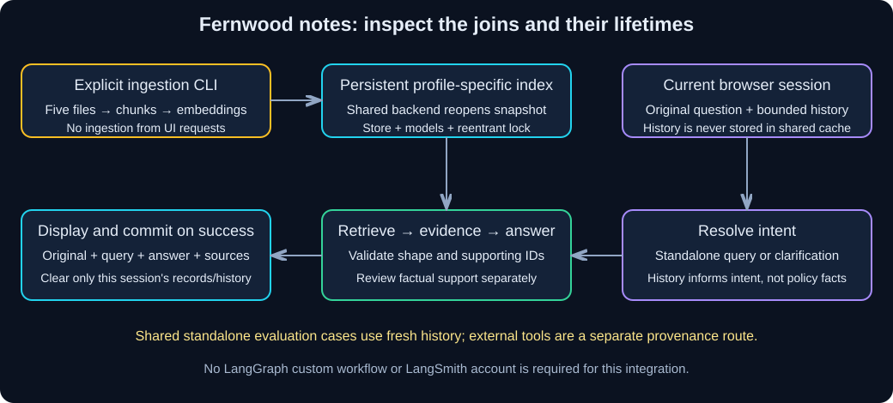

# Chapter 15 — Guided Integration: Build the Fernwood Notes Assistant

> **Study time:** 2–3 hours, plus optional live evaluation.  
> **Prerequisites:** Core Chapters 00–13; Chapter 14 is optional and is not used here.  
> **Central question:** Can you assemble, inspect, and test the whole assistant from workbook instructions alone?  
> **Running example:** Fernwood team-notes assistant.

[Previous: Optional Framework Extensions](14-langgraph-and-langsmith.md) · [Index](README.md) · [Next: Practice Challenges](16-practice-challenges.md)

## Learning objectives

- Build a learner-owned project from an empty directory using uv and complete workbook snippets.
- Separate explicit ingestion from persistent query-time resources.
- Connect bounded conversational rewriting to grounded answering and visible evidence.
- Keep history isolated per UI session and commit it only after a valid response.
- Run all thirteen shared standalone evaluation cases and document known failures.
- Explain document-only answer boundaries and the next capstone's responsibilities.

## 1. Intuition: assemble the workshop, then inspect the joins

Individual parts can work while their joins fail: the UI sends one user's history to another, a model switch reuses incompatible vectors, or a follow-up is answered from the wrong topic. Integration makes those boundaries visible.

You will build a small **document-only notes assistant**. A separate command creates the corpus snapshot. A shared service reopens it and holds the model resources. Each browser session owns its history. A request either asks clarification or resolves a standalone question and answers from retrieved passages.

### Pause and predict

Two browser sessions use the same cached model/store object. Must their histories also be shared?

<details><summary>Reveal the reasoning</summary>

No. Share appropriate resources, not conversation records. History enters this service as an explicit per-request argument. The service never stores it. A lock serializes shared resource use; that lock is not user authentication or a substitute for state ownership.

</details>

## 2. Understand the assembled mechanism



**Diagram walkthrough:**

1. The ingestion CLI reads the five fictional files, splits/embeds them, and persists a profile-specific snapshot.
2. On resource-cache creation, the service reopens a completed large/v1 snapshot. It cannot ingest from the UI.
3. A new standalone question goes directly to retrieval. With retained history, a rewrite prompt resolves intent or asks clarification.
4. The answer prompt receives only the resolved question and fresh passages. History is context for interpretation, not policy evidence.
5. The UI displays original/resolved questions, validated output, claimed supporting IDs, and candidate passage text. Only successful responses update that session's history/display records.

| Boundary | Contract |
|---|---|
| Input | Nonempty question, at most 1000 characters |
| History | Last two complete pairs; each entry at most 1500 characters; caller owns it |
| Rewrite | Resolved question or explicit clarification; schema checked, meaning still needs review |
| Answer | Chapter 09's status/answer/source-ID contract; unknown supporting IDs rejected |
| Evidence | Exact selected chunks visible; real IDs alone do not establish claim support |
| UI | At most ten displayed exchanges; clear removes current session's display and rewrite history |

## 3. Start from an empty directory

Use a **new learner workspace outside this repository**. Existing sample applications and repository Python code are not prerequisites. From a parent directory where you create personal projects, in PowerShell:

```powershell
uv init --no-package --python 3.11 --vcs none fernwood-notes
cd fernwood-notes
uv add python-dotenv pydantic langchain-core langchain-openai langchain-ollama langchain-chroma langchain-text-splitters numpy streamlit
uv sync --locked
New-Item -ItemType Directory -Path knowledge
```

The project uses ordinary script imports from this root. You do not need `langchain`, LangGraph, LangSmith, Gradio, Wikipedia, or a tracing account for this integration. Run commands below from `fernwood-notes`.

### File creation order — every imported file is accounted for

Save the **complete runnable file** snippet named in each linked chapter, not an explanatory fragment. These links are the code source; do not copy files from the repository's sample applications. If you completed earlier chapters, use your tested learner versions and compare them with these canonical snippets before moving them into this clean project.

| Order | Learner file | Complete source / purpose |
|---|---|---|
| 1 | `first_call.py` | [Chapter 02](02-models-and-messages.md), configuration/model/text-block helpers |
| 2 | `embedding_lab.py` | [Chapter 07](07-embeddings-and-similarity.md), hosted/local embedding profiles and prefixes |
| 3 | `retrieval_lab.py` | [Chapter 08](08-documents-and-retrieval.md), loading/chunks/manifest/persistence/query helpers |
| 4 | Five `knowledge/*.txt` files | [Shared materials](shared-materials.md), all complete UTF-8 source blocks, unchanged |
| 5 | `rag_lab.py` | [Chapter 09](09-grounded-rag.md), evidence prompt/fixture/answer validation |
| 6 | `conversation_rag_lab.py` | [Chapter 10](10-conversational-rag.md), rewrite prompt/schema/fixture and constants |
| 7 | `interface_backend.py` | [Chapter 12](12-streaming-and-interfaces.md), reusable locked query/answer backend |
| 8 | `notes_service.py` | Complete new glue file below |
| 9 | `notes_app.py` | Complete new integrated Streamlit interface below |
| 10 | `integration_check.py` | Complete end-to-end checks and thirteen-case collector below |

The referenced files import one another only within this learner root. There is no hidden import from a workbook repository sample project. Chapter 13's pytest suite remains useful in your original learning project; this new integration check has no pytest dependency.

### Configuration

The default offline fixture needs no credentials or model server and deliberately supports a narrow set of scripted responses. Create `.env` only for a live route; follow Chapter 00's private-file handling. Select one route, preserving placeholder values only until you replace them in your editor:

**Configuration — `.env`, hosted route**

```dotenv
MODEL_PROVIDER=openai
OPENAI_API_KEY=<replace-with-your-private-key>
```

**Alternative configuration — `.env`, local route**

```dotenv
MODEL_PROVIDER=local
```

The earlier helpers use hosted chat `gpt-4o-mini` / embeddings `text-embedding-3-small`, or local chat `llama3.1:8b` / embeddings `nomic-embed-text:v1.5`. For local mode install/start Ollama and download both models as in Chapter 00; CLI installation alone is not a running model service. Hosted account/model access must be verified by you. Never put keys into source code or chat input. Leave hosted tracing disabled unless deliberately configured under your own data policy.

### Index explicitly before launching

```powershell
uv run retrieval_lab.py inspect --setting large
uv run retrieval_lab.py index --setting large --revision v1
uv run retrieval_lab.py query --setting large --revision v1 --question "What is the annual home-office reimbursement limit?"
```

These create and query the hash-fixture snapshot. For live mode, separately run the same index command with `--live`. The profile hash separates fixture, hosted, and local directories. Keep sources unchanged for v1; Chapter 08 explains creating a new revision after edits. This integration fixes its UI to large/v1; adopting another revision requires changing that backend configuration explicitly and restarting the UI.

## 4. Build the integration glue

### Step 1 — service with caller-owned history

**Complete runnable file — `notes_service.py`**

Create beside `interface_backend.py`. The service adds no ingestion or external tools. A no-history question is treated as standalone; an ambiguous fresh-session follow-up can therefore miss evidence rather than being magically resolved. The CLI demo starts with the full allowance question before asking the follow-up.

```python
import argparse
import json
from langchain_core.messages import AIMessage
from langchain_core.runnables import RunnableLambda
from conversation_rag_lab import FOLLOW, MAX_ENTRY, MAX_TURNS, REWRITE_PROMPT, Rewrite, fixture_rewrite
from first_call import text_from_blocks
from interface_backend import Backend, validate_question
from rag_lab import ANNUAL


def bounded_history(history):
    if not isinstance(history, list):
        raise ValueError("History must be a caller-owned list.")
    selected = []
    for pair in history[-MAX_TURNS:]:
        if not isinstance(pair, dict) or set(pair) != {"user", "assistant"}:
            raise ValueError("Each history pair needs user and assistant text.")
        if any(not isinstance(value, str) or not value.strip() or len(value) > MAX_ENTRY
               for value in pair.values()):
            raise ValueError("History entries must be 1-1500 characters.")
        selected.append(dict(pair))
    return selected


def integration_rewrite_fixture(prompt):
    data = json.loads(prompt.to_messages()[-1].content.split("\n", 1)[1])
    # Additional exact integration case; this is scripted, not general understanding.
    if (data["latest"] == FOLLOW and data["history"]
            and data["history"][-1]["user"] == ANNUAL):
        return AIMessage(content=json.dumps({"status": "resolved", "question": ANNUAL,
                                             "clarification": ""}))
    return fixture_rewrite(prompt)


def next_history(history, record):
    text = record["answer"]["answer"]
    return bounded_history(bounded_history(history) + [{"user": record["original"], "assistant": text}])


class NotesService:
    def __init__(self, live=False):
        self.backend = Backend(live)
        self.rewriter = self.backend.model if live else RunnableLambda(integration_rewrite_fixture)

    def ask(self, question, history):
        original = validate_question(question)
        retained = bounded_history(history)
        with self.backend.lock:
            query = original
            if retained:
                data = json.dumps({"history": retained, "latest": original}, ensure_ascii=False)
                response = self.rewriter.invoke(REWRITE_PROMPT.invoke({"data": data}))
                resolved = Rewrite.model_validate(json.loads(text_from_blocks(response)))
                if resolved.status == "clarify":
                    record = {"mode": "document_only", "original": original, "query": "",
                              "answer": {"status": "clarify", "answer": resolved.clarification,
                                         "source_ids": []}, "evidence": []}
                    next_history(retained, record)  # Check before allowing caller to commit.
                    return record
                query = resolved.question
            result = self.backend.answer(query)
            record = {"mode": "document_only", "original": original, "query": query,
                      "answer": result["answer"], "evidence": result["evidence"]}
            next_history(retained, record)
            return record


def main():
    parser = argparse.ArgumentParser()
    parser.add_argument("--live", action="store_true")
    args = parser.parse_args()
    history = []
    try:
        service = NotesService(args.live)
        for question in [ANNUAL, FOLLOW]:
            record = service.ask(question, history)
            history = next_history(history, record)
            print(json.dumps(record, indent=2))
        return 0
    except Exception as exc:
        print(f"Assistant failed ({type(exc).__name__}); check index/provider/response contract.")
        return 1


if __name__ == "__main__":
    raise SystemExit(main())
```

`bounded_history` copies the last two pairs rather than mutating the caller's list. `ask` returns a record but does not remember it; the caller commits after success. The outer backend lock is reentrant, so calling the already-locked backend from the service is safe in this single-process design. The answer prompt never receives history, and clarification never calls retrieval/answer generation.

The outer `clarify` status belongs to conversational routing, not the Chapter 09 RAG schema. Actual document answers retain only `answered` / `insufficient_evidence`. This distinction prevents a clarification from looking like a source-backed policy answer.

Run from the learner project root:

```powershell
uv run notes_service.py
```

Expect two records: the complete allowance question and the original follow-up `And its limit?`, both resolved to the allowance query with supported fixture answers. Read the exact evidence and source IDs. The additional fixture mapping deliberately recognizes this exact sequence; it does not establish general reference resolution.

### Step 2 — integrated UI

**Complete runnable file — `notes_app.py`**

Create beside the service. Session records and rewrite history remain separate from the cached resource. Route changes and the clear button clear both current-session lists. No code path indexes documents.

```python
import streamlit as st
from interface_backend import validate_question
from notes_service import NotesService, next_history

st.set_page_config(page_title="Fernwood notes assistant")
st.title("Fernwood notes assistant")
st.caption("Document-only answers. Inspect the resolved question and supporting passages.")
live = st.checkbox("Use configured live provider", value=False)
if st.session_state.get("route") != live:
    st.session_state.route = live
    st.session_state.history = []
    st.session_state.records = []


@st.cache_resource
def get_service(live):
    return NotesService(live)


if st.button("Clear this conversation"):
    st.session_state.history = []
    st.session_state.records = []


for record in st.session_state.records:
    with st.chat_message("user"):
        st.text(record["original"])
    with st.chat_message("assistant"):
        st.text(record["answer"]["answer"])
        st.caption("Mode: " + record["mode"] + " | Status: " + record["answer"]["status"])
        st.write("Resolved query:", record["query"] or "Clarification required")
        st.write("Claimed supporting IDs:", record["answer"]["source_ids"])
        with st.expander("Retrieved candidates — verify every claim"):
            for passage in record["evidence"]:
                st.caption(passage["source_id"] + " | chunk " + passage["chunk_id"])
                st.caption("Cosine distance: " + str(round(passage["distance"], 4)))
                st.text(passage["text"])

question = st.chat_input("Ask a question (maximum 1000 characters)")
if question is not None:
    try:
        question = validate_question(question)
    except ValueError:
        st.warning("Enter a question of 1-1000 characters.")
    else:
        try:
            with st.spinner("Resolving the question and checking document evidence…"):
                record = get_service(live).ask(question, st.session_state.history)
                updated_history = next_history(st.session_state.history, record)
        except Exception:
            st.error("Request failed. Check the completed index, provider availability, and response contract. "
                     "No turn was saved; retry explicitly.")
        else:
            st.session_state.history = updated_history
            st.session_state.records = (st.session_state.records + [record])[-10:]
            st.rerun()
```

From the learner project root:

```powershell
uv run streamlit run notes_app.py --server.address 127.0.0.1 --server.port 8501
```

Open the printed local URL; stop with Ctrl+C. Start with the full allowance question, then the exact follow-up. Select live mode only after building its matching snapshot. Changing `.env`/models requires restarting to replace cached configuration. There is no automatic retry, public sharing tunnel, token streaming, or external action tool in this app. The spinner communicates progress; answers are committed only after complete validation.

### Step 3 — integration checks and all shared standalone cases

**Complete runnable file — `integration_check.py`**

Create beside the service. It checks the fixture joins and collects all thirteen exact shared questions with fresh history for each. It does not auto-grade semantics. Offline checks intentionally expose seven answerable cases the scripted answerer cannot answer. `--live` skips fixture-specific assertions and collects live results instead; it is explicitly selected and can incur cost.

```python
import argparse
import json
from pathlib import Path
from time import perf_counter

from notes_service import NotesService, next_history
from rag_lab import ANNUAL

CASES = [
    ("A01", "When is orientation, and who sends the invitation?"),
    ("A02", ANNUAL),
    ("A03", "Can I buy a monitor first and request approval afterward?"),
    ("A04", "What do I submit for equipment reimbursement, and by when?"),
    ("A05", "Which VPN profile do I select, and how do I authenticate?"),
    ("A06", "What should I do if VPN sign-in succeeds but connection fails?"),
    ("A07", "What are the shared collaboration hours?"),
    ("A08", "How often are procedure notes reviewed, and by whom?"),
    ("U01", "How many weeks of paid parental leave does Fernwood provide?"),
    ("U02", "What percentage does Fernwood contribute to retirement accounts?"),
    ("U03", "What is the VPN server's IP address?"),
    ("U04", "Can I work from France for six months?"),
    ("U05", "How many years must every company document be retained?"),
]


def fixture_checks(service):
    first = service.ask(ANNUAL, [])
    history_a = next_history([], first)
    original_history = [dict(pair) for pair in history_a]
    follow = service.ask("And its limit?", history_a)
    assert follow["query"] == ANNUAL and follow["answer"]["status"] == "answered"
    assert history_a == original_history  # Caller commits explicitly.
    history_b = [{"user": "Tell me about VPN access.", "assistant": "VPN topic only."}]
    ambiguous = service.ask("And its limit?", history_b)
    assert ambiguous["answer"]["status"] == "clarify" and ambiguous["evidence"] == []
    assert history_a == original_history
    try:
        service.ask(" ", history_a)
    except ValueError:
        pass
    else:
        raise AssertionError("Empty input accepted")
    ids = set(service.backend.store.get(include=[])["ids"])
    reopened = NotesService()
    assert set(reopened.backend.store.get(include=[])["ids"]) == ids
    assert reopened.ask(ANNUAL, [])["answer"]["source_ids"] == ["FW-EQUIPMENT-001"]
    print("Fixture integration checks passed: joins, validation, isolated history, persistent IDs.")


def main():
    parser = argparse.ArgumentParser()
    parser.add_argument("--live", action="store_true")
    parser.add_argument("--output", type=Path, required=True)
    args = parser.parse_args()
    if args.output.exists():
        parser.error("Choose a new output filename; previous evidence is preserved.")
    try:
        service = NotesService(args.live)
        if not args.live:
            fixture_checks(service)
        with args.output.open("x", encoding="utf-8") as output:
            for case_id, question in CASES:
                started = perf_counter()
                row = {"case_id": case_id, "question": question, "fixture": not args.live,
                       "profile": service.backend.profile, "setting": "large", "revision": "v1",
                       "expected_answerable": case_id.startswith("A"),
                       "review": {"complete": None, "supported": None, "citations": None}}
                try:
                    row["record"] = service.ask(question, [])
                    row["valid"] = True
                except Exception as exc:
                    row.update({"valid": False, "error_type": type(exc).__name__})
                row["seconds"] = perf_counter() - started
                output.write(json.dumps(row, ensure_ascii=False) + "\n")
                output.flush()
                print(case_id, "valid:", row["valid"])
        print("Collected thirteen cases; review against shared materials before reporting quality.")
        return 0
    except Exception as exc:
        print(f"Integration check failed ({type(exc).__name__}); inspect configuration and the failing boundary.")
        return 1


if __name__ == "__main__":
    raise SystemExit(main())
```

Run from the learner project root:

```powershell
uv run integration_check.py --output integration-fixture.jsonl
```

For explicitly selected live evaluation:

```powershell
uv run integration_check.py --live --output integration-live.jsonl
```

The live batch makes thirteen query-embedding calls and up to thirteen answer calls. Fresh history means no rewrite calls in this standalone batch. Test conversational behavior separately in the UI/CLI. Row errors remain recorded and collection continues; zero exit means collection completed, not that all cases passed. This collector records total latency but not usage; use Chapter 13's collector for usage-aware four-case diagnostics. Model/provider details and package/lock versions should accompany your learner evaluation notes.

## 5. Final project tree and acceptance walkthrough

```text
fernwood-notes/
  .python-version
  pyproject.toml
  uv.lock
  .venv/                           # generated by uv
  .env                             # private, only for live mode
  first_call.py
  embedding_lab.py
  retrieval_lab.py
  rag_lab.py
  conversation_rag_lab.py
  interface_backend.py
  notes_service.py
  notes_app.py
  integration_check.py
  knowledge/
    team-handbook.txt
    equipment-policy.txt
    vpn-guide.txt
    remote-work-faq.txt
    documentation-guide.txt
  chroma_store/                    # generated profile-specific snapshots/manifest
  integration-fixture.jsonl        # generated learner evidence
```

| Check | Action and observable evidence |
|---|---|
| Persistence | Stop/restart CLI/server; index IDs remain, service reopens without ingestion |
| Input validation | Submit empty/oversized input; no turn is saved and no answer call should run |
| Grounded allowance | Verify amount, calendar-year period, combined scope against displayed equipment passage |
| Sources visible | Inspect candidate source/chunk IDs separately from claimed supporting IDs |
| Follow-up | Full allowance question → `And its limit?`; inspect original and resolved query |
| Isolation | Independent browser sessions: A equipment topic, B VPN topic; no mixed history |
| Clear | Clear A; A's display/history empty, B unchanged, index intact |
| Failure | Unavailable live provider or invalid response: safe error, no saved turn, explicit retry |
| No query-time ingestion | Inspect service/backend call path; repeated queries must not embed documents |
| Evaluation | Thirteen shared questions recorded, reviewed or explicitly marked unreviewed |

### Known fixture outcomes and unverified live quality

The offline collector should answer A02 and abstain on A01/A03–A08 and all five unsupported cases. That is **one of eight answerable cases completed**, seven false abstentions, and five of five unsupported cases abstained. It verifies plumbing and abstention handling, not a useful general notes assistant. The scripted rewrite also supports only fixed examples; other follow-ups/topic changes may ask clarification unnecessarily.

For live mode, review all thirteen cases using Chapter 13's support, completeness, citation, and abstention criteria. A valid result is not automatically correct. U04 must not turn “discuss with your manager” into authorization to work abroad. A08's 90-day review cycle must not become U05's retention duration. Record failures rather than changing the expected policy to match a model answer. Live quality remains a learner verification step until a real model run is reviewed.

## 6. Diagnose one integration failure

In your learner copy, temporarily change the service's `query = resolved.question` assignment to `query = original`. Rerun the two-turn CLI demo. The second record now searches the ambiguous follow-up directly, losing the resolved intent; the fixture answerer abstains. Inspect its query/evidence, restore the assignment, and rerun. Do not rebuild the index to repair a routing bug.

| Symptom | Likely boundary | Diagnostic/repair |
|---|---|---|
| Missing learner module | File creation order/import graph | Recreate the named complete workbook snippet in this root |
| Matching source but missing fact | Retrieval coverage | Inspect chunks and Chapter 13 comparisons before changing generation |
| Correct rewrite displayed, wrong query searched | Glue assignment | Trace the string passed to `Backend.answer` |
| Another session's topic appears | History ownership | Keep only resources cached; pass session history explicitly |
| Switching route gives missing snapshot | Embedding-profile boundary | Build matching live snapshot; do not mix vectors |
| No new record after error | Expected failure policy | Fix service/configuration; retry explicitly; preserve previous successful state |
| Edited source silently absent | Snapshot immutability | Build a new revision and update backend selection deliberately |

## 7. Document-only answers and optional tools

This assistant exposes no external tools. That makes the `mode="document_only"` label truthful: policy answers use supplied Fernwood passages or abstain. Chapter 11's hypothetical calculator and optional Wikipedia material are separate exercises; they must not silently become Fernwood policy sources.

If you later add a tool route in your learner copy, return a separate answer record with a visible mode such as `external_reference`, its actual tool name/result/source, and explicit provenance. Never assign Fernwood document IDs to a Wikipedia answer or merge it invisibly into document-only evidence. Action tools additionally need authorization; a model request or valid input schema does not grant it. This optional extension is not required to pass the integration lab.

## 8. Limitations and independent exercise

This is a local single-process teaching application. It does not authenticate users, enforce document permissions, resolve conflicting policy versions, provide durable conversation storage, or guarantee injection resistance. The lock serializes work and limits throughput. History/window bounds are character/turn bounds, not token accounting. Clearing a session does not delete source documents, provider logs, or all server state. Schema/source membership checks do not prove factual support.

**Exercise:** Rebuild the same project in another empty learner directory using the file-order table alone. Keep the five source texts unchanged, run the fixture checks, then add one live evaluation run only if a model service is available. Identify one failure by stage and justify a one-variable repair.

**Deliverables:** project tree, lockfile, index profile/revision, two-turn trace, thirteen-case log, and a pass/fail/untested checklist. **Pass:** no sample application imports, no indexing from UI requests, explicit source visibility, isolated bounded history, and honest recorded limitations.

<details><summary>Hint 1 — concept</summary>

Successful assembly includes proving that the right objects have the right lifetimes. A screenshot of a plausible answer alone is insufficient.

</details>

<details><summary>Hint 2 — narrower implementation hint</summary>

Follow the file table in order. Test ingestion/query before service, service before UI, then run the thirteen-case collector. Keep standalone evaluation history empty so one case cannot bias the next.

</details>

<details><summary>Worked reasoning</summary>

A missing snapshot is a setup failure, a wrong follow-up query is a glue/rewrite failure, and a wrong amount with the correct passage is a generation failure. Each has a different repair. Passing fixture integration proves the joins function; completing the shared live rubric is separate evidence of model quality. Neither requires the optional Chapter 14 graph or tracing service.

</details>

## 9. Knowledge checks

<details><summary>1. Why is history an explicit service argument?</summary>

It makes ownership visible and avoids storing conversations in the shared cached backend. The caller commits its own copied bounded history after success.

</details>

<details><summary>2. What belongs in the answer prompt after rewriting?</summary>

The resolved question and freshly retrieved passages. Prior conversation claims help interpret intent but are not verified policy evidence.

</details>

<details><summary>3. Why run evaluation cases with fresh history?</summary>

Standalone cases should not influence one another. Conversational evaluation needs deliberately specified multi-turn scenarios instead.

</details>

<details><summary>4. Does five of five unsupported abstentions make the fixture a good assistant?</summary>

No. It also falsely abstains on seven of eight answerable questions. Report both usefulness and unsupported-answer behavior.

</details>

<details><summary>5. Can external reference material carry a Fernwood source ID?</summary>

No. Preserve actual provenance and separate modes. External facts do not establish internal policy.

</details>

## 10. Revision and next project

- [ ] I built the project from workbook snippets in a separate learner workspace.
- [ ] I can explain every import, configuration choice, and resource/state lifetime.
- [ ] I checked persistence, validation, evidence, follow-ups, and isolated history.
- [ ] I ran the UI and recorded which browser/live checks remain unverified.
- [ ] I collected all shared cases and documented known failures honestly.
- [ ] I can explain why external tools must preserve separate provenance and authorization.

Continue with [practice challenges](16-practice-challenges.md), then use the separate [RAG capstone workbook](../02-rag-capstone-workbook/README.md) as the next project. Its [project brief](../02-rag-capstone-workbook/00-project-brief.md) is the starting point for a more independent design. This lab assembles taught components; it does not replace that capstone or claim its scaffold is already a completed course.

## References  

- Core complete snippets: [models](02-models-and-messages.md), [embeddings](07-embeddings-and-similarity.md), [retrieval](08-documents-and-retrieval.md), [RAG](09-grounded-rag.md), [conversation](10-conversational-rag.md), [UI/backend](12-streaming-and-interfaces.md).
- [Shared corpus and golden cases](shared-materials.md); [evaluation rubric](13-debugging-testing-and-evaluation.md).
- [Streamlit Session State](https://docs.streamlit.io/develop/api-reference/caching-and-state/st.session_state) and [resource cache](https://docs.streamlit.io/develop/api-reference/caching-and-state/st.cache_resource): state ownership and resource reuse.

