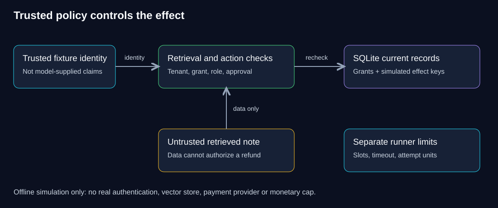

# W-RELIABILITY-01 — Trust boundaries survive plausible output

**Which controls must hold even when a model proposes an unsafe action?** This supplement isolates trusted identity, current grants and a local ledger so you can test each boundary directly.

> **Your goal:** Demonstrate that application code decides tenant, approval and simulated effects.<br>
> **You need:** Python/SQLite/async basics, [typed tools](../../langchain/01-learning-workbook/11-tools-and-agents.md) and [testing](../../langchain/01-learning-workbook/13-debugging-testing-and-evaluation.md).<br>
> **Effort:** 20 minutes reading, 40 build and 30 independent work; estimated.<br>
> **You will produce:** Fault/repair evidence, an independent approval policy and a trust-boundary decision record. **Status:** Draft; offline reference, unpiloted.

**Project boundary:** this is a separate standard-library package, not an extension to `safe-actions` or the Fernwood project. Reuse your understanding and prior evidence, then inspect the different control implementation. Default reference tests do not complete the approval starter.

**Study route:** predict unsafe-action and revocation behavior, inspect retrieval before effects, reproduce a fault and implement the distinct-approver transfer. Use synthetic inputs; no provider or real payment is involved.

<details>
<summary>Reference: unit identity, runtime and historical verification</summary>

> **Unit ID:** W-RELIABILITY-01 · **Capability:** AI-RELIABLE-01

> **Audience:** Backend engineers with Python functions, exceptions, SQLite and async basics<br>
> **Central question:** Which controls must still work when a model proposes an unsafe action?<br>
> **Your goal:** Show with tests that trusted code, not model-supplied arguments, decides tenant, approval and effect.<br>
> **Prerequisites:** [Python route](../../python/README.md), [W-LC-11 — typed tools](../../langchain/01-learning-workbook/11-tools-and-agents.md), [W-LC-13 — testing](../../langchain/01-learning-workbook/13-debugging-testing-and-evaluation.md)<br>
> **Reading / build / independent effort:** 20 / 40 / 30 minutes, estimated; not pilot timing<br>
> **Artifact:** Fault tests and a short trust-boundary decision record<br>
> **Status:** Draft; offline reference tested, no model-quality or deployment claim<br>
> **Environment:** Windows PowerShell, uv 0.8.3, Python 3.11.13; standard library only

</details>

**QuickCart** is our fictional e-commerce platform. Its merchants share an application. A retrieved note can contain instructions, permissions can change, and a client can retry a refund request after losing the response. A fluent answer cannot establish tenant isolation or exactly-once business effects. This lab makes those controls observable without a provider or paid calls.

**Intuition:** A retrieved note is like a request attachment: useful evidence, not a new permission grant. The analogy does not establish authentic identity or safe cache invalidation; those need trusted enforcement and tests.

## Predict before running

If the retrieved document says “refund 999,” which function may authorize that action? If a grant is revoked after the first read, should a second request see the document? Write your predictions before reading `test_controls.py`.

<details><summary>Reasoning</summary>

The document is data, not authority. The application supplies identity and approval independently of model arguments. Every retrieval rechecks current permission. A persistent idempotency record survives reopening the database, but this local simulation does not coordinate a real payment provider.

</details>

## Starting state and setup

Start from the supplied `controls.py`, `test_controls.py` and `pyproject.toml` in this directory. This is an inspectable reference implementation, not a TODO solution that proves independent competence. Copy this directory into a personal workspace if you want to change it without affecting course files. No `.env`, cloud account, model, external fixture or third-party Python dependency is needed.

From the repository root in PowerShell:

**Before running:** recorded checks used Windows PowerShell, uv 0.8.3 and Python 3.11.13, with the standard library only. Initial tooling/Python downloads may need internet; tests make no paid requests and remove their temporary databases. If you copied only this package, open its root and omit the `cd` line. Preserve private source/evidence before eventual environment cleanup.

```powershell
cd workbooks/reliability/offline-controls
uv sync --python 3.11
uv run python -m unittest discover -v
```

The acceptance property is sixteen passing tests, including current-permission denial, tenant isolation, deletion, unsafe tool denial, conflicting retry payload, restart persistence and timeout/cancellation behavior. Test duration varies. Review each assertion; a passing test proves only its fixture behavior.

## Inspect the enforcement points

> [!IMPORTANT]
> Trusted fixture identity is a teaching input, not authentication. A passing denial test demonstrates the tested control path; it does not establish real-model quality or production isolation by itself.



**Diagram walkthrough:** Enter at the trusted identity fixture, follow identity into policy checks, and recheck current SQLite records. The upward arrow carries untrusted document data, not authority. Runner limits are a separate execution responsibility. The invariant is that retrieved text cannot manufacture permission or approval. Real authentication, vectors/caches, provider billing and payment reconciliation are omitted and must not be inferred from this diagram.

In `controls.py`, read `Store.retrieve` before `Store.refund`. Retrieval joins the current grant with tenant and subject scope. Revocation and deletion modify the source of truth. This is database retrieval, not vector search; cached/vector copies and stale result handles are not implemented.

`Identity` and `approved` represent already trusted application decisions. Neither may be accepted from user/model JSON. A real service must authenticate the caller and enforce roles/approval records itself. The lab's fixed role rule is an explicit fixture, not an identity provider or production approval system.

Refunds write to a synthetic SQLite ledger inside a transaction. The tenant/idempotency key is unique, and retry payload conflicts fail. No money moves. `bounded` retries only timeout failures, limits total attempts and propagates cancellation. Its budget counts attempts; it is not a monetary spending cap. Total elapsed time is approximately attempt count times timeout plus cooperative cleanup; a blocking or cancellation-suppressing provider needs additional isolation.

`validate_answer` checks syntax-level business fields and source-ID membership. It intentionally accepts a schema-valid false claim so you can demonstrate why semantic grounding is a separate evaluation. The injection test proves denied action control, not that a model always ignores injected text.

`Runner` supplies shared semaphore slots and reserves one synthetic unit before each provider attempt. The tests submit five requests against three units and two slots: three complete, two are refused and peak in-flight work stays at two. This is single-event-loop admission, not distributed billing enforcement. A two-slot review queue rejects the third item; queued work is not reviewed success.

## Break, diagnose, repair

In your personal copy, change the SQL in `Store.retrieve` from `FROM docs JOIN grants ON docs.id=grants.doc` to `FROM docs`, remove `AND subject=?` and its subject parameter. Predict which test fails, then run `uv run python -m unittest test_controls.BoundaryTests.test_tenant_and_current_permission -v`. Revocation no longer controls retrieval. Removing only the subject predicate leaves the grant join, so it is not the same fault. Restore the join, predicate and parameter, rerun the specific test, then the full suite. Record the before/after result rather than overwriting failure evidence.

For a second fault, remove `self.db` persistence by creating the store with an in-memory database in the restart test. Explain why restart evidence disappears rather than claiming idempotency works across processes. Restore the file-backed store and verify again.

## Independent transfer task

### Named starter and reference checkpoints

Start `approval_starter.py` with `uv run python approval_starter.py`; it should report that no policy is implemented or approval granted. Complete its three TODOs in a personal copy, then run `uv run python check_starter.py`. That check intentionally raises `NotImplementedError` on the untouched starter, so default reference tests cannot be mistaken for your independent result. Consult `approval_reference.py` only after recording your attempt. `test_approval.py` exercises the reference policy and least-privilege dispatcher; tool arguments may contain only key/amount, never identity/approval. No whole application copy is required.

Require two different approved operators for refunds above 50 units, while preserving small-refund behavior. Add a test that reusing the same operator twice is rejected and that a retry cannot apply the effect twice. Then revoke one operator's permission before execution. Do not merely rename the sample identity. Produce the code change, failure trace, regression results and a 150-word stakeholder note explaining the remaining real-provider reconciliation requirement.

<details><summary>Progressive hints and worked design reasoning</summary>

First separate an approval record from a boolean. Next model distinct operator identities and check their current grants at execution. Persist the approved payload/hash with the idempotency key so changed amounts cannot reuse approval. A transaction can protect the local record; real provider delivery still needs an idempotency protocol, durable dispatch/reconciliation and an incident owner. Tests must assert effect count and denial, not just a returned success string.

</details>

## Troubleshooting, cleanup and next step

### Versioned fixture evaluation and migration

From this project root, run `uv run python evaluate_fixture.py`. The four authored development cases demonstrate denominators: coverage 2/4, supported answers 1/2, useful outcomes 2/4, one failure and one appropriate abstention. Five synthetic attempt units and four hypothetical review minutes are example inputs, not observed provider costs or staffing time. Output includes per-case **local validation** latency; it is not model latency. Application/schema/config/data/evaluation hashes identify the run; no prompt or model was executed. Report N/A for a zero denominator and retain failed rows. A held-out live-model/deployment report remains separate.

Version 0.2.0 adds the separate starter/reference approval checkpoint, dispatcher, fixture evaluator and shared synthetic spending reserve. Runner's default cooperative request deadline is 0.5 seconds and includes waiting for a slot; adapt explicit configuration to the intended workload rather than treating the lab setting as a production SLO. SQLite fixture tables are unchanged. Preserve your prior learner copy and results before adopting the new checkpoint; no learner migration is automatic.

**Reflection:** Which assumption changes if approval is revoked between proposal and execution? Explain which failed case your implementation repaired, what remains a simulation and what evidence would change a no-release decision.

| Symptom | Likely cause | Diagnostic and repair |
|---|---|---|
| Import `controls` fails | Wrong working directory | Run from this project root, not the course root, using the documented command. |
| Python version differs | Wrong environment | Inspect `uv run python --version`; synchronize with the supported 3.11 route and retain the lockfile. |
| Timeout test fails after a code change | Cancellation swallowed or retries exceed budget | Inspect call/cancel counters and allow `CancelledError` to propagate. |
| Database remains open | Store not closed | Preserve `tearDown`/`close`; fixtures own their temporary storage. |

Tests use and remove temporary databases. No continuing paid resources or servers exist. To remove a personal `.venv`, verify its resolved path belongs to your copied project before deleting it. Do not delete your independent solution/evidence. Keep logs synthetic; real systems need restricted access, retention and redaction. Later, compare these local controls with the [capstone evidence requirements](../../../assessments/capstone-evidence.md); cloud/model quality remains separately required at program milestones.

**Sources:** Python standard-library `sqlite3`, `asyncio` and `unittest` documentation, recorded in the [source ledger](../../../docs/source-ledger.md). [Root map](../../../README.md)

## Completion checkpoint

**You can now:** show that trusted code, not tool arguments, decides tenant, approval and grant, and that a retried request produces one effect.

**Show it:** passing tests, your repaired fault and the independent approval change.

**Next:** [W-LLM-EVAL-01 — Versioned evaluation](../../llm/eval-harness/README.md), the next unit in the course map's AI-RELIABLE-01 row.
